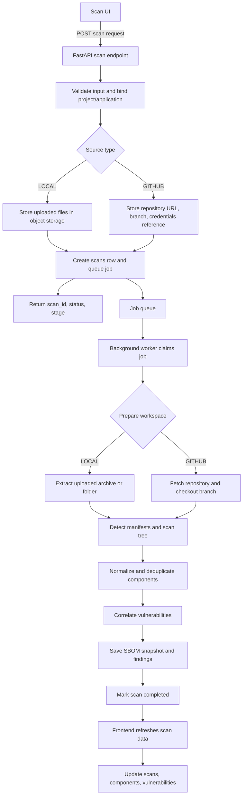
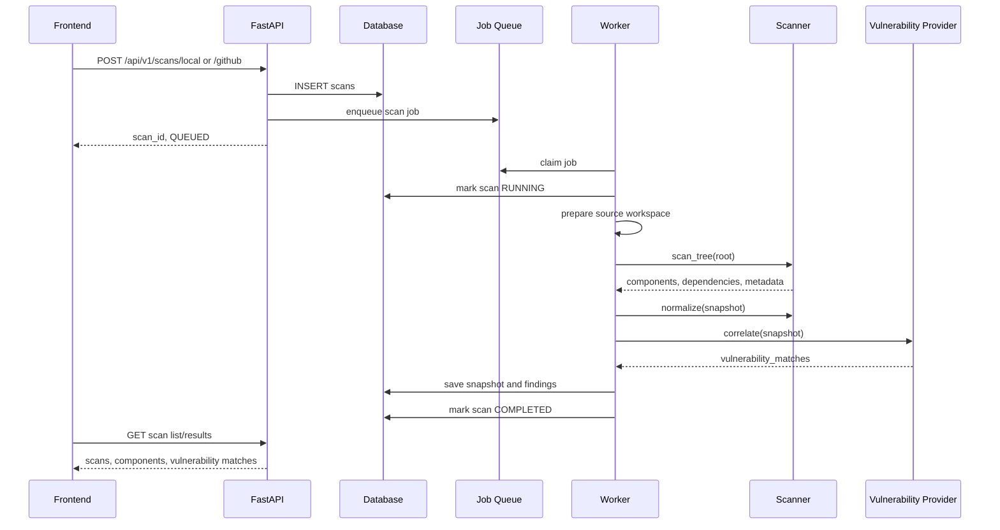
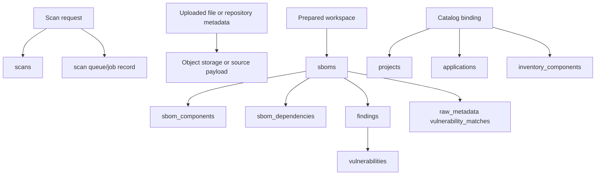

# SBOM Scan API and Data Flow

This document describes how a scan moves through the frontend, API, worker, scanner pipeline, vulnerability correlation, persistence layer, and frontend hydration.

## 1. High-level scan lifecycle



## 2. Source-specific API calls

### Local source

Used for a manifest file, archive, or uploaded folder.

```text
POST /api/v1/scans/local
Content-Type: multipart/form-data
```

Frontend entry points:

- `startScan()` in `frontend/src/context/AppStateContext.tsx`
- `createLocalScan()` in `frontend/src/api/client.ts`

Multipart fields:

| Field | Purpose |
|---|---|
| `file` | One manifest or archive |
| `files` | Folder files |
| `paths` | Relative paths for folder files |
| `project_name` | Project display/name binding |
| `application_name` | Application/service binding |
| `project_id` | Optional catalog project ID |
| `application_id` | Optional catalog application ID |
| `version` | Release/version, or `UNKNOWN` |
| `description` | Optional scan description |

Backend behavior in `backend/app/api/server.py`:

1. Validate file type, size, and non-empty content.
2. Pack folder uploads when necessary.
3. Store the upload in object storage under an `uploads/...` key.
4. Create an orchestrator scan with `source_type = LOCAL`.
5. Return `scan_id`, initial status, and stage.

Worker source preparation:

```text
app.sources.workspace.prepare_local(...)
```

### Remote GitHub source

Used for a GitHub repository URL.

```text
POST /api/v1/scans/github
Content-Type: application/json
```

Frontend entry points:

- `startScan()` in `frontend/src/context/AppStateContext.tsx`
- `createGitHubScan()` in `frontend/src/api/client.ts`
- Optional `createGitHubPat()` when a token is supplied

Request fields:

| Field | Purpose |
|---|---|
| `repository_url` | GitHub repository URL |
| `project_name` | Project display/name binding |
| `application_name` | Application/service binding |
| `project_id` | Optional catalog project ID |
| `application_id` | Optional catalog application ID |
| `version` | Release/version, or `UNKNOWN` |
| `branch` | Branch to scan |
| `authentication` | Optional credential reference |
| `description` | Optional scan description |

Backend behavior:

1. Validate the repository URL.
2. Bind the request to the catalog project/application.
3. Create an orchestrator scan with `source_type = GITHUB`.
4. Queue the repository URL, branch, and credential reference.
5. Return `scan_id`, initial status, and stage.

Worker source preparation:

```text
app.sources.workspace.prepare_github(...)
```

### Bulk spreadsheet source

Used for CSV, XLSX, or XLS input.

```text
POST /api/v1/scans/bulk
Content-Type: multipart/form-data
```

Frontend entry point:

- `createBulkScan()` in `frontend/src/api/client.ts`
- Bulk branch of `startScan()` in `frontend/src/context/AppStateContext.tsx`

Bulk processing:

```mermaid
flowchart LR
    FILE[CSV/XLSX/XLS upload] --> BULKAPI[POST /api/v1/scans/bulk]
    BULKAPI --> PARSE[Parse rows and validate]
    PARSE --> ROWS[One row per repository/application]
    ROWS --> CHILD[Create child scan]
    CHILD --> GH[Child source_type = GITHUB]
    CHILD --> QUEUE[Queue each valid child scan]
    BULKAPI --> AGG[Bulk status and validation result]
    QUEUE --> RESULTS[GET /api/v1/bulk-scans/{bulk_id}]
```

Bulk rows are GitHub scans. The bulk endpoint does not run a separate scanner source; it creates child GitHub scan jobs for valid rows. Duplicate projects or invalid rows are recorded as skipped/failed rows.

## 3. Scan status and result APIs

| API | Purpose | Main data returned |
|---|---|---|
| `GET /api/v1/scans` | List scans for initial hydration and refresh | Scan metadata, status, stage, source, project/application, snapshot ID |
| `GET /api/v1/scans/{scan_id}` | Get one scan | One scan record |
| `GET /api/v1/scans/{scan_id}/status` | Poll status | Current status and stage |
| `GET /api/v1/scans/{scan_id}/events` | Read progress events | Stage/event history |
| `GET /api/v1/scans/{scan_id}/components` | Read snapshot components | Components from the completed SBOM snapshot |
| `GET /api/v1/scans/{scan_id}/dependencies` | Read dependency graph | Dependency edges |
| `GET /api/v1/scans/{scan_id}/vulnerabilities` | Read vulnerability matches | Finding records from snapshot metadata |
| `GET /api/v1/scans/{scan_id}/sbom` | Read complete snapshot | SBOM, components, dependencies, metadata |
| `GET /api/v1/bulk-scans/{bulk_id}` | Read bulk aggregate and child rows | Bulk status, items, errors |
| `GET /api/v1/bulk-scans/{bulk_id}/results` | Read bulk child results | Child scan results |

The vulnerability endpoint returns:

```python
(snapshot["raw_metadata"] or {}).get("vulnerability_matches")
```

It is a scan-scoped endpoint. It does not aggregate multiple scans by project.

## 4. Background worker and scanner pipeline



Pipeline stages in `backend/app/scans/orchestrator.py`:

1. `VALIDATING`
2. `EXTRACTING`
3. `DETECTING_MANIFESTS`
4. `NORMALIZING`
5. `ANALYZING_VULNERABILITIES`
6. `GENERATING_SBOM`
7. Completed status

Scanner work in `backend/app/scanner/pipeline.py`:

1. Detect supported manifests.
2. Parse package/component declarations.
3. Deduplicate components and dependency edges.
4. Build dependency graph.
5. Enrich local component data.
6. Run compliance checks.
7. Attach snapshot IDs.

## 5. Data destination by stage



### Core relational tables

| Table | Data stored | Created/updated by |
|---|---|---|
| `organizations` | Tenant/organization | Catalog and migration setup |
| `projects` | Catalog projects | Catalog binding and migration setup |
| `applications` | Applications/services under projects | Catalog binding |
| `inventory_components` | Persistent inventory components and `vulnerability_count` | Inventory APIs |
| `scans` | Scan request, source, status, project/application, snapshot reference | Scan API/orchestrator |
| `sboms` | One completed SBOM snapshot per scan | BOM repository |
| `sbom_components` | Components inside one SBOM snapshot | Snapshot persistence |
| `sbom_dependencies` | Dependency edges inside one snapshot | Snapshot persistence |
| `vulnerabilities` | Canonical vulnerability identity and advisory data | Findings persistence |
| `findings` | One vulnerability match for one package in one SBOM | Findings persistence |
| `vulnerability_triage` | Status/VEX/remediation overrides | Triage API |

The schema is defined primarily in:

- `backend/migrations/006_ten_tables.up.sql`
- `backend/migrations/005_relational_facts.up.sql`
- `backend/migrations/007_vulnerability_triage.up.sql`

## 6. Vulnerability persistence model

The vulnerability provider writes match data into snapshot metadata as `vulnerability_matches`. During persistence, `backend/app/repositories/facts.py`:

1. Reads each match's `component_id` and `vulnerability_id`.
2. Normalizes the vulnerability key to uppercase.
3. Upserts the canonical vulnerability into `vulnerabilities`.
4. Inserts or updates the component-specific association in `findings`.
5. Uses the uniqueness rule `(sbom_component_id, vulnerability_id)` to avoid duplicate findings for the same package and CVE inside one SBOM.

The same CVE can still legitimately appear in multiple components or snapshots because each finding is scoped to its SBOM component and snapshot.

## 7. Frontend hydration after a scan

Initial hydration and refresh are handled by `AppStateContext.tsx`:

```mermaid
flowchart TD
    INIT[AppStateProvider mount] --> LIST[GET /api/v1/scans]
    INIT --> INV[GET inventory components]
    INIT --> PROJ[GET /api/v1/projects]
    LIST --> COMPLETED[Completed scans]
    COMPLETED --> COMP[GET /scans/{id}/components]
    COMPLETED --> VULN[GET /scans/{id}/vulnerabilities]
    COMP --> MAPC[mapComponent]
    VULN --> MAPV[mapVulns]
    MAPC --> MERGEC[merge components]
    MAPV --> MERGEV[merge vulnerabilities]
    MERGEC --> STATE[React AppState]
    MERGEV --> STATE
```

Relevant frontend functions:

- `loadScanResults()` in `frontend/src/context/AppStateContext.tsx`
- `api.scanComponents()` in `frontend/src/api/client.ts`
- `api.scanVulnerabilities()` in `frontend/src/api/client.ts`
- `api.mapVulns()` in `frontend/src/api/client.ts`
- `mergeByPackage()` and `mergeVulns()` in `frontend/src/context/AppStateContext.tsx`

`loadScanResults()` retrieves components and vulnerability matches for each completed scan, maps them into frontend types, updates component vulnerability counts, and merges vulnerability records into global app state.

## 8. Source-to-table summary

| Source | Create API | Queue/source type | Source preparation | Primary persisted data |
|---|---|---|---|---|
| Local file/manifest/archive/folder | `POST /api/v1/scans/local` | `LOCAL` | `prepare_local()` | `scans`, upload object, `sboms`, `sbom_components`, `findings`, `vulnerabilities` |
| GitHub repository | `POST /api/v1/scans/github` | `GITHUB` | `prepare_github()` | `scans`, `sboms`, `sbom_components`, `findings`, `vulnerabilities` |
| Bulk CSV/XLSX/XLS | `POST /api/v1/scans/bulk` | Child rows become `GITHUB` | `prepare_github()` per valid row | Bulk child `scans`, then same GitHub scan tables |
| Existing inventory component | `POST /api/v1/inventory/components` | No scan queue | No scanner pipeline | `inventory_components` |

## 9. Important scope rules

- A scan result API is scoped by `scan_id`.
- A project dashboard may select the latest completed snapshot for project-level metrics.
- Frontend state can contain records from multiple completed scans at once.
- Component vulnerability counts are based on vulnerability matches associated with that component.
- Canonical vulnerability rows identify the CVE/advisory, while `findings` represent package/SBOM associations.
- Triage data changes status/VEX fields but does not create a new scan or new vulnerability match.

