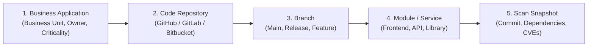
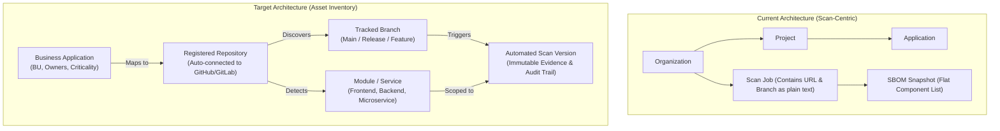
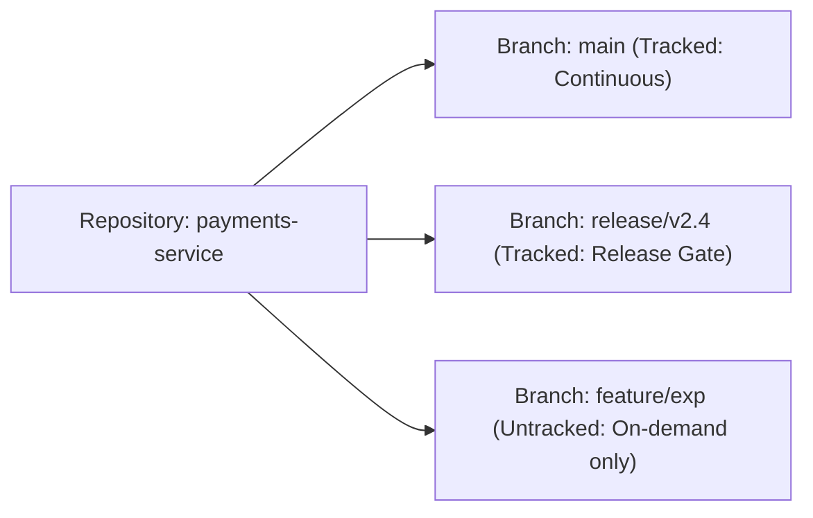
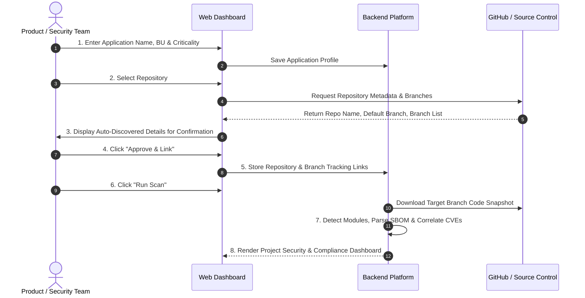
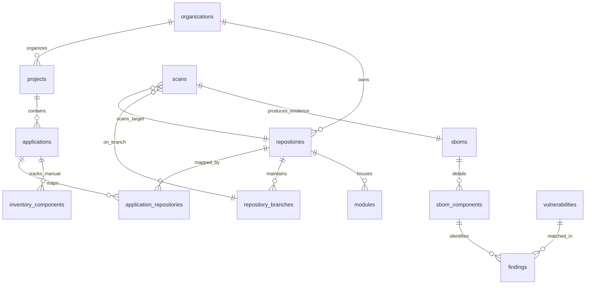
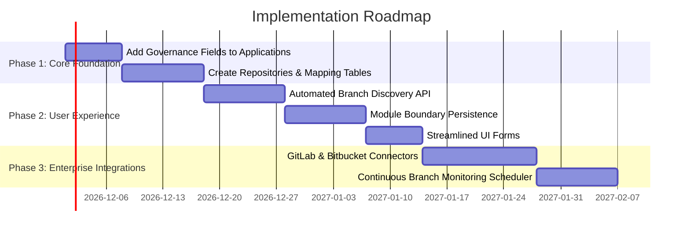

# Software Bill of Materials (SBOM) Platform
## Enterprise Application & Code Inventory: Strategic Architecture Assessment & Roadmap

**Target Audience:** Company Leadership, Product Management, Security & Engineering Teams  
**Document Classification:** Internal Technical Strategy & Architecture Review  
**Version:** 2.0 (Executive Edition)  

---

## 1. Executive Summary

As our organization scales its Software Supply Chain Security and SBOM governance, this assessment evaluates the current state of our SBOM platform against an enterprise-grade **Application & Code Inventory** model:

$$\text{Business Application} \longrightarrow \text{Code Repository} \longrightarrow \text{Branch} \longrightarrow \text{Module / Service} \longrightarrow \text{Scan Snapshot}$$



### Key Takeaways for Stakeholders

1. **Strong Scan & Vulnerability Engine (Ready):**  
   Our core scanning pipeline is robust. It automatically detects and parses **over 35 manifest types** across 15 programming language ecosystems (npm, PyPI, Maven, Go, NuGet, Cargo, etc.). It correlates real-time security vulnerabilities against the Google OSV database and MITRE CVE Services, generating immutable, audit-ready SBOM snapshots.

2. **The Strategic Gap (From "Scan Tool" to "Enterprise Asset Inventory"):**  
   The current platform is designed as a *per-scan utility* rather than a *central software asset catalog*. Repositories and branches are entered as repetitive text strings during each scan rather than existing as reusable, tracked company assets. Logical microservices inside monorepos are not currently isolated into distinct modules.

3. **High Automation Potential (70–80% Manual Effort Reduction):**  
   Users currently re-type repository URLs, branch names, and application details for every scan. By introducing connected source-control integrations, the system can automatically discover repository names, active branches, languages, commit details, frameworks, and manifests without user data entry.

4. **Scalability Readiness:**  
   The underlying database is well-indexed, fast, and stable. Upgrading it to support full enterprise inventory requires adding four lightweight relational tables without disrupting any existing scan data or historic SBOM artifacts.

---

## 2. Current Architecture vs. Target Enterprise Model

The platform currently operates on a direct scan model. The target architecture expands this into a structured 5-tier organizational hierarchy:



### Strategic Benefits of the Target Model
* **Executive Visibility:** Leadership can see overall security risk grouped by **Business Unit**, **Application Tier**, or **External Vendor**, rather than scattered scan reports.
* **Elimination of Duplicate Work:** Connecting a repository once allows all teams and microservices to run scans without re-entering credentials or repository URLs.
* **Support for Large Codebases (Monorepos):** When multiple microservices live in one repository, each business application can monitor only its specific subfolder instead of scanning the entire codebase repeatedly.

---

## 3. Database Inventory & Current System Capabilities

The active production database contains **11 core application domain tables** and **1 system migration table**:

| Category | Table Name | Business Purpose | Current Status & Capabilities |
|---|---|---|---|
| **Organization** | `organizations` | Multi-tenant isolation | Provides company/tenant boundaries. |
| **Catalog** | `projects` | High-level project groups | Groups related services under a unified name. |
| **Catalog** | `applications` | Specific application services | Links services to a project. Minimal metadata currently stored. |
| **Manual Inventory** | `inventory_components`| Static inventory tracker | Stores manually entered or spreadsheet-uploaded components. |
| **Security** | `credentials` | Secure token management | Stores GitHub PATs and App keys encrypted with AES-256-GCM. |
| **Execution** | `scans` | Scan job orchestrator | Manages queue status (`QUEUED`, `RUNNING`, `COMPLETED`, `FAILED`). |
| **SBOM Evidence** | `sboms` | Certified snapshot header | Stores scanner version, commit hash, commit author, and timestamps. |
| **Components** | `sbom_components` | Discovered software packages | Records name, version, license, package manager, and NTIA compliance. |
| **Security Intel** | `vulnerabilities` | Global CVE vulnerability catalog | Centralized vulnerability intelligence with CVSS scores and vectors. |
| **Security Intel** | `findings` | Correlation table | Connects specific components in an SBOM to active CVE vulnerabilities. |
| **Governance** | `vulnerability_triage`| Persistent vulnerability overrides | Retains remediation status (`False Positive`, `Resolved`, `In Review`). |

### Key Architectural Observations
* **Clean Data Separation:** The scan execution engine and vulnerability correlation tables are robust, normalized, and performant.
* **Missing Bridge Entities:** There are currently no tables representing `repositories`, `branches`, `modules`, or `users`. Repositories and branches are stored as repeated text columns on individual scan records.

---

## 4. Level 1: Business Application Analysis

An application represents a customer-facing product, business system, or enterprise service (e.g., *Customer Portal*, *Core Billing Engine*, *Mobile API Gateway*).

```
┌────────────────────────────────────────────────────────┐
│ Target Application Entity                              │
├────────────────────────────────────────────────────────┤
│ • Application ID (System-generated UUID)               │
│ • Application Name (e.g. Core Banking Gateway)         │
│ • Business Unit (e.g. Retail Banking, Operations)      │
│ • Criticality Tier (Tier 1 Mission Critical, Tier 2/3) │
│ • Technical Owner & Business Owner                     │
│ • Development Type (In-house / Outsourced / Vendor)    │
│ • Operational Status (Active / In Development / Legacy)│
└────────────────────────────────────────────────────────┘
```

### Current Status
* **What Exists:** The `applications` table exists with `id`, `name`, and `project_id`.
* **What Is Missing:** Business Unit, Criticality Tier, Business Owner, Technical Owner, Development Type, and Vendor Name are not yet stored in the database.
* **User Experience Issue:** The frontend registration window collects fields like version, tags, and risk level, but the backend API currently stores only the name, discarding the remaining business information.

---

## 5. Level 2: Code Repository Analysis

A repository is a central version-controlled codebase hosted on GitHub, GitLab, Bitbucket, or Azure DevOps.

### Current Status
* **What Exists:** The system securely stores GitHub access tokens in the encrypted `credentials` table and clones repositories during scans.
* **What Is Missing:** Repositories are not registered as independent assets. Instead, users must type or paste the full GitHub URL every time they initiate a scan.
* **Provider Limitation:** The codebase currently accepts only `https://github.com/` URLs. Integrations for GitLab, Bitbucket, Azure DevOps, or on-premises Git servers are not yet implemented.
* **Business Opportunity:** Connecting a repository once allows the system to automatically retrieve the repository name, default branch, primary programming languages, and recent commit history.

---

## 6. Level 3: Application-to-Repository Relationship (Monorepos & Shared Code)

In enterprise software engineering, the relationship between applications and repositories is flexible:
1. **One Application $\rightarrow$ Multiple Repositories:** A large application may consist of a frontend repository, a backend API repository, and an infrastructure repository.
2. **One Repository $\rightarrow$ Multiple Applications (Monorepo):** A single large repository often houses multiple distinct microservices in subfolders (e.g., `/services/billing` and `/services/notifications`).
3. **Shared Repositories:** Common authentication or utility libraries may be consumed across multiple business applications.

### Current Status
* **What Exists:** A scan is tied to one application name and one repository URL string.
* **What Is Missing:** There is no mapping table connecting applications to repositories. Monorepos cannot be scoped to specific subdirectories; the scanner currently processes the entire repository from the root, which causes duplicate component reporting across unrelated teams.

---

## 7. Level 4: Branch Tracking & Lifecycle Analysis

Branches represent distinct code streams (e.g., `main`, `release/v2.4`, `feature/payment-v2`).



### Current Status
* **What Exists:** Scans record the branch name on the SBOM snapshot record.
* **What Is Missing:** The system does not query the source control provider to list available branches. Users must manually type the branch name into a free-text box, which introduces risks of typos and failed scans.
* **Automation Opportunity:** The system should automatically discover all remote branches via API and allow administrators to mark production and release branches for automated continuous monitoring.

---

## 8. Level 5: Module & Microservice Discovery Analysis

A module represents a distinct deployable service or logical component inside a repository (e.g., a React frontend, a FastAPI microservice, or a shared Java library).

### Current Status
* **What Exists (Detection Engine):** The system has an advanced scanner (`detector.py`) that identifies **over 35 package manifest formats** across directory trees up to 30 levels deep.
* **What Is Missing (Persistence):** Once manifests are discovered, the system flattens all components into a single combined list for the whole scan. The structural concept of distinct modules is not saved to the database.
* **Business Impact:** In a repository containing both a customer portal and an internal backend, security reports cannot currently separate which vulnerability belongs to the public frontend versus the private backend.

---

## 9. Scan Execution & Code Versioning Analysis

A scan represents an immutable, point-in-time security audit of a specific code snapshot.

### Current Status
* **Production Ready:** This area is fully implemented and operating effectively.
* **Key Strengths:**
  * Every scan generates an immutable SBOM snapshot with a unique identifier.
  * Captures the exact Git Commit SHA, commit author, commit email, and commit message.
  * Supports complete lifecycle states (`PENDING`, `RUNNING`, `COMPLETED`, `FAILED`, `CANCELLED`).
  * Preserves full forensic history: subsequent scans create new snapshot records rather than overwriting past audit data.

---

## 10. People, Teams & Ownership Analysis

Enterprise risk governance requires clear accountability for security remediation.

### Current Status
* **What Exists:** Individual vulnerability findings allow entering an `owner` string during security triage. The latest commit author is recorded on the SBOM snapshot.
* **What Is Missing:** There is no internal user directory or team assignment table. The user management screen in the frontend is currently a prototype using mock data.
* **Governance Opportunity:** Assigning Business Owners and Technical Leads to Applications allows vulnerability notifications to be routed automatically to the correct engineering team.

---

## 11. Complete System Capability Comparison Matrix

| Level | Capability / Field | Current Platform Status | How It Works Today | Business & Technical Recommendation |
|---|---|---|---|---|
| **Application** | Application ID | 🟢 **Available** | Auto-generated UUID | Retain existing logic. |
| **Application** | Application Name | 🟢 **Available** | Stored and enforced unique per project | Retain existing logic. |
| **Application** | Business Unit | 🔴 **Missing** | Not stored | Add organizational division tracking. |
| **Application** | Business & Tech Owners | 🔴 **Missing** | Not stored | Add assigned owner contacts for accountability. |
| **Application** | Criticality Tier | 🔴 **Missing** | Discarded by API | Add Tier 1 (Mission Critical) to Tier 3 ratings. |
| **Application** | Lifecycle Status | 🟡 **Partially Built** | Derived dynamically from scan activity | Add administrative status (`Active`, `Archived`). |
| **Repository** | Central Repository Catalog | 🔴 **Missing** | URLs entered as free text per scan | Introduce a centralized repository asset catalog. |
| **Repository** | Provider Integrations | 🟡 **Partially Built** | GitHub only | Add support for GitLab, Bitbucket, and Azure DevOps. |
| **Repository** | Auto-fetch Metadata | 🟡 **Partially Built** | Fetches commit SHA during scan only | Auto-fetch repository name, language, and branches. |
| **Repository** | Secure Credentials | 🟢 **Available** | AES-256-GCM encrypted token storage | Retain existing credential engine. |
| **Relationship** | Multi-Repository Support | 🔴 **Missing** | Scans bind to one URL only | Add many-to-many application-repository mapping. |
| **Relationship** | Monorepo Subfolder Scoping | 🔴 **Missing** | Always scans repository root | Add folder path targeting (e.g. `/services/billing`). |
| **Branch** | Branch Discovery | 🔴 **Missing** | Users must manually type branch names | Fetch branch dropdown lists automatically via Git API. |
| **Branch** | Continuous Tracking Flag | 🔴 **Missing** | Scans triggered on demand only | Add tracking toggles (`Tracked for continuous scans`). |
| **Module** | Manifest Detection | 🟢 **Available** | Detects 35+ formats (`pom.xml`, `package.json`) | Retain existing multi-language detection engine. |
| **Module** | Module Separation | 🔴 **Missing** | All components merged into flat list | Preserve module boundaries to isolate services. |
| **Module** | Framework & Type Detection | 🔴 **Missing** | Not classified | Auto-identify React, FastAPI, Spring Boot, etc. |
| **Scan Version** | Snapshot Immutability | 🟢 **Available** | Historical snapshots preserved | Retain existing audit architecture. |
| **Scan Version** | Commit Provenance | 🟢 **Available** | Captures SHA, author, and timestamp | Retain existing commit tracking. |
| **People** | User & Team Directory | 🔴 **Missing** | Frontend UI prototype with mock data | Introduce real user and team management tables. |

*Legend: 🟢 Fully Available | 🟡 Partially Built / Needs Refinement | 🔴 Missing / Planned Improvement*

---

## 12. Automated vs. Manual Data Collection Strategy

To ensure high adoption and minimize operational overhead, **users must never be asked to manually enter data that the platform can discover automatically.**

```
DATA CAPTURE EFFICIENCY BREAKDOWN

[========================================] 75% Automated (Discovered by Platform)
  • Repository Name, Provider, Default Branch, Language
  • Active Branches, Commit Hash, Author, Timestamp
  • Package Manifests, Libraries, Versions, Licenses
  • Vulnerability Matches, Severity, CVSS Scores

[==========] 25% Manual (High-Value Human Input)
  • Application Name & Project Alignment
  • Business Unit & Criticality Tier
  • Technical & Business Owners
  • Remediation Decisions & Triage Notes
```

### What the Platform Can Collect Automatically
1. **From Source Control Providers (GitHub / GitLab / Bitbucket API):**
   * Repository display name and description.
   * Default branch name.
   * Full list of active remote branches.
   * Primary programming languages.
   * Latest commit SHA, author name, author email, and commit message.
2. **From Source Code Analysis (`detector.py` & `parsers.py`):**
   * All software package manifests (`package.json`, `pom.xml`, `requirements.txt`, `go.mod`, etc.).
   * Complete direct and transitive dependency lists with exact versions.
   * Open-source license declarations.
   * Framework identification (e.g., Spring Boot, React, Django) inferred from package declarations.
3. **From Security Intelligence Feeds (OSV & MITRE APIs):**
   * Active Common Vulnerabilities and Exposures (CVEs).
   * CVSS v3.1 severity scores and attack vectors.
   * Available remediation and upgrade patch versions.

### What Genuinely Requires Human Business Input
* **Business Context:** Assigning the Business Unit (e.g., *Wealth Management* vs *Internal HR*).
* **Risk Categorization:** Determining whether an application is *Tier 1 (Mission Critical)* or an internal utility.
* **Accountability:** Designating the responsible Lead Engineer and Product Owner.
* **Security Triage:** Formally acknowledging a vulnerability as a false positive or marking it resolved.

---

## 13. Current Automated Workflow Verification

Inspection of the current codebase confirms how data moves through the platform today:

| Automated Step | What the System Does Today | What Needs Improvement |
|---|---|---|
| **1. Source Retrieval** | Safely downloads GitHub repository tarballs via API into an isolated sandbox (`workspace.py`). | Extend connector support to GitLab, Bitbucket, and Azure DevOps. |
| **2. Manifest Crawl** | Recursively scans folders up to 30 levels deep, identifying 35+ package manifest types (`detector.py`). | Group detected manifests into persistent module records instead of discarding folder boundaries. |
| **3. Dependency Parsing** | Extracts package names, version numbers, and declared licenses into structured components (`parsers.py`). | Correlate packages with high-level frameworks (e.g., detecting Angular or Express). |
| **4. CVE Correlation** | Queries `api.osv.dev` in batches of 500 components and retrieves detailed MITRE CVE advisories (`provider.py`). | Fully automated and functional. |
| **5. Audit Persistence** | Writes normalized components, dependency relationships, and findings into the database (`facts.py`). | Link the resulting SBOM snapshot to formal repository and branch records. |

---

## 14. Recommended Streamlined User Experience & Form Design

To maximize developer productivity, user input forms should be kept minimal and intuitive.

### Step 1: Register Application (Fast, High-Level Setup)
*Only business classification fields are requested.*
* **Application Name:** e.g., `Customer Payment Portal`
* **Project Group:** Select from dropdown (e.g., `Digital Banking`)
* **Business Unit:** Select from dropdown (e.g., `Retail Operations`)
* **Criticality Tier:** Select `Tier 1 (Mission Critical)`, `Tier 2`, or `Tier 3`
* *(Optional)* Technical Lead and Business Owner email addresses.

### Step 2: Connect Repository (One-Click Auto-Discovery)
* **Action:** User selects their source provider and picks a repository from their authenticated organization list (or enters the repository URL).
* **Instant Automation:** The platform contacts the Git provider API and auto-populates:
  * Repository Name: `payments-service`
  * Default Branch: `main`
  * Main Language: `TypeScript / Node.js`
  * Discovered Branches: Automatically loaded into a selectable list.

### Step 3: Branch Selection & Continuous Monitoring
* The system displays all discovered branches.
* `main` and active `release/*` branches are automatically marked as **Tracked**.
* User clicks **Save & Finish**.

### Step 4: Run Scan (Two-Click Execution)
* User selects: **Application** $\rightarrow$ **Repository** $\rightarrow$ **Branch** (from pre-populated dropdowns).
* User clicks **Run Scan**.
* The platform extracts the code, identifies modules, generates the SBOM, matches vulnerabilities, and renders the dashboard.

---

## 15. Form Input Reduction Plan & User Journey

### Master Input Reduction Matrix

| Workflow Phase | Mandatory User Input | Optional User Input | Fully Automated by System |
|---|---|---|---|
| **1. Application Setup** | App Name, Business Unit, Criticality | Business Owner, Technical Owner | App ID, Creation Date, Status |
| **2. Repository Connection** | Select Repository | Access Credential | Repo Name, Provider, Default Branch, Language |
| **3. Branch Configuration** | None (Sensible defaults applied) | Uncheck non-production branches | Complete Branch List, Latest Commit Hash, Commit Author |
| **4. Module Discovery** | None | Override inferred module name | Folder Paths, Manifest Files, Frameworks, Ecosystems |
| **5. Scan Execution** | Select App, Repo, Branch | Scan Description | Commit SHA, Author, Dependencies, Licenses, CVEs, NTIA Status |

### Visual End-to-End User Journey



---

## 16. Business Justification: Why Each Missing Element Matters

| Proposed Improvement | Business Problem Solved | Return on Investment & Impact |
|---|---|---|
| **Dedicated Repository Catalog** | Eliminates typing URLs repeatedly. Prevents duplicate repository records across teams. | Centralizes access control. Streamlines developer onboarding. |
| **Application-to-Repository Mapping** | Solves the monorepo challenge. Allows an application to monitor only its specific microservice folder. | Prevents bloated, inaccurate SBOM reports containing unrelated codebase dependencies. |
| **Automated Branch Discovery** | Prevents typos in branch names that cause scans to fail. | Enables automated continuous scanning on release and production branches. |
| **Persistent Module Entities** | Clarifies which service inside a multi-service repository contains a vulnerability. | Engineering teams immediately know which microservice requires a patch. |
| **Application Governance (BU & Tier)** | Security teams currently cannot prioritize whether a vulnerability affects a critical system or an internal tool. | Enables risk-based prioritization: fix vulnerabilities in Tier 1 payment systems first. |
| **Team & Contributor Mapping** | Triage tickets cannot be routed automatically without knowing who owns the application. | Cuts incident response time by directly notifying the responsible engineering team. |

---

## 17. Architecture & Database Evolution Plan

The database evolution is additive: **it introduces 4 new relational tables while preserving all existing tables, scan logs, and SBOM snapshots without disruption.**



### Summary of New Tables Required

1. **`repositories` Table:**  
   Stores the central repository registry (`id`, `organization_id`, `name`, `url`, `provider`, `default_branch`, `main_language`, `credential_id`).
2. **`application_repositories` Mapping Table:**  
   Connects Applications to Repositories. Includes a `subfolder_path` attribute to support Monorepos (e.g., scoping an application to `/services/billing`).
3. **`repository_branches` Table:**  
   Tracks available branches, branch classifications (`main`, `release`, `feature`), and continuous monitoring status (`is_tracked = TRUE`).
4. **`modules` Table:**  
   Records logical microservices and libraries identified within a repository, along with their manifest path and framework.

---

## 18. Enterprise Scalability Assessment (15 Real-World Scenarios)

| # | Enterprise Scenario | Platform Readiness | Assessment & Action Required |
|---|---|---|---|
| 1 | Organization has 100+ Applications | 🟢 **Ready** | Fully supported. Cursor-based database pagination handles large catalogs efficiently. |
| 2 | Application spans multiple repositories | 🔴 **Action Required** | Adding the `application_repositories` table will enable multi-repo mapping. |
| 3 | Single repository contains multiple microservices (Monorepo) | 🟡 **Partially Built** | The scanner finds all files; adding folder path scoping will isolate microservices cleanly. |
| 4 | Shared repository used by multiple applications | 🔴 **Action Required** | The mapping table will allow sharing a repository without duplicating scan records. |
| 5 | Repositories with multiple active branches | 🟡 **Partially Built** | The scan engine supports any branch; automated branch discovery will eliminate manual entry. |
| 6 | Continuous scanning of release and main branches | 🟢 **Ready** | Scans run independently per branch; results are isolated and preserved. |
| 7 | Repeated scans across new code commits | 🟢 **Ready** | Fully supported. Each scan creates an immutable snapshot linked to the specific Git commit hash. |
| 8 | Multi-provider SCM (GitLab, Bitbucket, Azure DevOps) | 🔴 **Action Required** | The Git connector currently validates only GitHub. Adding provider adapters will resolve this. |
| 9 | Cross-functional vendor and team contributions | 🟡 **Partially Built** | Triage supports owner assignment; adding team profiles will provide complete ownership tracking. |
| 10| Historical compliance and audit reporting | 🟢 **Ready** | Fully supported. Detailed timestamps, scan stages, and NTIA compliance flags are preserved. |
| 11| Polyglot applications (React + Python + Java) | 🟡 **Partially Built** | Scans all manifests accurately; preserving module boundaries will keep reporting clear. |
| 12| Organization-wide vulnerability blast radius queries | 🟢 **Ready** | Supported. SQL queries can instantly locate all applications affected by a specific CVE across the company. |
| 13| High concurrent user and scan volume | 🟢 **Ready** | The platform uses background worker pools, non-blocking job queues, and connection pooling. |
| 14| Scheduled background scan checks | 🔴 **Action Required** | Requires adding a periodic cron worker to trigger scans when new commits are detected. |
| 15| Automated CI/CD pipeline triggers | 🟢 **Ready** | Supported. The platform includes a GitHub webhook endpoint (`/api/v1/github/webhooks`). |

---

## 19. Prioritized Implementation Roadmap



### Phase 1: Core Foundation & Data Accuracy (Immediate Priority)
* **Goal:** Ensure business metadata is stored and establish reusable repository records.
* **Key Deliverables:**
  1. Add `business_unit`, `criticality`, and `owner` fields to the `applications` table.
  2. Implement the `repositories` table and `application_repositories` mapping table.
  3. Update application forms to persist all entered business metadata.

### Phase 2: User Experience & Auto-Discovery Automation (High Impact)
* **Goal:** Eliminate manual typing and streamline developer onboarding.
* **Key Deliverables:**
  1. Implement automated branch discovery via Git API (replacing text inputs with dropdowns).
  2. Persist detected module boundaries from `detector.py` into the database.
  3. Deploy the two-click scan launch dialog.

### Phase 3: Enterprise Integrations & Scaling (Strategic Value)
* **Goal:** Support diverse engineering toolchains across the enterprise.
* **Key Deliverables:**
  1. Add connectors for GitLab, Bitbucket, and Azure DevOps.
  2. Implement scheduled automated scans for tracked branches.
  3. Integrate corporate Single Sign-On (SSO) to automatically map Git commit authors to internal company teams.

---

## 20. Conclusion & Strategic Next Steps

### Summary of Strategic Findings

1. **How much of the target inventory structure is implemented today?**  
   Approximately **40%**. The scanning engine, dependency parsing, vulnerability correlation, and historical snapshot integrity are mature and production-ready. The asset catalog layer (Repositories, Branches, Modules) currently operates on free-text inputs and needs formalization.

2. **What is the most important technical enhancement?**  
   Reintroducing formal `repositories`, `repository_branches`, and `application_repositories` tables. This enables monorepo support, prevents duplicate data entry, and allows continuous branch tracking.

3. **How does this improve the user experience?**  
   It reduces manual form entry by **70–80%**. Developers and security leads will simply select their repository and branch from auto-populated dropdowns rather than re-entering URLs, credentials, and configuration details.

4. **Is the architecture ready for enterprise scale?**  
   **Yes.** The existing system has a solid architectural base with non-blocking worker pools, relational foreign keys, and normalized vulnerability records. Adding the proposed asset inventory tables completes the platform into a comprehensive, enterprise-ready Software Supply Chain Governance system.

### Recommended Decisions for the Meeting
* **Decision 1 (Data Model):** Approve the addition of the 4 inventory tables (`repositories`, `application_repositories`, `repository_branches`, `modules`) to the database schema.
* **Decision 2 (User Experience):** Approve the transition from manual text-based scan forms to auto-discovered repository and branch dropdowns.
* **Decision 3 (Governance):** Mandate the capture of Business Unit and Criticality Tier during Application creation to enable executive risk reporting.
