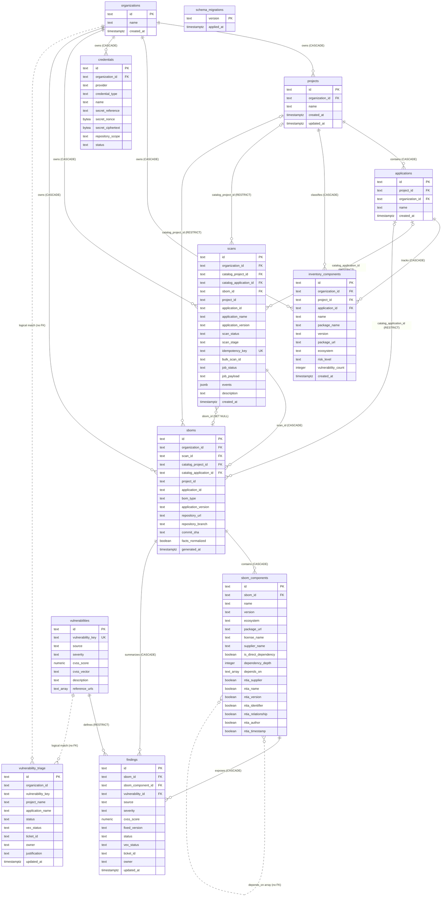
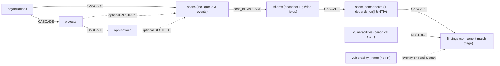

# SBOM Database Schema – Relationship Mapping and Improvement Analysis

> **Scope & Accuracy Note:** Every statement in the **Current Schema** sections (Sections 1–5) is derived directly from inspecting the actual PostgreSQL migrations (`backend/migrations/001` through `008`) and backend persistence/application code (`backend/app/**/*.py`). Where a concept (such as `users`, `repositories`, `commits`, `packages`, or `audit_logs`) does **not** exist as a table in the active database schema, this document states that explicitly rather than assuming it exists. Sections 6–9 clearly separate **Proposed / Recommended Improvements** from the live implementation.

---

## 1. Existing Database Schema Overview

### 1.1 Schema Evolution Summary (`backend/migrations/`)

The database uses **PostgreSQL** (`postgres:16-alpine` in `backend/docker-compose.yml`), managed by a custom migration runner `migrate()` in `backend/app/core/db.py` (which uses advisory lock `83726194` and tracks applied files in `schema_migrations`):

1. **`001_initial.up.sql` & `002_security_scans_move.up.sql`**: Created a normalized `tbl_*` hierarchy (`tbl_organizations`, `tbl_security_scans`, `tbl_scan_runs`, `tbl_scan_jobs`, `tbl_scan_events`, `tbl_bom_snapshots`, `tbl_bom_components`, `tbl_bom_dependencies`, `tbl_bulk_scans`, `tbl_bulk_scan_items`, `tbl_git_credentials`, `tbl_credential_secrets`, `tbl_webhook_events`, `tbl_audit_logs`) and dropped legacy unprefixed prototype tables (`users`, `repositories`, `repository_connections`, `component_vulnerabilities`, `exports`, `scanner_versions`, etc.).
2. **`004_software_inventory.up.sql`**: Added `tbl_software_inventory`, `tbl_projects_and_microservices`, `tbl_project_applications_and_services`, `tbl_software_components_and_packages`, `tbl_sbom_documents_and_artifacts`, and `tbl_sbom_document_components`.
3. **`005_relational_facts.up.sql`**: Normalized JSON blobs into `tbl_packages`, `tbl_package_versions`, `tbl_vulnerabilities`, `tbl_vulnerability_references`, `tbl_repositories`, `tbl_repository_branches`, `tbl_commits`, `tbl_findings`, `tbl_component_hashes`, and `tbl_component_compliance_checks`.
4. **`006_ten_tables.up.sql`**: **Consolidated and replaced all 30 `tbl_*` tables into 10 core unprefixed tables**, migrating data into them and executing `DROP TABLE IF EXISTS tbl_* CASCADE` (lines 812–841).
5. **`007_vulnerability_triage.up.sql`**: Added triage/VEX columns to `findings` and created `vulnerability_triage` (the 11th application table).
6. **`008_scan_description.up.sql`**: Added `description TEXT NOT NULL DEFAULT ''` to `scans`.

Together with the migration metadata table `schema_migrations`, the active database currently contains **12 tables total** (**11 domain tables + 1 migration tracking table**).

---

### 1.2 Complete Inventory of Existing Tables

#### 1. `organizations`
- **Purpose:** Multi-tenant root entity isolating all projects, scans, SBOMs, credentials, and inventory components by tenant.
- **Primary Key (PK):** `id TEXT`
- **Foreign Keys (FK):** None (root parent).
- **Important Columns:** `id`, `name TEXT NOT NULL`, `created_at TIMESTAMPTZ NOT NULL DEFAULT CURRENT_TIMESTAMP`
- **Data Stored:** Tenant identifier and display name (in practice, `ensure_organization` in `backend/app/catalog/store.py` sets both `id` and `name` to the `X-Organization-Id` header value, defaulting to `"default"`).
- **Relationships:**
  - `1:N` with `projects`, `credentials`, `scans`, `sboms`, and `inventory_components` (all via FK `ON DELETE CASCADE`).
  - Logical `1:N` (no FK) with `vulnerability_triage`.
- **Used By:** `backend/app/catalog/store.py` (`ensure_organization`), `backend/app/api/server.py` (`_org`).

#### 2. `projects`
- **Purpose:** Tenant-scoped catalog of software projects / microservices.
- **Primary Key (PK):** `id TEXT` (UUID generated in `CatalogRepo.ensure_project` or deterministic MD5 from earlier migrations).
- **Foreign Keys (FK):**
  - `organization_id` → `organizations (id) ON DELETE CASCADE`
- **Unique & Check Constraints:**
  - `UNIQUE (organization_id, name)`
  - `UNIQUE (id, organization_id)` (supports composite FKs)
  - `CHECK (length(btrim(name)) > 0)`
- **Indexes:** `idx_projects_organization (organization_id, name)`
- **Important Columns:** `id`, `organization_id`, `name`, `created_at`, `updated_at`
- **Data Stored:** Canonical project IDs and unique project names per organization.
- **Relationships:**
  - `N:1` to `organizations` (`ON DELETE CASCADE`).
  - `1:N` to `applications` (`ON DELETE CASCADE`).
  - `1:N` to `inventory_components` (`ON DELETE CASCADE`).
  - `1:N` to `scans` and `sboms` via `catalog_project_id` (`ON DELETE RESTRICT`).
- **Used By:** `backend/app/catalog/store.py` (`CatalogRepo`), `backend/app/repositories/store.py` (`_upsert_projects`), `backend/app/repositories/facts.py` (`resolve_catalog_ids`).

#### 3. `applications`
- **Purpose:** Specific applications, services, or build targets belonging to a `project`.
- **Primary Key (PK):** `id TEXT`
- **Foreign Keys (FK):**
  - `(project_id, organization_id)` → `projects (id, organization_id) ON DELETE CASCADE`
- **Unique & Check Constraints:**
  - `UNIQUE (organization_id, project_id, name)`
  - `UNIQUE (id, project_id, organization_id)`
  - `CHECK (length(btrim(name)) > 0)`
- **Indexes:** `idx_applications_project (project_id, name)`
- **Important Columns:** `id`, `project_id`, `organization_id`, `name`, `created_at`
- **Data Stored:** Canonical service/application records within a project.
- **Relationships:**
  - `N:1` to `projects` (`ON DELETE CASCADE`).
  - `1:N` to `inventory_components` (`ON DELETE CASCADE`).
  - `1:N` to `scans` and `sboms` via `catalog_application_id` (`ON DELETE RESTRICT`).
- **Used By:** `backend/app/catalog/store.py`, `backend/app/repositories/store.py` (`_upsert_applications`), `backend/app/repositories/facts.py` (`resolve_catalog_ids`).

#### 4. `inventory_components`
- **Purpose:** Manually registered or imported software components tracked in the Software Inventory module.
- **Primary Key (PK):** `id TEXT` (UUID)
- **Foreign Keys (FK):**
  - `organization_id` → `organizations (id) ON DELETE CASCADE`
  - `(project_id, organization_id)` → `projects (id, organization_id) ON DELETE CASCADE`
  - `(application_id, project_id, organization_id)` → `applications (id, project_id, organization_id) ON DELETE CASCADE`
- **Check Constraints:** `CHECK (length(btrim(name)) > 0)`, `CHECK (length(btrim(version)) > 0)`, `CHECK (vulnerability_count >= 0)`
- **Indexes:**
  - `idx_inventory_components_organization (organization_id, created_at DESC, id DESC)`
  - `idx_inventory_components_application (application_id)`
- **Important Columns:** `name`, `package_name`, `version`, `component_type`, `source_file_name`, `license_name`, `package_url`, `ecosystem`, `risk_level`, `vulnerability_count`, `is_direct_dependency`, `supplier_name`, `created_by`, `created_at`
- **Data Stored:** Static inventory entries submitted via `POST /api/v1/inventory/components`. Notice `vulnerability_count` and `risk_level` are flat user/import-provided columns, **not** computed from `findings`.
- **Relationships:**
  - `N:1` to `organizations`, `projects`, `applications` (`ON DELETE CASCADE`).
  - **No relationship** (neither FK nor logical join) to `sbom_components` or `findings`.
- **Used By:** `backend/app/repositories/store.py` (`BomRepo.list_inventory_components`, `add_inventory_components`, `delete_inventory_component`), `backend/app/api/server.py` (`/api/v1/inventory/components`).

#### 5. `credentials`
- **Purpose:** Encrypted GitHub credentials (Fine-Grained PATs and GitHub App private keys) used when cloning repositories during scans.
- **Primary Key (PK):** `id TEXT`
- **Foreign Keys (FK):**
  - `organization_id` → `organizations (id) ON DELETE CASCADE`
- **Indexes:** `idx_credentials_organization (organization_id, created_at DESC)`
- **Important Columns:** `provider`, `credential_type`, `name`, `secret_reference`, `secret_nonce BYTEA`, `secret_ciphertext BYTEA`, `repository_scope` (comma-separated string or `'*'`), `status` (`'ACTIVE'` or `'REVOKED'`), `created_at`, `updated_at`, `last_validated_at`, `expires_at`
- **Data Stored:** Metadata plus AES-GCM encrypted secret (`secret_nonce` + `secret_ciphertext` encrypted using 32-byte KEK in `CredentialStore`). On revocation, `secret_nonce` and `secret_ciphertext` are set to `NULL`.
- **Relationships:**
  - `N:1` to `organizations` (`ON DELETE CASCADE`).
  - Logical reference only from `scans.job_payload` JSON (`credential_id`), with no FK.
- **Used By:** `backend/app/credentials/service.py` (`Credentials`), `backend/app/sources/workspace.py` (`prepare_github`), `backend/app/api/server.py` (`/api/v1/credentials/github`).

#### 6. `scans`
- **Purpose:** Central "multi-purpose" table storing scan execution state, the durable worker job queue, bulk spreadsheet metadata, ignored webhook tombstones, and stage progress event logs.
- **Primary Key (PK):** `id TEXT`
- **Foreign Keys (FK):**
  - `organization_id` → `organizations (id) ON DELETE CASCADE`
  - `fk_scans_catalog_project`: `(catalog_project_id, organization_id)` → `projects (id, organization_id) ON DELETE RESTRICT`
  - `fk_scans_catalog_application`: `(catalog_application_id, catalog_project_id, organization_id)` → `applications (id, project_id, organization_id) ON DELETE RESTRICT`
  - `fk_scans_sbom`: `sbom_id` → `sboms (id) ON DELETE SET NULL`
- **Unique Constraints:** `idempotency_key TEXT NOT NULL UNIQUE`
- **Indexes:**
  - `idx_scans_organization (organization_id, created_at DESC)`
  - `idx_scans_job_queue (job_status, next_attempt_at)`
  - `idx_scans_bulk (bulk_scan_id, bulk_row_number)`
- **Important Columns:**
  - Target labels: `project_id` (**stores project name string, not UUID**), `application_id` (**stores app name string**), `application_name`, `application_version`, `version_strategy`, `description` (added in `008`)
  - Catalog links: `catalog_project_id`, `catalog_application_id` (nullable UUID FKs)
  - Execution state: `bom_type`, `source_type`, `scan_status`, `scan_stage`, `error_code`, `error_message`, `idempotency_key`, `created_at`, `started_at`, `completed_at`, `sbom_id`
  - Bulk upload fields: `bulk_scan_id`, `bulk_row_number`, `bulk_file_name`, `bulk_status`, `bulk_total_rows`, `bulk_invalid_rows`, `bulk_errors`
  - Repository strings: `repository_url`, `branch`
  - Queue fields: `job_status`, `job_payload` (JSON string), `priority`, `attempts`, `max_attempts`, `next_attempt_at`, `job_started_at`, `job_completed_at`, `job_error_code`, `job_error_message`
  - Event log: `events JSONB NOT NULL DEFAULT '[]'::jsonb`
- **Relationships:**
  - `N:1` to `organizations`, `projects`, `applications`.
  - Bidirectional `1:1` / `1:N` with `sboms` (`sboms.scan_id -> scans.id` and `scans.sbom_id -> sboms.id`).
- **Used By:** `backend/app/repositories/store.py` (`ScanRepo`, `JobQueue`), `backend/app/scans/orchestrator.py` (`Orchestrator`), `backend/app/projects/dashboard.py` (`list_projects`), `backend/app/api/server.py`, `backend/app/worker.py`.

#### 7. `sboms`
- **Purpose:** Persisted SBOM snapshot header generated by a scan, including repository/commit provenance and document metadata.
- **Primary Key (PK):** `id TEXT`
- **Foreign Keys (FK):**
  - `organization_id` → `organizations (id) ON DELETE CASCADE`
  - `scan_id` → `scans (id) ON DELETE CASCADE`
  - `fk_sboms_catalog_project`: `(catalog_project_id, organization_id)` → `projects (id, organization_id) ON DELETE RESTRICT`
  - `fk_sboms_catalog_application`: `(catalog_application_id, catalog_project_id, organization_id)` → `applications (id, project_id, organization_id) ON DELETE RESTRICT`
- **Indexes:**
  - `idx_sboms_scan (scan_id)`
  - `idx_sboms_application (application_id, generated_at DESC)`
- **Important Columns:** `id`, `organization_id`, `project_id` (name string), `application_id` (name string), `scan_id`, `catalog_project_id`, `catalog_application_id`, `bom_type`, `application_version`, `version_strategy`, `repository_url`, `repository_branch`, `commit_sha`, `commit_author`, `commit_email`, `commit_message`, `scanner_name`, `scanner_version`, `bom_format_version`, `generated_at`, `raw_metadata TEXT`, `file_name`, `file_format`, `file_size_bytes`, `signature_status`, `facts_normalized BOOLEAN`
- **Data Stored:** Snapshot header, git commit metadata, scan summary `raw_metadata` JSON (`manifests_detected`, `pipeline`, `parse_errors`, etc. — `vulnerability_matches` is stripped by `stored_metadata()` when `facts_normalized` is used).
- **Used By:** `backend/app/repositories/store.py` (`BomRepo`), `backend/app/repositories/facts.py`, `backend/app/projects/dashboard.py`, `backend/app/export/formats.py`, `backend/app/api/server.py`.

#### 8. `sbom_components`
- **Purpose:** Individual software components/packages discovered inside a specific `sboms` snapshot, along with their NTIA compliance flags and outgoing dependency edges.
- **Primary Key (PK):** `id TEXT`
- **Foreign Keys (FK):**
  - `sbom_id` → `sboms (id) ON DELETE CASCADE`
- **Unique & Check Constraints:**
  - `UNIQUE (id, sbom_id)` (composite target for `findings` FK)
  - `CHECK (dependency_depth IS NULL OR dependency_depth >= 0)`
- **Indexes:**
  - `idx_bom_components_sbom` / `idx_sbom_components_sbom (sbom_id)`
  - `idx_sbom_components_name (name, version)`
- **Important Columns:** `id`, `sbom_id`, `name`, `version`, `ecosystem`, `package_manager`, `package_url`, `cpe`, `content_hash`, `license_name`, `supplier_name`, `dependency_scope`, `is_direct_dependency`, `source_manifest`, `raw_component TEXT`, `created_at`, `dependency_depth`, `ntia_supplier`, `ntia_name`, `ntia_version`, `ntia_identifier`, `ntia_relationship`, `ntia_author`, `ntia_timestamp`, `depends_on TEXT[] NOT NULL DEFAULT '{}'`
- **Data Stored:** Every component occurrence for an SBOM snapshot, its dependency child IDs (`depends_on` array of `sbom_components.id`), NTIA 7 minimum element booleans, and residual JSON in `raw_component`.
- **Used By:** `backend/app/repositories/store.py` (`BomRepo._components`, `_deps`, `_known_package_keys`), `backend/app/repositories/facts.py`.

#### 9. `vulnerabilities`
- **Purpose:** Canonical catalog of CVE / advisory definitions shared across all snapshots and organizations.
- **Primary Key (PK):** `id TEXT` (UUID)
- **Foreign Keys (FK):** None.
- **Unique & Check Constraints:**
  - `vulnerability_key TEXT NOT NULL UNIQUE` (uppercased CVE or advisory ID, e.g., `CVE-2023-45133`)
  - `CHECK (severity IN ('CRITICAL', 'HIGH', 'MEDIUM', 'LOW', 'UNKNOWN'))`
  - `CHECK (cvss_score >= 0 AND cvss_score <= 10)`
- **Important Columns:** `id`, `vulnerability_key`, `source`, `severity`, `cvss_score NUMERIC(4,1)`, `cvss_vector`, `description`, `reference_urls TEXT[] NOT NULL DEFAULT '{}'`, `created_at`, `updated_at`
- **Data Stored:** Canonical metadata from OSV / MITRE upserted via `ON CONFLICT (vulnerability_key) DO UPDATE` in `_upsert_vulnerability()`. Note: Does **not** store affected version ranges or fixed versions.
- **Used By:** `backend/app/repositories/facts.py` (`_upsert_vulnerability`, `overlay_snapshot_facts`), `backend/app/api/server.py` (`update_vuln_status`).

#### 10. `findings`
- **Purpose:** Component-level vulnerability matches binding a specific `sbom_components` row in a `sboms` snapshot to a canonical `vulnerabilities` row, plus finding-level remediation/VEX state.
- **Primary Key (PK):** `id TEXT` (UUID)
- **Foreign Keys (FK):**
  - `sbom_id` → `sboms (id) ON DELETE CASCADE`
  - `(sbom_component_id, sbom_id)` → `sbom_components (id, sbom_id) ON DELETE CASCADE`
  - `vulnerability_id` → `vulnerabilities (id) ON DELETE RESTRICT`
- **Unique & Check Constraints:**
  - `UNIQUE (sbom_component_id, vulnerability_id)`
  - `CHECK (severity IN ('CRITICAL', 'HIGH', 'MEDIUM', 'LOW', 'UNKNOWN'))`
  - `CHECK (cvss_score >= 0 AND cvss_score <= 10)`
- **Indexes:**
  - `idx_findings_sbom (sbom_id)`
  - `idx_findings_vulnerability (vulnerability_id)`
  - `idx_findings_status (status)` (added in `007`)
- **Important Columns:** `id`, `sbom_id`, `sbom_component_id`, `vulnerability_id`, `source`, `severity`, `cvss_score`, `cvss_vector`, `description`, `fixed_version`, `status` (default `'Open'`, `007`), `vex_status` (default `'affected'`, `007`), `ticket_id` (`007`), `owner` (`007`), `created_at`, `updated_at` (`007`)
- **Data Stored:** Point-in-time severity/CVSS/description/fixed_version observed when the scan ran, plus triage state updated by `PATCH /api/v1/vulnerabilities/{cve_id}/status`.
- **Used By:** `backend/app/repositories/facts.py`, `backend/app/api/server.py`.

#### 11. `vulnerability_triage` (Added in `007_vulnerability_triage.up.sql`)
- **Purpose:** Persistent triage/VEX overrides keyed by organization, CVE/advisory ID, and optional project/application name so statuses survive rescans and new snapshots.
- **Primary Key (PK):** `id TEXT` (UUID)
- **Foreign Keys (FK):** **None.**
- **Unique Constraints:** `UNIQUE (organization_id, vulnerability_key, project_name, application_name)`
- **Indexes:** `idx_vulnerability_triage_lookup (organization_id, vulnerability_key)`
- **Important Columns:** `id`, `organization_id`, `vulnerability_key`, `project_name`, `application_name`, `status`, `vex_status`, `ticket_id`, `owner`, `justification`, `updated_at`
- **Used By:** `backend/app/api/server.py` (`GET /api/v1/vulnerabilities/triage`, `PATCH /api/v1/vulnerabilities/{cve_id}/status`), `backend/app/repositories/facts.py` (`overlay_snapshot_facts`, `_persist_findings`).

#### 12. `schema_migrations` (Created in `backend/app/core/db.py`)
- **Purpose:** Tracks executed SQL migration filenames (`001_initial.up.sql` … `008_scan_description.up.sql`) to ensure idempotent startup.
- **Primary Key (PK):** `version TEXT`
- **Foreign Keys (FK):** None.
- **Important Columns:** `version`, `applied_at TIMESTAMPTZ NOT NULL DEFAULT CURRENT_TIMESTAMP`

---

## 2. Database Relationship Mapping

### 2.1 Database-Enforced Foreign Key Relationships

| Parent Table | Child Table | Parent Key | Child FK Column(s) | Cardinality | Why the Relationship Exists | On Update / Delete Behavior |
|---|---|---|---|---|---|---|
| `organizations` | `projects` | `id` | `organization_id` | 1:N | Isolate project catalog per tenant | `ON DELETE CASCADE` (no `ON UPDATE`) |
| `organizations` | `inventory_components` | `id` | `organization_id` | 1:N | Tenant-scope software inventory items | `ON DELETE CASCADE` |
| `organizations` | `credentials` | `id` | `organization_id` | 1:N | Tenant-scope Git tokens / GitHub Apps | `ON DELETE CASCADE` |
| `organizations` | `scans` | `id` | `organization_id` | 1:N | Tenant-scope all scan executions | `ON DELETE CASCADE` |
| `organizations` | `sboms` | `id` | `organization_id` | 1:N | Tenant-scope generated SBOM documents | `ON DELETE CASCADE` |
| `projects` | `applications` | `(id, organization_id)` | `(project_id, organization_id)` | 1:N | Group applications/services under a project | `ON DELETE CASCADE` |
| `projects` | `inventory_components` | `(id, organization_id)` | `(project_id, organization_id)` | 1:N | Enforce cross-tenant integrity on inventory rows | `ON DELETE CASCADE` |
| `applications` | `inventory_components` | `(id, project_id, organization_id)` | `(application_id, project_id, organization_id)` | 1:N | Bind manually tracked packages to an app | `ON DELETE CASCADE` |
| `projects` | `scans` | `(id, organization_id)` | `(catalog_project_id, organization_id)` | 1:N (Optional) | Optional link from a scan to a catalog project | `ON DELETE RESTRICT` (`fk_scans_catalog_project`) |
| `applications` | `scans` | `(id, project_id, organization_id)` | `(catalog_application_id, catalog_project_id, organization_id)` | 1:N (Optional) | Optional link from a scan to a catalog app | `ON DELETE RESTRICT` (`fk_scans_catalog_application`) |
| `projects` | `sboms` | `(id, organization_id)` | `(catalog_project_id, organization_id)` | 1:N (Optional) | Optional link from an SBOM to a catalog project | `ON DELETE RESTRICT` (`fk_sboms_catalog_project`) |
| `applications` | `sboms` | `(id, project_id, organization_id)` | `(catalog_application_id, catalog_project_id, organization_id)` | 1:N (Optional) | Optional link from an SBOM to a catalog app | `ON DELETE RESTRICT` (`fk_sboms_catalog_application`) |
| `scans` | `sboms` | `id` | `scan_id` | 1:N at DB level (1:1 in code) | Each completed scan generates an SBOM snapshot | `ON DELETE CASCADE` (`fk_sboms_scan`) |
| `sboms` | `scans` | `id` | `sbom_id` | 1:N at DB level (1:1 in code) | Fast pointer from scan row to active SBOM | `ON DELETE SET NULL` (`fk_scans_sbom`) |
| `sboms` | `sbom_components` | `id` | `sbom_id` | 1:N | Store every discovered component inside its snapshot | `ON DELETE CASCADE` |
| `sboms` | `findings` | `id` | `sbom_id` | 1:N | Partition/query findings per SBOM without joining components | `ON DELETE CASCADE` |
| `sbom_components` | `findings` | `(id, sbom_id)` | `(sbom_component_id, sbom_id)` | 1:N | Attach vulnerability matches to a component in the same SBOM | `ON DELETE CASCADE` |
| `vulnerabilities` | `findings` | `id` | `vulnerability_id` | 1:N | Reuse canonical CVE records across many component findings | `ON DELETE RESTRICT` (`fk_findings_vulnerability`) |

### 2.2 Application-Level / Logical Relationships (No Database Foreign Key)

The following relationships exist **only in Python queries or JSON/array columns**, not as database constraints:

1. **`sbom_components` ↔ `sbom_components` (Dependency Graph via `depends_on TEXT[]`):**
   - `sbom_components.depends_on` stores an array of child `sbom_components.id` strings. Enforced only in Python (`persist_snapshot_facts` filters to `kept` component IDs, and `BomRepo._deps` expands the array on read). Deleting/updating a child component does not automatically clean parent `depends_on` arrays.
2. **`scans.bulk_scan_id` (Self-Grouping Batch Scans):**
   - `scans.bulk_scan_id` groups multiple `scans` rows created from one CSV/XLSX upload (`_submit_bulk`, `_get_bulk`). There is no parent `bulk_scans` table.
3. **`scans.job_payload` → `credentials.id`:**
   - For private GitHub scans, `credential_id` is serialized inside the `scans.job_payload` text JSON column and resolved at runtime in `prepare_github()` via `Credentials.resolve(cred_id, org)`.
4. **`vulnerability_triage` → `organizations`, `vulnerabilities`, `projects`, `applications`:**
   - Joined only in SQL/application logic by string values (`organization_id`, `UPPER(vulnerability_key)`, `project_name`, `application_name`). Updating a project name or deleting an organization does not cascade to `vulnerability_triage`.
5. **`scans` / `sboms` (`project_id`, `application_id`) → `projects.name` / `applications.name`:**
   - Despite their column names, `scans.project_id`, `scans.application_id`, `sboms.project_id`, and `sboms.application_id` hold **text names**, matched via `resolve_catalog_ids()` (`facts.py`) and grouped in Python by `projects/dashboard.py` (`_project_key`).
6. **`inventory_components` vs. `sbom_components`:**
   - **Completely disconnected.** Neither shares a canonical package ID nor syncs vulnerability counts automatically.

### 2.3 Status of Specific Requested Concept Areas in Current Schema

- **Organizations and users:** `organizations` exists; **`users` does NOT exist** (dropped in `002_security_scans_move.up.sql`). Identity is only the HTTP header `X-Organization-Id` (and client-passed `created_by` string on manual inventory).
- **Projects and repositories:** `projects` exists; **`repositories` / `repository_branches` / `commits` do NOT exist** (dropped in `006_ten_tables.up.sql`). Repository URL, branch, and commit metadata live as flat text columns on `sboms` and `scans`.
- **Projects and scans:** Connected via `scans.catalog_project_id` (`ON DELETE RESTRICT`, optional) and string match on `scans.project_id = projects.name`.
- **Scans and SBOM snapshots:** Mutually linked via `sboms.scan_id -> scans.id` (`ON DELETE CASCADE`) and `scans.sbom_id -> sboms.id` (`ON DELETE SET NULL`).
- **SBOM snapshots and components:** `sboms 1:N sbom_components` (`ON DELETE CASCADE`).
- **Components and dependencies:** Stored inside `sbom_components.depends_on TEXT[]` (same-snapshot edges only; no separate dependency table).
- **Components and vulnerabilities / CVE records:** `sbom_components 1:N findings N:1 vulnerabilities` creates a **Many-to-Many (M:N)** relationship between `sbom_components` and `vulnerabilities`, keyed by `UNIQUE (sbom_component_id, vulnerability_id)`.
- **Projects and inventory:** `projects 1:N applications 1:N inventory_components` (`ON DELETE CASCADE`).
- **Scan history and vulnerability findings:** Stored historically per scan via `scans -> sboms -> findings` (unless `rescan()` is called on the same `scan_id`, which deletes the prior `sboms` row and cascades to its `findings`).
- **Jobs and scan execution:** **No separate `scan_jobs` or `scan_events` tables exist** (`006` merged them into `scans` via `job_*` columns and `events JSONB`).
- **Integrations and repository credentials:** `credentials` holds GitHub tokens/App keys scoped to `organizations` and a comma-separated `repository_scope` string; webhook events are not stored in a dedicated table (only non-push/release ignored webhooks write dummy `IGNORED` rows into `scans`).

---

## 3. Database Relationship Diagram

### 3.1 Existing Database ER Diagram (Actual Schema)

*(Note: `text_array` represents PostgreSQL `TEXT[]` in the diagram.)*

### 3.2 Simplified Main SBOM Workflow (Actual Structure)

Unlike a strict linear tree (`Organization → Project → Scan → SBOM → Components → Findings`), the **actual** database attaches `scans` and `sboms` directly to `organizations`, with **optional** `RESTRICT` links to `projects`/`applications`:

---

## 4. Data Flow Between Tables

### A. New Project Creation
1. **Explicit API Creation:** `POST /api/v1/catalog/projects` (`backend/app/api/server.py:326`) calls `CatalogRepo.create_project()` (`backend/app/catalog/store.py:197`).
   - Calls `ensure_organization(db, org_id)` → `INSERT INTO organizations ... ON CONFLICT DO NOTHING`.
   - Calls `ensure_project(db, org_id, name)` → `INSERT INTO projects ... ON CONFLICT (organization_id, name) DO NOTHING`.
   - For each application name in payload, calls `ensure_application()` → `INSERT INTO applications ... ON CONFLICT (organization_id, project_id, name) DO NOTHING`.
2. **Implicit Creation During Scan or Inventory Upload:**
   - Single scans (`POST /api/v1/scans/local`, `POST /api/v1/scans/github`) call `_bind_scan_target()` (`server.py:864`), which calls `catalog.ensure_named()` if names are provided without UUIDs.
   - Bulk scans (`_submit_bulk()`, `server.py:972`) call `catalog.ensure_named(org, project_name, application_name)` per valid spreadsheet row.
   - Inventory adds (`BomRepo.add_inventory_components()`, `store.py:707`) batch-upsert `projects` and `applications` inside a transaction before inserting into `inventory_components`.

### B. Starting a Scan
1. **HTTP Ingestion:** `POST /api/v1/scans/local` (`server.py:134`), `POST /api/v1/scans/github` (`server.py:247`), `POST /api/v1/scans/bulk` (`server.py:699`), or `POST /api/v1/github/webhooks` (`server.py:788`).
   - Local files/folders are zipped (if folder) and persisted to object storage (`LocalStore.put("uploads", ...)`).
2. **Orchestration & Queueing:** `Orchestrator.create_scan()` (`backend/app/scans/orchestrator.py:63`):
   - Computes SHA-256 `idempotency_key` (`orchestrator.py:279`) and checks `ScanRepo.find_by_key()`.
   - `ScanRepo.create_scan()` (`store.py:68`) resolves `catalog_project_id` and `catalog_application_id` via `resolve_catalog_ids()` (`facts.py:23`) and inserts a row into `scans` (`scan_status='PENDING'`, `scan_stage='QUEUED'`).
   - `JobQueue.enqueue()` (`store.py:298`) immediately **updates the same `scans` row** to set `job_status='QUEUED'`, `job_payload` (JSON string containing `object_key` or `repository_url`, `branch`, `commit_sha`, `credential_id`), `repository_url`, `branch`, and `next_attempt_at`.
   - `Audit.record("SCAN_CREATED", ...)` is called (`orchestrator.py:119`), which is currently a **no-op** (`credentials/service.py:138`).
3. **Worker Claim & Execution:** Worker threads (`backend/app/worker.py:32`) poll `JobQueue.claim()` (`store.py:320`), which executes `SELECT ... FROM scans WHERE job_status = 'QUEUED' AND next_attempt_at <= ? FOR UPDATE SKIP LOCKED` and updates `job_status='RUNNING'`, `attempts=attempts+1`. Stage transitions append JSON objects to `scans.events` (`ScanRepo.record_event`) and update `scans.scan_stage`.

### C. SBOM Generation
1. **Workspace & Manifest Extraction:** `Orchestrator.execute()` (`orchestrator.py:167`) prepares local archive (`prepare_local`) or clones GitHub (`prepare_github`, decrypting `credentials` if `credential_id` is in `job_payload`).
2. **Tree Scan & Normalization:** `scanner.scan_tree()` (`backend/app/scanner/pipeline.py:30`) crawls manifests, parses dependencies, deduplicates `(name.lower(), version, ecosystem.lower())`, computes `dependency_depth` via DFS (`apply_graph`), enriches PURLs/licenses/hashes (`enrich_local`), and evaluates the 7 NTIA flags (`audit_compliance`).
3. **Transactional Snapshot Persistence:** `BomRepo.save_snapshot()` (`store.py:464`) runs inside a single DB transaction:
   - Calls `_drop_prior_snapshots(scan_id)` to clear any previous SBOM for the same `scan_id`.
   - Inserts snapshot header into **`sboms`** (stripping `vulnerability_matches` from `raw_metadata` via `stored_metadata()`).
   - Inserts each unique component into **`sbom_components`** (stripping `vulnerabilities` and `compliance_status` from `raw_component` via `stored_component_raw()`).
   - Calls `persist_snapshot_facts()` (`facts.py:65`), which updates `sboms.catalog_project_id`, `catalog_application_id`, `facts_normalized=TRUE`, and updates each `sbom_components` row with `dependency_depth`, `depends_on TEXT[]`, and the 7 `ntia_*` booleans.
   - Finally, `ScanRepo.mark_completed(scan_id, snap["id"])` updates `scans.scan_status='COMPLETED'` and `scans.sbom_id`.

### D. Vulnerability Matching
1. **External Lookup:** Before `save_snapshot()`, `Orchestrator.execute()` calls `VulnProvider.correlate(snap)` (`backend/app/vulnerabilities/provider.py:53`):
   - Queries `https://api.osv.dev/v1/querybatch` in chunks of 500 components, fetches advisory details (`/v1/vulns/{id}`), and in `mitre` mode resolves CVE records via `self.mitre_base/cve/{cve}` (with OSV fallback for missing CVSS).
   - Populates `snap["raw_metadata"]["vulnerability_matches"]` and `comp["raw"]["vulnerabilities"]` in memory.
2. **Relational Persistence:** Inside `BomRepo.save_snapshot()` → `persist_snapshot_facts()` → `_persist_findings()` (`facts.py:187`):
   - Iterates `raw_metadata["vulnerability_matches"]`, deduplicating on `(component_id, vulnerability_key)`.
   - Calls `_upsert_vulnerability()` (`facts.py:240`), executing `INSERT INTO vulnerabilities ... ON CONFLICT (vulnerability_key) DO UPDATE ...` (upserting canonical severity, CVSS score/vector, description, and `reference_urls`).
   - Checks `vulnerability_triage` (`facts.py:205`) for any pre-existing org/project triage status override matching `UPPER(vulnerability_key)`.
   - Inserts into **`findings`** (`ON CONFLICT (sbom_component_id, vulnerability_id) DO UPDATE SET status, vex_status, updated_at`) storing point-in-time `source`, `severity`, `cvss_score`, `cvss_vector`, `description`, `fixed_version`, `status`, and `vex_status`.

### E. Repeated Scanning
There are **two distinct behaviors** in the codebase:
1. **Triggering a new scan (`POST /api/v1/scans/local` or `/github`):**
   - If the `idempotency_key` matches an active or `COMPLETED` scan (`orchestrator.py:70-85`), **no new scan or SBOM is created** — the existing scan is returned (`outcome = "existing"`).
   - If the prior scan was `FAILED`, `DEAD_LETTER`, or `CANCELLED`, `create_scan()` reopens the **same** `scans` row.
   - If source changed (new `upload_hash`, `commit_sha`, `branch`, or `scanner_version`), a **new** `scans` row, **new** `sboms` row, **new** `sbom_components` rows, and **new** `findings` rows are created. Old snapshots and findings remain intact for history.
   - Inside `save_snapshot()`, `_known_package_keys(org_id)` queries all prior `(lower(name), version, lower(ecosystem))` in `sbom_components` across the org only to compute the informational `components_skipped` ("existing versions") metric — **it still inserts all components for the new snapshot**.
2. **Triggering a rescan (`POST /api/v1/scans/{scan_id}/rescan`):**
   - `Orchestrator.rescan()` (`orchestrator.py:123`) resets the **existing** `scans` row (`reset_for_rescan`, setting `sbom_id = NULL`, clearing `started_at`/`completed_at`) and requeues it.
   - When the worker finishes and calls `BomRepo.save_snapshot()`, `_drop_prior_snapshots(scan_id)` (`store.py:538`) sets `scans.sbom_id = NULL` and executes `DELETE FROM sboms WHERE id = ?`, which **permanently deletes** the prior SBOM snapshot, its `sbom_components`, and its `findings` via `ON DELETE CASCADE`.

### F. Vulnerability Remediation
1. **Updating Triage / VEX Status:** `PATCH /api/v1/vulnerabilities/{cve_id}/status` (`server.py:496`):
   - Validates state transitions against `vulnerability_triage` (blocks direct `Open` → `Closed`/`Fixed` without `justification`).
   - Upserts **`vulnerability_triage`** keyed on `(organization_id, vulnerability_key, project_name, application_name)`.
   - Bulk-updates **`findings`** across all existing SBOMs belonging to `organization_id` (optionally scoped by `sboms.project_id = project_name`) where `vulnerability_id IN (SELECT id FROM vulnerabilities WHERE UPPER(vulnerability_key) = ?)`.
2. **Reading Triage State:**
   - `GET /api/v1/vulnerabilities/triage` (`server.py:469`) reads `vulnerability_triage` directly.
   - `GET /api/v1/scans/{scan_id}/vulnerabilities`, `/sbom`, `/components`, and `GET /api/v1/boms/{bom_id}` call `BomRepo.get_snapshot()` → `overlay_snapshot_facts()` (`facts.py:110`), which joins `findings` → `vulnerabilities` → `LEFT JOIN vulnerability_triage` and builds `raw_metadata["vulnerability_matches"]` + `comp["raw"]["vulnerabilities"]` dynamically.
3. **Fixed Versions:** `fixed_version` comes from external advisory data (`_fixed_for()` in `provider.py:448`) and is stored per finding in `findings.fixed_version`. It is not updated during user remediation.

### G. SBOM Export
1. **Endpoint Resolution:** `GET /api/v1/scans/{scan_id}/export` (`server.py:579`) either redirects (`302`) to `GET /api/v1/boms/{snapshot_id}/export` for a single scan, or executes a bulk query (`SELECT s.sbom_id ... FROM scans s WHERE s.bulk_scan_id = ?`) and merges snapshots in Python.
2. **Multi-Table Hydration:** `BomRepo.get_snapshot()` (`store.py:557`) runs **4 sequential SQL queries**:
   - `SELECT ... FROM sboms WHERE id = ?`
   - `SELECT ... FROM sbom_components WHERE sbom_id = ?` (`_components`)
   - `SELECT id, sbom_id, depends_on FROM sbom_components WHERE sbom_id = ?` (`_deps` — re-reads `sbom_components`!)
   - `overlay_snapshot_facts()` (`facts.py:110`): `findings JOIN vulnerabilities LEFT JOIN vulnerability_triage` + another `SELECT ntia_* FROM sbom_components WHERE sbom_id = ?` (a 3rd scan of `sbom_components` for the same snapshot!).
3. **Format Serialization:** `export_snapshot(fmt, snap)` (`backend/app/export/formats.py:34`) maps the hydrated snapshot dictionary to:
   - `cyclonedx-json` (`_cyclonedx`): CycloneDX `1.5` JSON including `metadata`, `components`, `vulnerabilities`, and `dependencies`.
   - `spdx-json` (`_spdx`): SPDX `2.3` JSON including `packages` (`externalRefs` for PURL/CPE, `checksums`) and `relationships` (`DESCRIBES`, `DEPENDS_ON`).
   - `csv` (`_csv`) and `xlsx` (`_xlsx`, including a second `"CERT-In 28-Column SBOM"` worksheet).

---

## 5. Identify Existing Database Design Problems

### Confirmed Design Bugs & Structural Flaws (Verified in Code)

1. **`overlay_snapshot_facts` `LEFT JOIN vulnerability_triage` Causes Duplicate Vulnerability Findings** *(Confirmed Bug)*
   - **Where:** `backend/app/repositories/facts.py:114-128`
   - **Detail:** `findings` is joined with `LEFT JOIN vulnerability_triage t ON UPPER(t.vulnerability_key) = UPPER(v.vulnerability_key) AND t.organization_id = ? AND (t.project_name = ? OR t.project_name = '')`. Because `vulnerability_triage` has `UNIQUE (organization_id, vulnerability_key, project_name, application_name)`, a CVE triaged globally (`project_name = ''`) **and** at a project level (`project_name = 'ProjA'`), or across multiple `application_name` values within `'ProjA'`, matches **multiple** `vulnerability_triage` rows. PostgreSQL multiplies the `findings` rows on read, returning duplicate entries for the same `(sbom_component_id, vulnerability_id)` inside `raw_metadata.vulnerability_matches` and `comp.raw.vulnerabilities`!
2. **Contradictory `ON DELETE` Rules Between `organizations`, `projects`/`applications`, and `scans`/`sboms`** *(Confirmed Flaw)*
   - **Where:** `backend/migrations/006_ten_tables.up.sql:468-496` vs lines `132, 162`
   - **Detail:** `scans.organization_id` and `sboms.organization_id` cascade (`ON DELETE CASCADE`) when an organization is deleted, while `scans(catalog_project_id, organization_id)` and `sboms(catalog_project_id, organization_id)` use **`ON DELETE RESTRICT`** to `projects` (and `applications`). Deleting a `project` fails whenever any scan or SBOM references it, and deleting an `organization` can trigger constraint conflicts depending on deletion order (`projects` cascade vs `scans`/`sboms` restrict).
3. **Circular Foreign Keys Between `scans` and `sboms` Without `UNIQUE (scan_id)`** *(Confirmed Structural Flaw)*
   - **Where:** `006_ten_tables.up.sql:163` (`sboms.scan_id -> scans.id ON DELETE CASCADE`) and line `482` (`scans.sbom_id -> sboms.id ON DELETE SET NULL`).
   - **Detail:** Neither `scans.sbom_id` nor `sboms.scan_id` has a `UNIQUE` constraint (so the DB allows multiple SBOMs per scan even though app logic assumes 1:1). Additionally, `BomRepo._drop_prior_snapshots()` (`store.py:544-545`) must manually null out `scans.sbom_id` before deleting from `sboms`, and `rescan()` permanently destroys previous scan snapshots instead of preserving history.
4. **Overloaded "God Table": `scans` Handles 5 Distinct Responsibilities** *(Confirmed Structural Flaw)*
   - **Where:** `006_ten_tables.up.sql:91-133`, `server.py:809-819, 1053-1091`, `store.py:298-457`
   - **Detail:** A single row in `scans` holds: (a) scan metadata, (b) queue worker state (`job_status`, `job_payload`, `attempts`, `next_attempt_at`), (c) bulk CSV batch headers repeated identically across every child row (`bulk_file_name`, `bulk_status`, `bulk_total_rows`, `bulk_invalid_rows`, `bulk_errors`), (d) an unbounded `events JSONB` array mutated on every stage transition (`events || ?::jsonb`), and (e) ignored GitHub webhook records (`scan_status = 'IGNORED'`).
   - **Impact:** Every `UPDATE scans` (queue claim, stage change, event append, bulk error update) rewrites wide rows with large JSON blobs; `bulk_errors` is duplicated across *N* child rows of the same batch; `SELECT ... FROM scans` for dashboard listing scans/locks alongside active queue workers.
5. **Confusing & Inconsistent Column Semantics (`project_id` / `application_id` Store Names on `scans`/`sboms`, UUIDs on `inventory_components`)** *(Confirmed Flaw)*
   - **Where:** `server.py:228-230`, `store.py:665, 692`, `facts.py:23-47`
   - **Detail:** On `scans` and `sboms`, `project_id` and `application_id` hold human-readable **names** (and `catalog_project_id` / `catalog_application_id` hold the actual UUID FKs), whereas on `inventory_components`, `project_id` and `application_id` hold the actual **UUID FKs**. Furthermore, `projects/dashboard.py` groups projects by `scans.project_id` (text string) rather than `catalog_project_id`, and `BomRepo.list_for_application(app_id)` (`store.py:665`) queries `sboms.application_id = ?` (which fails if passed a catalog UUID!).
6. **`Audit.record()` Silently Discards All Audit Trails** *(Confirmed Regression)*
   - **Where:** `backend/app/credentials/service.py:134-139`
   - **Detail:** Because `tbl_audit_logs` was dropped in `006_ten_tables.up.sql`, `Audit.record()` is now an empty `return` statement. Events like `SCAN_CREATED`, `SCAN_RESCANNED`, `SCAN_CANCELLED`, `CREDENTIAL_CREATED`, `CREDENTIAL_REVOKED`, and `SCAN_COMPLETED` are silently dropped.
7. **Missing Foreign Keys & Unenforced Array References** *(Confirmed Flaw)*
   - `vulnerability_triage` has **zero** foreign keys (`organization_id`, `vulnerability_key`, `project_name`, `application_name` can all drift or orphan).
   - `sbom_components.depends_on TEXT[]` has no FK enforcement on component IDs and cannot be indexed with a standard B-tree for reverse dependency ("who depends on component X?") queries.
   - `scans.bulk_scan_id` has no FK or parent table.
   - `scans.job_payload` embeds `credential_id` inside unstructured text JSON with no FK to `credentials`.
8. **Index Bypass & Missing Indexes** *(Confirmed Performance Issue)*
   - **Bypassed Indexes:** `facts.py:122` (`UPPER(t.vulnerability_key) = UPPER(v.vulnerability_key)`), `facts.py:207` (`UPPER(vulnerability_key) = ?`), and `server.py:566` (`WHERE UPPER(vulnerability_key) = ?`) wrap indexed `vulnerability_key` columns in `UPPER()`, forcing sequential scans instead of using `idx_vulnerability_triage_lookup` or the `UNIQUE (vulnerability_key)` index even though keys are already stored uppercased.
   - **Missing Indexes (checked against `006` and `007` DDL):**
     - No index on `scans (catalog_project_id)` or `scans (catalog_application_id)` (hurts `ON DELETE RESTRICT` checks on `projects`/`applications` and catalog joins).
     - No index on `sboms (catalog_project_id)` or `sboms (catalog_application_id)`.
     - No index on `sboms (organization_id, generated_at DESC)`.
     - No index on `inventory_components (project_id)`.
     - No index on `sbom_components (package_url)` or `(ecosystem, name, version)`.
     - No composite index on `findings (sbom_id, severity)` or `(sbom_id, status)`.
9. **Component & Dependency Redundancy + Disconnected Inventory** *(Confirmed Flaw)*
   - **No shared package identity:** `tbl_packages` and `tbl_package_versions` were dropped in `006`. Every scan re-inserts identical `name`, `version`, `ecosystem`, `package_manager`, `package_url`, `cpe`, `license_name`, `supplier_name`, and `raw_component` across `sbom_components` for every snapshot, inflating table size linearly with scan count.
   - **Disconnected `inventory_components`:** Manually added inventory rows have static `vulnerability_count` and `risk_level` columns and share no FK or sync with `sbom_components` or `findings`.
   - **Redundant queries in `BomRepo.get_snapshot()` & N+1 in `projects/dashboard.py`:** `get_snapshot()` queries `sbom_components` **three separate times** (`_components`, `_deps`, `overlay_snapshot_facts`), and `projects/dashboard.py:69` calls `boms.get_snapshot()` inside a loop once per project (N+1 hydration including full component and dependency graphs just to count CVEs and NTIA pass rates).

### Possible Improvements / Scaling Risks (As Usage Grows)

1. **No `users` or RBAC model:** All authorization currently hinges on an unverified `X-Organization-Id` header (`_org()` defaults to `"default"`). Project-level access control and actor attribution for triage/audits are not represented in PostgreSQL.
2. **TEXT Primary Keys Everywhere:** Every PK and FK uses `TEXT` (36-char UUID strings or MD5 strings), increasing B-tree index footprint compared to native PostgreSQL `UUID`.
3. **Unbounded `sbom_components` & `findings` Growth:** Without immutable scan-history archival/partitioning or canonical `package_versions`, repeated CI scans of a 500-dependency repo (e.g., 100 scans/month) store 50,000+ duplicated component rows and 100k+ finding rows per project.
4. **Concurrency Bottleneck in Python `Database` Layer:** `backend/app/core/db.py:80` shares a **single `psycopg` connection protected by a `threading.RLock()`** across FastAPI and worker threads, serializing DB round-trips across threads (`N+1` queries block all other threads).

---

## 6. Recommended Database Schema Improvements

*(Recommendations only — existing tables remain untouched in code until an explicit migration plan is executed.)*

### 6.1 Component Management
- **Canonical Identity (`packages` + `package_versions`):** Restore shared canonical tables keyed by `(ecosystem, normalized_name)` and `(package_id, version, normalized_purl)`. Include `ecosystem`, `name`, `version`, and normalized `purl` (ignoring transient qualifiers when deduplicating, while preserving raw manifest PURLs).
- **Multi-Project & Multi-Version Representation:**
  - Store intrinsic package attributes (`purl`, `cpe`, canonical `license`, `supplier`) once in `package_versions`.
  - Keep `sbom_components` (or `snapshot_components`) as a lightweight occurrence table pointing `package_version_id -> package_versions.id`, holding only snapshot-contextual attributes (`is_direct_dependency`, `dependency_depth`, `dependency_scope`, `source_manifest`, NTIA pass flags).
  - Multiple versions of the same package naturally become separate `package_versions` rows under one `packages` row, while multiple projects using the same version share the same `package_versions.id`.
  - **Advantages:** Dramatically shrinks storage, enables instant cross-project "where is Log4j 2.14.1 used?" queries via `package_version_id`, and links `inventory_components` to scan data via the same `package_version_id`.
  - **Disadvantages & Migration Impact:** Requires a two-step upsert (`packages` → `package_versions`) during scan persistence; existing `sbom_components` and `inventory_components` need backfill population of `package_version_id`.

### 6.2 Vulnerability Management
- **Separate Intelligence (`vulnerabilities`) from Findings (`findings`):**
  - Keep `vulnerabilities` strictly for global CVE/advisory intelligence (`vulnerability_key`, `source`, `published_at`, `modified_at`, `cvss_score`, `cvss_vector`, `severity`, `description`, `reference_urls`).
  - Add a dedicated **`vulnerability_affected_ranges`** table (`vulnerability_id`, `package_id`/`ecosystem`+`package_name`, `introduced_version`, `fixed_version`, `range_type`, `ecosystem_specific`) so affected & fixed versions are queryable across scans rather than buried only inside matched findings.
- **Representing Shared CVEs & Preventing Duplicates:**
  - Keep `UNIQUE (sbom_component_id, vulnerability_id)` on `findings` so one CVE never appears twice for the same component occurrence in a snapshot.
  - Normalize keys in uppercase on write (`BEFORE` persistence) and avoid `UPPER(...)` in SQL predicates.
- **Triage & Remediation History:**
  - Connect `vulnerability_triage` via proper FKs (`organization_id -> organizations.id`, `vulnerability_id -> vulnerabilities.id`, nullable `project_id -> projects.id`, nullable `application_id -> applications.id`) using a deterministic resolution rule (e.g., `DISTINCT ON` or precedence ordering in SQL so it can never fan out `findings` rows).
  - Add **`finding_status_history`** (append-only log of actor, old status, new status, VEX state, ticket, justification, timestamp) for compliance auditing.
  - **Migration Impact:** Requires resolving free-text `project_name`/`application_name` in `vulnerability_triage` to UUID FKs (keeping nullable fallback or unlinked legacy text during transition).

### 6.3 Scan History
- **Immutable Snapshots Per Execution:**
  - **Every scan execution (including rescans) should create a new `scan_runs` + `sboms` snapshot** rather than deleting the prior `sboms` row via `_drop_prior_snapshots`. Keep `rescan_of_scan_id` (self-FK on `scans`) to link retries/rescans to their predecessor.
- **Separate Queue & Events from Scan Headers:**
  - Split `scans` back into **`scans`** (execution metadata), **`scan_jobs`** (worker queue with `FOR UPDATE SKIP LOCKED`), **`scan_events`** (append-only progress rows instead of mutating `events JSONB`), and **`bulk_scans`** + **`bulk_scan_items`**.
- **Tracking Component & Vulnerability Deltas (`Added / Removed / Modified`):**
  - Because each scan produces an immutable snapshot pointing to `package_versions`, diffs between Snapshot *N-1* and Snapshot *N* can be computed cleanly via SQL `FULL OUTER JOIN` on `(package_id, source_manifest)` (or materialized in a **`snapshot_diffs`** summary table storing added/removed/upgraded components and newly-introduced vs resolved CVEs).
  - Historical `findings` remain tied to their exact `sbom_id` and `sbom_component_id`, preserving point-in-time auditability.

### 6.4 Organization, User, Project, and Repository Management
- **Multi-Organization Isolation & RBAC:**
  - Introduce **`users`**, **`organization_members`** (`organization_id`, `user_id`, `role`), and **`project_members`** (`project_id`, `user_id`, `role`). Enforce `organization_id` scoping in a repository base layer (and optionally PostgreSQL Row-Level Security policies).
- **Repositories & Commits:**
  - Extract **`repositories`**, **`repository_branches`**, and **`commits`** (previously dropped in `006`) linked to `projects` / `applications`, so multiple scans of the same repo/commit share provenance metadata cleanly.
- **Credentials Security:**
  - Keep `secret_nonce` / `secret_ciphertext` isolated in a **`credential_secrets`** table (`1:1` with `credentials`), link `scans.credential_id -> credentials.id ON DELETE SET NULL` instead of embedding it inside `job_payload` text, and store scoped repo mappings in a **`credential_repositories`** join table instead of comma-separated `repository_scope`.

### 6.5 Database Performance & Indexing
- **Immediate Indexes Needed on Current Schema (Zero Breaking Changes):**
  - `CREATE INDEX idx_scans_catalog_project ON scans (catalog_project_id);`
  - `CREATE INDEX idx_scans_catalog_application ON scans (catalog_application_id);`
  - `CREATE INDEX idx_sboms_catalog_project ON sboms (catalog_project_id);`
  - `CREATE INDEX idx_sboms_catalog_application ON sboms (catalog_application_id);`
  - `CREATE INDEX idx_sboms_org_generated ON sboms (organization_id, generated_at DESC);`
  - `CREATE INDEX idx_inventory_components_project ON inventory_components (project_id);`
  - `CREATE INDEX idx_sbom_components_purl ON sbom_components (package_url) WHERE package_url <> '';`
  - `CREATE INDEX idx_findings_sbom_severity ON findings (sbom_id, severity);`
  - `CREATE INDEX idx_findings_sbom_status ON findings (sbom_id, status);`
- **Composite Indexes & Unique Constraints in Recommended Schema:**
  - `UNIQUE (ecosystem, package_name)` on `packages`; `UNIQUE (package_id, version, package_url)` on `package_versions`.
  - `UNIQUE (sbom_id, package_version_id, source_manifest)` (or component key) on `sbom_components`.
  - `CREATE INDEX idx_sbom_components_pkg_ver ON sbom_components (package_version_id);`
  - `UNIQUE (sbom_id, from_component_id, to_component_id, dependency_kind)` on `sbom_dependencies` + index on `(to_component_id)` for fast reverse-impact ("blast radius") queries.
- **Query Optimizations:**
  - Remove `UPPER()` around `vulnerability_key` in `facts.py:122, 207` and `server.py:566` so PostgreSQL uses `idx_vulnerability_triage_lookup` and `vulnerabilities_vulnerability_key_key`.
  - Replace the N+1 `boms.get_snapshot()` loop in `projects/dashboard.py:69` with a single SQL aggregate query joining `sboms` + `findings` + `sbom_components`.
  - Consolidate the 3 separate `sbom_components` queries in `BomRepo.get_snapshot()` into 1 query.
  - Replace the single shared `psycopg` connection + `RLock` in `db.py` with `psycopg_pool.ConnectionPool`.

---

## 7. Proposed Improved ER Diagram

> **PROPOSED DESIGN (NOT CURRENT IMPLEMENTATION):** This ER diagram represents the recommended target architecture. It separates canonical packages and vulnerability intelligence from immutable scan snapshots, restores users/repositories/audit/queue tables, replaces array links with relational edge tables, and adds proper foreign keys throughout.

```mermaid
erDiagram
    organizations {
        uuid id PK
        text name
        timestamptz created_at
    }

    users {
        uuid id PK
        text email UK
        text display_name
        boolean is_active
        timestamptz created_at
    }

    organization_members {
        uuid organization_id FK
        uuid user_id FK
        text role
        timestamptz created_at
    }

    projects {
        uuid id PK
        uuid organization_id FK
        text name
        timestamptz created_at
        timestamptz updated_at
    }

    project_members {
        uuid project_id FK
        uuid user_id FK
        text role
        timestamptz created_at
    }

    applications {
        uuid id PK
        uuid organization_id FK
        uuid project_id FK
        text name
        timestamptz created_at
    }

    repositories {
        uuid id PK
        uuid organization_id FK
        uuid application_id FK
        text provider
        text repository_url
        text default_branch
    }

    commits {
        uuid id PK
        uuid repository_id FK
        text branch_name
        text commit_sha
        text author_name
        timestamptz committed_at
    }

    credentials {
        uuid id PK
        uuid organization_id FK
        text provider
        text credential_type
        text name
        text status
        timestamptz expires_at
    }

    credential_secrets {
        uuid credential_id PK
        bytea secret_nonce
        bytea secret_ciphertext
        timestamptz rotated_at
    }

    bulk_scans {
        uuid id PK
        uuid organization_id FK
        uuid created_by FK
        text file_name
        text bulk_status
        integer total_rows
        integer invalid_rows
        timestamptz created_at
    }

    scans {
        uuid id PK
        uuid organization_id FK
        uuid project_id FK
        uuid application_id FK
        uuid repository_id FK
        uuid commit_id FK
        uuid credential_id FK
        uuid bulk_scan_id FK
        uuid rescan_of_scan_id FK
        text idempotency_key UK
        text source_type
        text scan_status
        text scan_stage
        text description
        timestamptz created_at
        timestamptz completed_at
    }

    scan_jobs {
        uuid id PK
        uuid scan_id FK
        text job_status
        integer priority
        integer attempts
        integer max_attempts
        jsonb job_payload
        timestamptz next_attempt_at
    }

    scan_events {
        uuid id PK
        uuid scan_id FK
        text scan_stage
        text message
        jsonb event_data
        timestamptz created_at
    }

    sboms {
        uuid id PK
        uuid organization_id FK
        uuid project_id FK
        uuid application_id FK
        uuid scan_id FK
        uuid commit_id FK
        text bom_type
        text bom_format_version
        text scanner_name
        text scanner_version
        timestamptz generated_at
    }

    packages {
        uuid id PK
        text ecosystem
        text normalized_name
        timestamptz created_at
    }

    package_versions {
        uuid id PK
        uuid package_id FK
        text version
        text canonical_purl UK
        text cpe
        text license_name
        text supplier_name
    }

    sbom_components {
        uuid id PK
        uuid sbom_id FK
        uuid package_version_id FK
        text source_manifest
        text dependency_scope
        boolean is_direct_dependency
        integer dependency_depth
        boolean ntia_supplier
        boolean ntia_name
        boolean ntia_version
        boolean ntia_identifier
        boolean ntia_relationship
        boolean ntia_author
        boolean ntia_timestamp
    }

    sbom_dependencies {
        uuid id PK
        uuid sbom_id FK
        uuid from_component_id FK
        uuid to_component_id FK
        text dependency_kind
    }

    inventory_components {
        uuid id PK
        uuid organization_id FK
        uuid project_id FK
        uuid application_id FK
        uuid package_version_id FK
        uuid latest_sbom_component_id FK
        text component_type
        text created_by
        timestamptz created_at
    }

    vulnerabilities {
        uuid id PK
        text vulnerability_key UK
        text source
        text severity
        numeric cvss_score
        text cvss_vector
        text description
        text_array reference_urls
        timestamptz updated_at
    }

    vulnerability_affected_ranges {
        uuid id PK
        uuid vulnerability_id FK
        uuid package_id FK
        text range_type
        text introduced_version
        text fixed_version
    }

    findings {
        uuid id PK
        uuid sbom_id FK
        uuid sbom_component_id FK
        uuid vulnerability_id FK
        text matched_fixed_version
        numeric cvss_score_at_scan
        text severity_at_scan
        text status
        text vex_status
        text ticket_id
        uuid owner_user_id FK
        timestamptz updated_at
    }

    vulnerability_triage {
        uuid id PK
        uuid organization_id FK
        uuid vulnerability_id FK
        uuid project_id FK
        uuid application_id FK
        text status
        text vex_status
        text ticket_id
        uuid owner_user_id FK
        text justification
        timestamptz updated_at
    }

    audit_logs {
        uuid id PK
        uuid organization_id FK
        uuid actor_user_id FK
        text audit_kind
        uuid target_id
        jsonb metadata
        timestamptz created_at
    }

    organizations ||--o{ organization_members : "has"
    users ||--o{ organization_members : "belongs_to"
    organizations ||--o{ projects : "owns"
    projects ||--o{ project_members : "grants"
    users ||--o{ project_members : "assigned"
    projects ||--o{ applications : "contains"
    applications ||--o{ repositories : "linked_to"
    repositories ||--o{ commits : "records"
    organizations ||--o{ credentials : "owns"
    credentials ||--|| credential_secrets : "protects"
    organizations ||--o{ bulk_scans : "uploads"
    bulk_scans ||--o{ scans : "spawns"
    projects ||--o{ scans : "scans"
    applications ||--o{ scans : "targets"
    repositories |o--o{ scans : "sources"
    commits |o--o{ scans : "pins"
    credentials |o--o{ scans : "authenticates"
    scans |o--o{ scans : "rescan_of"
    scans ||--o| scan_jobs : "queues"
    scans ||--o{ scan_events : "logs"
    scans ||--|| sboms : "produces"
    sboms ||--o{ sbom_components : "snapshots"
    packages ||--o{ package_versions : "versions"
    package_versions ||--o{ sbom_components : "instantiated_in"
    sbom_components ||--o{ sbom_dependencies : "from"
    sbom_components ||--o{ sbom_dependencies : "to"
    applications ||--o{ inventory_components : "tracks"
    package_versions ||--o{ inventory_components : "catalogs"
    vulnerabilities ||--o{ vulnerability_affected_ranges : "affects"
    packages ||--o{ vulnerability_affected_ranges : "matched_by"
    sbom_components ||--o{ findings : "exposes"
    vulnerabilities ||--o{ findings : "identifies"
    organizations ||--o{ vulnerability_triage : "scopes"
    vulnerabilities ||--o{ vulnerability_triage : "triaged_by"
    projects |o--o{ vulnerability_triage : "optional_scope"
    organizations ||--o{ audit_logs : "audits"
    users |o--o{ audit_logs : "performs"
```

---

## 8. Current vs Recommended Schema Comparison

| Area | Current Design | Recommended Design | Reason |
|---|---|---|---|
| **Projects** | `projects` + `applications` exist, but `scans` & `sboms` store **names** in `project_id`/`application_id`, optional `catalog_project_id` FK uses `ON DELETE RESTRICT`, and dashboard groups by string name. | Mandatory UUID FK `scans.project_id -> projects.id`, `applications.id`; remove name strings from ID columns; consistent `RESTRICT` vs soft-delete/archive flag on `projects`. | Eliminates ID/name ambiguity, fixes orphan/mismatch risks, and removes `ON DELETE CASCADE` vs `RESTRICT` conflicts on tenant cleanup. |
| **Scans** | Single `scans` table combines scan metadata, worker queue (`job_*`), bulk CSV metadata (`bulk_*`), `events JSONB`, and ignored webhook rows (`scan_status='IGNORED'`). | Split into `scans`, `scan_jobs`, `scan_events`, `bulk_scans`, and `webhook_events`. Keep `scans` focused on run metadata. | Prevents write amplification from JSONB appends, avoids repeating bulk headers across rows, and speeds up worker queue polling and list queries. |
| **SBOM snapshots** | `sboms` has bidirectional FK with `scans` (without `UNIQUE (scan_id)`), stores raw git strings (`repository_url`, `commit_sha`), and deletes previous snapshot on `rescan()`. | `1:1` `sboms.scan_id UNIQUE -> scans.id`; immutable snapshots (`rescan` creates new `scan` + `sbom` with `rescan_of_scan_id`); link to normalized `repositories` & `commits`. | Preserves historical SBOM audit trails across rescans and eliminates circular FK manual cleanup in Python. |
| **Components** | `sbom_components` duplicates package metadata per snapshot; `inventory_components` is a disconnected copy with static `vulnerability_count`/`risk_level`. | Extract canonical `packages` + `package_versions` (`canonical_purl`); both `sbom_components` and `inventory_components` reference `package_version_id`. | Enables deduplicated storage, cross-project blast-radius queries, PURL normalization, and live vulnerability counts in inventory. |
| **Dependencies** | Stored as `depends_on TEXT[]` column inside `sbom_components` with no foreign key checks on target IDs. | Restore relational `sbom_dependencies (sbom_id, from_component_id, to_component_id, dependency_kind)` with composite FKs and reverse index. | Guarantees graph referential integrity and supports fast SQL queries for transitive/reverse dependencies. |
| **Vulnerabilities** | `findings` links `sbom_components` to `vulnerabilities` (`UNIQUE(sbom_component_id, vulnerability_id)`), plus triage state duplicated per row and joined to FK-less `vulnerability_triage`. | Keep `findings` linked cleanly with FKs; link `vulnerability_triage` via FKs (`organization_id`, `vulnerability_id`, nullable `project_id`) with deterministic precedence; add `finding_status_history`. | Fixes the `LEFT JOIN vulnerability_triage` duplicate-row bug on read, protects referential integrity, and gives an audit trail of remediation. |
| **CVE records** | `vulnerabilities` holds canonical CVE metadata (`vulnerability_key` unique), but stores no affected version ranges or ecosystem package links (`fixed_version` lives only per `finding`). | Keep `vulnerabilities` for advisory metadata and add `vulnerability_affected_ranges` linked to `packages` to store introduced/fixed version bounds. | Allows proactive matching/re-evaluation against stored SBOMs when new CVEs arrive without re-crawling source code. |
| **Scan history** | `rescan()` erases prior `sboms`/`sbom_components`/`findings`; new commits create new snapshots without explicit snapshot-diff tracking. | Never overwrite `sboms`; generate a new snapshot per execution and record `snapshot_diffs` (added/removed/upgraded components & CVEs) or compute via `package_version_id`. | Supports enterprise trend tracking, regression detection, and regulatory auditability of past releases. |
| **Organizations / users** | `organizations` table only; **no `users` or RBAC tables**; tenant is inferred from `X-Organization-Id` HTTP header. | Add `users`, `organization_members`, and `project_members` with roles (`Admin`, `Maintainer`, `Viewer`) and restore `audit_logs` (`Audit.record()`). | Necessary for multi-user enterprise governance, least-privilege project access, and compliance auditing. |

---

## 9. Migration and Backward Compatibility

### 9.1 Non-Breaking Immediate Fixes (No Schema Structure Change)
These can be deployed safely right now without altering any table or column:
1. **Fix `overlay_snapshot_facts()` join fan-out (`facts.py:121`):** Replace the bare `LEFT JOIN vulnerability_triage` with a correlated `LEFT JOIN LATERAL (... ORDER BY CASE WHEN t.project_name <> '' AND t.application_name <> '' THEN 0 WHEN t.project_name <> '' THEN 1 ELSE 2 END, t.updated_at DESC LIMIT 1)` so one finding always yields at most one triage override.
2. **Fix index usage (`facts.py:122, 207`, `server.py:566`):** Ensure `vulnerability_key` is always uppercased in Python before queries and drop `UPPER(vulnerability_key)` from SQL predicates so B-tree indexes are used.
3. **Add missing non-blocking indexes (`CREATE INDEX CONCURRENTLY IF NOT EXISTS`):** Add indexes on `scans (catalog_project_id)`, `scans (catalog_application_id)`, `sboms (catalog_project_id)`, `sboms (catalog_application_id)`, `sboms (organization_id, generated_at DESC)`, `inventory_components (project_id)`, `sbom_components (package_url)`, and `findings (sbom_id, severity)`.
4. **Replace `projects/dashboard.py` N+1 snapshot loads & `db.py` single-connection lock:** Replace loop-calling `boms.get_snapshot()` with an aggregated SQL query, and move `db.py` to `psycopg_pool`.

### 9.2 Additive Schema Changes (Expand Phase)
Changes that introduce new tables/columns while keeping existing columns readable and writable:
1. Create **`packages`**, **`package_versions`**, **`sbom_dependencies`**, **`audit_logs`**, **`users`**, **`organization_members`**, and **`vulnerability_affected_ranges`** as new additive tables.
2. Add nullable `package_version_id`, `rescan_of_scan_id`, `credential_id` FK columns on `sbom_components`, `inventory_components`, and `scans`.
3. Add nullable FK columns `vulnerability_id` and `project_id` on `vulnerability_triage` alongside the existing text columns.

### 9.3 Changes Requiring Data Migration & Backfill
1. **Package Identity Backfill:** Batched SQL migration (`INSERT ... ON CONFLICT DO NOTHING`) extracting distinct `(lower(ecosystem), lower(name))` into `packages` and `(package_id, version, purl)` into `package_versions` from `sbom_components` and `inventory_components`, then updating `package_version_id` in chunks.
2. **Dependency Edges Backfill:** Unnest `sbom_components.depends_on` (`CROSS JOIN LATERAL unnest(depends_on)`) into `sbom_dependencies` verifying both endpoints exist in the same `sbom_id`.
3. **Triage Backfill:** Resolve `vulnerability_triage.vulnerability_key -> vulnerabilities.id` and `project_name -> projects.id` into the new FK columns; preserve unmapped legacy rows with null `project_id` for manual review rather than deleting them.
4. **Rescan History Preservation:** Update `Orchestrator.rescan()` to insert a new `scans` row (`rescan_of_scan_id = original.id`) instead of resetting `sbom_id = NULL` and calling `_drop_prior_snapshots()`.

### 9.4 Maintaining Existing APIs, Frontend Compatibility & Rollback
- **Preserve Existing JSON Envelopes:** `public_scan()`, `BomRepo.get_snapshot()`, and `_inventory_component()` already act as mapping layers between PostgreSQL rows and the JSON payloads expected by `frontend/src/api/client.ts`. Dual-writing new normalized tables (`sbom_dependencies`, `packages`, `package_versions`) while keeping `scans`/`sboms` response adapters identical prevents frontend breakage.
- **Zero Destructive Drops During Expand Phase:** Keep legacy columns (`sbom_components.depends_on`, `scans.events`, `scans.job_*`) populated via dual-write or read-fallback during one release cycle (`expand -> migrate -> verify -> contract`).
- **Rollback Strategy:**
  - Because `db.py:migrate()` runs `.up.sql` files forward-only, deploy additive migrations paired with a tested `.down.sql` script kept in version control (dropping newly added constraints/indexes/tables without touching original columns).
  - Take a `pg_dump` logical snapshot before running any backfill migration.
  - Gate new read paths (e.g., reading `sbom_dependencies` instead of `depends_on[]`) behind a feature flag in `Config` so application reads can immediately revert to existing columns on regression.
- **Pre-Production Verification Checklist:**
  1. Restore an anonymized copy of production PostgreSQL data into staging.
  2. Run the additive migration + chunked backfill and verify row-count parity (`sbom_components` vs `sbom_dependencies` edges, `findings` count before/after triage fix).
  3. Run `pytest backend/tests/` plus `EXPLAIN (ANALYZE, BUFFERS)` on `overlay_snapshot_facts`, `list_projects`, and `JobQueue.claim` under realistic volume (e.g., 500+ components/SBOM, 1,000+ scans).
  4. Verify API parity by diffing `GET /api/v1/scans/{id}/sbom` and `/export?format=cyclonedx-json` before and after migration.

---

## 10. Final Recommendations

1. **Complete Existing Table Inventory:** **12 active tables** — `organizations`, `projects`, `applications`, `inventory_components`, `credentials`, `scans`, `sboms`, `sbom_components`, `vulnerabilities`, `findings`, `vulnerability_triage`, and `schema_migrations`.
2. **Existing ER Summary:** `organizations` owns `projects` (`-> applications -> inventory_components`), `credentials`, `scans`, and `sboms`; `scans <-> sboms` have mutual FKs; `sboms -> sbom_components -> findings <- vulnerabilities`; `vulnerability_triage` and `depends_on[]` exist without database FKs.
3. **Actual Relationship Reality:** Multi-tenancy relies on `organizations` + HTTP headers (no `users` table); `scans` is an overloaded table combining scan metadata, job queue, bulk headers, events, and ignored webhooks; `inventory_components` is isolated from `sbom_components` and `findings`.
4. **Main Weaknesses:** `LEFT JOIN vulnerability_triage` duplicate-finding bug in `overlay_snapshot_facts`; `ON DELETE RESTRICT` vs `CASCADE` conflict between `projects` and `scans`/`sboms`; `rescan()` deleting snapshot history; `project_id` storing names on `scans`/`sboms` vs UUIDs on `inventory_components`; `UPPER()` bypassing `vulnerability_key` indexes; dead `Audit.record()`; missing indexes and single-connection `RLock`.
5. **Recommended Improvements:** Add `LATERAL LIMIT 1` triage fix + missing indexes immediately; separate `packages`/`package_versions`, `sbom_dependencies`, `scan_jobs`/`scan_events`/`bulk_scans`, `repositories`/`commits`, `users`/RBAC, `audit_logs`, and `vulnerability_affected_ranges`; make scans/snapshots immutable across rescans.
6. **Proposed ER Architecture:** See Section 7 (clearly marked as proposed target schema).
7. **Migration Priority:**
   - **High Priority (Immediate / Low Risk):**
     1. Fix `overlay_snapshot_facts()` duplicate triage join (`facts.py:121`).
     2. Remove `UPPER(vulnerability_key)` from SQL predicates (`facts.py`, `server.py`) and add missing B-tree indexes (`CONCURRENTLY`).
     3. Replace N+1 `get_snapshot()` loop in `projects/dashboard.py` with aggregated SQL and adopt `psycopg_pool`.
     4. Fix `scans`/`sboms` `ON DELETE RESTRICT` vs `CASCADE` conflict and stop `rescan()` from destroying prior `sboms` history.
   - **Medium Priority (Next Refactor Cycle):**
     5. Restore `audit_logs` table and re-enable `Audit.record()`.
     6. Add proper FKs and resolution precedence to `vulnerability_triage` + add `finding_status_history`.
     7. Extract `scan_jobs`, `scan_events`, and `bulk_scans` out of `scans`, and extract `sbom_dependencies` out of `sbom_components.depends_on TEXT[]`.
     8. Re-introduce `packages` + `package_versions` and link `inventory_components` to `package_version_id`.
   - **Low Priority (Long-Term Enterprise Scaling):**
     9. Introduce `users`, `organization_members`, `project_members` RBAC + PostgreSQL RLS.
     10. Extract `repositories`, `repository_branches`, `commits`, `credential_secrets`, and `vulnerability_affected_ranges`.
8. **Long-Term Database Maintenance Recommendations:**
   - Adopt reversible migrations (`.up.sql` + `.down.sql` or Alembic) with mandatory `EXPLAIN ANALYZE` checks in CI.
   - Enable `pg_stat_statements` in PostgreSQL to monitor slow queries (`list_scans`, `get_snapshot`, `list_projects`).
   - Plan partitioning or retention/archival policies on `scan_events`, `audit_logs`, and historical `sbom_components`/`findings` once tables exceed millions of rows.
   - Schedule periodic `VACUUM ANALYZE` tuning on high-churn queue tables (`scans` / `scan_jobs`) to prevent tuple bloat from frequent status/heartbeat updates.

