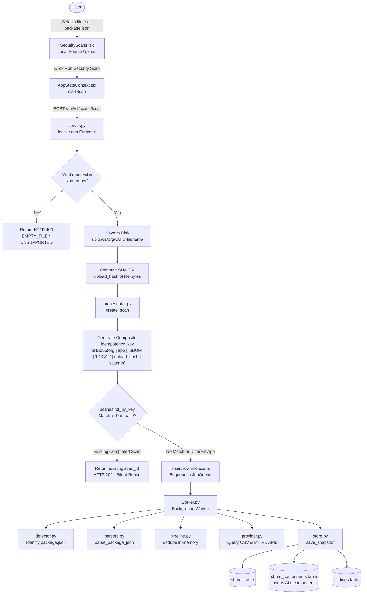
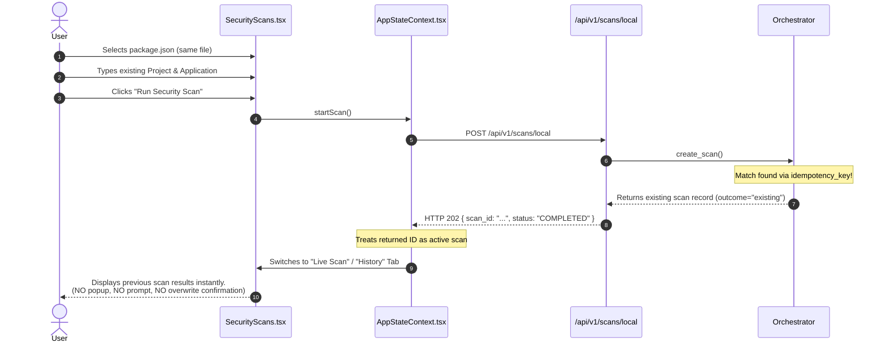
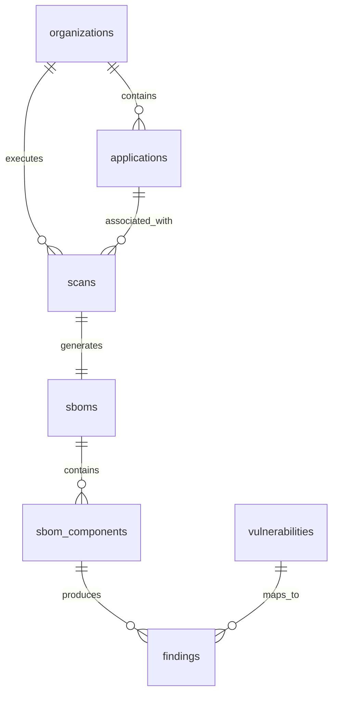
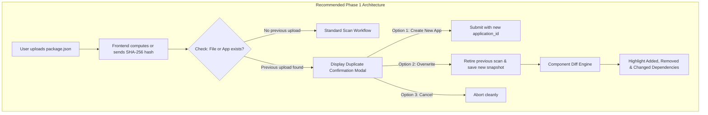

# SBOM Platform: Existing File Detection & Duplicate Component Verification (Phase 1)

**Document Version:** 1.0  
**Investigation Scope:** Local Source File Upload, Duplicate Detection, Component Diffing, Confirmation Modals, and Database Architecture  
**Primary Module / File Type Evaluated:** `package.json` (`npm` / Node.js)  
**Repository Working Directory:** `c:\Users\Dell\Desktop\SBOM`  

---

## 1. Executive Summary & Objective

This investigation verifies how the SBOM platform currently handles previously uploaded files and their extracted components during local scans. Specifically, it assesses whether the platform:
1. Recognizes when an uploaded file already exists in the system.
2. Identifies components extracted from previous uploads.
3. Compares newly uploaded components against previously stored components (detecting additions, removals, and version updates).
4. Displays a confirmation popup when duplicate uploads occur:
   > *"This file has been uploaded previously. What would you like to do? — Create New Application or Overwrite Previous Upload"*
5. Allows users to choose between creating an isolated application or updating/overwriting the previous upload.

### Key Investigation Findings

* **Silent Idempotency Match (No User Notification):**  
  If a user uploads the **exact same file** (byte-for-byte identical SHA-256 hash) for the **same application name**, the backend identifies an `idempotency_key` match in the `scans` table. However, it does this **silently**: it returns the existing scan ID without notifying the user, prompting for confirmation, or re-scanning.
* **No Cross-Application Duplicate Awareness:**  
  If the exact same file is uploaded under a **different application or project name**, the system treats it as a brand-new file, duplicates storage, and scans it from scratch without detecting that the file already exists in another application.
* **Confirmation Popup Is Missing:**  
  No modal or confirmation dialog exists in the frontend or backend to ask users whether to "Create New Application" or "Overwrite Previous Upload".
* **Component Diffing Is Missing:**  
  The system parses each upload independently. It does not compare the new components against the application's previous SBOM snapshot. It does not flag newly added components, removed components, or upgraded versions.
* **Database Is Append-Only:**  
  Every new scan generates a new snapshot in `sboms` and inserts duplicate rows for all packages into `sbom_components`. There is currently no active "overwrite" mutation logic.

---

## 2. Complete Upload & Duplicate Detection Workflow



### Step-by-Step Execution Breakdown

1. **User Interaction (`frontend/src/pages/scans/SecurityScans.tsx`):**
   * The user selects a manifest file (e.g. `package.json`) via file picker (`modalFileInputRef`).
   * The user provides `Project Name` and `Application Service` (or selects from existing catalog records).
   * Clicking "Run Security Scan" dispatches `startScan()` in `frontend/src/context/AppStateContext.tsx`.

2. **HTTP Transmission (`frontend/src/api/client.ts`):**
   * Transmits a `multipart/form-data` payload to `POST /api/v1/scans/local` with:
     * `file`: Binary file stream.
     * `project_name` / `project_id`: Project target.
     * `application_name` / `application_id`: Application service target.
     * `version`: Version string (defaults to `'UNKNOWN'`).
     * `description`: Optional scan notes.

3. **Backend Ingestion & Storage (`backend/app/api/server.py`):**
   * Reads the uploaded byte stream into memory: `blob = await file.read()`.
   * Checks for 0 bytes (`EMPTY_FILE` error if length is zero).
   * Validates manifest naming via `is_supported_manifest(filename)` (must match supported manifests or archives `.zip`/`.tar.gz`).
   * Saves the file in the local object store under a randomized UUID:
     $$\text{uploads/}\{\text{organization\_id}\}/\{\text{uuid.uuid4}()\}\text{-}\{\text{upload\_name}\}$$
     *Notice: Even if the exact same file is uploaded twice, a new copy is always written to disk under a new UUID.*
   * Computes the raw file checksum:
     $$\text{upload\_hash} = \text{hashlib.sha256}(blob)\text{.hexdigest}()$$
   * Calls `orchestrator.create_scan()`.

4. **Orchestrator Idempotency Evaluation (`backend/app/scans/orchestrator.py`):**
   * Constructs the unique composite idempotency key:
     ```python
     parts = [
         data.get("organization_id") or "",
         data.get("application_id") or "",
         data.get("bom_type") or "SBOM",
         data.get("source_type") or "",             # "LOCAL"
         str(payload.get("repository_url") or ""),  # ""
         str(payload.get("branch") or ""),          # ""
         str(payload.get("commit_sha") or ""),      # ""
         str(payload.get("upload_hash") or ""),     # sha256 checksum
         scanner_name,                              # "sbom"
         scanner_version,                           # "1.0.0-dev"
         "",
     ]
     idempotency_key = hashlib.sha256("|".join(parts).encode()).hexdigest()
     ```
   * Queries the database: `self.scans.find_by_key(key)`.

---

## 3. Duplicate File Detection Analysis

| Detection Dimension | Currently Implemented? | Technical Reality in Codebase |
|---|---|---|
| **Same File + Same Application** | 🟡 **Partially Implemented (Silent)** | When `upload_hash` and `application_id` both match, `orchestrator.py` retrieves the existing scan row. If status is `COMPLETED`, it marks `outcome = "existing"` and immediately returns the existing `scan_id` with HTTP 202. **No prompt or notification is shown to the user.** |
| **Same File + Different Application** | 🔴 **Not Implemented** | Because `application_id` is part of the `idempotency_key` formula, uploading the same file under another application name produces a different hash. The system scans the file as a completely new project. |
| **Modified File + Same Application** | 🔴 **Not Implemented** | Modifying even 1 byte changes the `upload_hash`, generating a new `idempotency_key`. A new scan record is created alongside the old one. The previous scan is **not overwritten**. |
| **Standalone Checksum Indexing** | 🔴 **Not Implemented** | `upload_hash` is stored only inside the JSON string column `job_payload` in `scans`. It is not an indexed relational column and cannot be queried directly to find existing files across the platform. |
| **Filename Comparison** | 🔴 **Not Implemented** | Filename is checked only to confirm it is a valid manifest format (e.g. `package.json`), not to detect prior uploads. |
| **Content / AST Diffing** | 🔴 **Not Implemented** | The platform does not perform structural or semantic diffing of uploaded files. |

---

## 4. Component-Level Verification (`package.json` / npm)

*Focus: First supported manifest type in the scanner pipeline (`priority 1` in `detector.py`).*

### Component Extraction Flow (`parsers.py` $\rightarrow$ `parse_package_json`)
```
Uploaded package.json
  ├── dependencies           ──► Extracted as runtime components (scope: runtime, direct: true)
  ├── devDependencies        ──► Extracted as dev components (scope: dev, direct: true)
  ├── optionalDependencies   ──► Extracted as optional components
  ├── peerDependencies       ──► Extracted as peer components
  └── name / version (root)  ──► Extracted as root component
```

### Component Comparison & Diffing Capabilities

| Verification Question | System Behavior | Evidence in Codebase |
|---|---|---|
| **Are components compared with previous uploads?** | 🔴 **No** | Neither `pipeline.py` nor `parsers.py` receives or queries previous scan snapshots. Scanning runs completely statelessly from the extracted file tree. |
| **Are identical components recognized?** | 🟡 **Inside file only** | `pipeline.py` (`dedupe()`) merges duplicate package declarations *within the same file*. It does not recognize identity across different uploads of the application. |
| **Are changed versions detected?** | 🔴 **No** | Version changes (e.g. `lodash` upgrading from `4.17.15` to `4.17.21`) are not tracked or flagged as version deltas. |
| **Are newly added components identified?** | 🔴 **No** | All extracted components are treated as new components. There is no `is_new` or `diff_status = "added"` attribute. |
| **Are removed components identified?** | 🔴 **No** | Components deleted from `package.json` simply do not appear in the new snapshot; no deletion log or diff is generated. |
| **Can duplicate component records be created in the database?** | ⚠️ **Yes** | Every new scan snapshot inserts a full set of rows into `sbom_components`. If `express@4.19.2` is scanned 5 times, 5 distinct rows exist in `sbom_components`, each linked to a different `sbom_id`. |

### The Global Organization Counter (`store.py:495-508`)
In `backend/app/repositories/store.py`, the function `_known_package_keys()` queries the database for all `(lower(name), version, lower(ecosystem))` tuples across the **entire organization**.
```python
if key in known:
    skipped_existing += 1
```
* **Critical Finding:** This counter is **purely informational for logging**. The system STILL inserts the component into `sbom_components` for the new snapshot. It is only used to format the progress message:
  `"scan complete, 10 components (6 new, 4 existing versions)"`

---

## 5. Confirmation Popup Verification

### Verification of Expected Popup
> *"This file has been uploaded previously. What would you like to do? — [ Create New Application ] [ Overwrite Previous Upload ]"*

```
POPUP AUDIT RESULT:
┌────────────────────────────────────────────────────────┐
│ Status: NOT IMPLEMENTED                                │
│ Location Searched: All frontend .tsx and .ts components│
│ Result: Zero occurrences of duplicate upload modals    │
└────────────────────────────────────────────────────────┘
```

### What Actually Happens When a Duplicate File Is Uploaded



### Note on Existing "Rescan Modal" (`SecurityScans.tsx:3376`)
The frontend contains a modal titled **"Rescan Project"**, but this modal is **only accessible from the Scan History table** when a user clicks the "Rescan" button on an old job. It allows choosing between re-scanning the original file or uploading a new file. It is **never triggered during an initial file upload**.

---

## 6. Database Verification

### Active Tables Involved in Local Uploads



### 1. `scans` Table
* **Primary Key:** `id` (UUID)
* **Unique Constraints:** `idempotency_key TEXT NOT NULL UNIQUE`
* **Key Columns:**
  * `source_type`: Set to `'LOCAL'` for uploaded files.
  * `project_id`, `application_id`, `application_name`, `application_version`.
  * `scan_status`: `'PENDING'`, `'RUNNING'`, `'COMPLETED'`, `'FAILED'`, `'CANCELLED'`.
  * `job_payload`: Contains JSON payload including `upload_hash`, `object_key`, and `file_name`.
* **Behavior:** Holds the sole idempotency constraint. Does not support an explicit "overwritten" state.

### 2. `sboms` Table
* **Primary Key:** `id` (UUID)
* **Foreign Keys:** `scan_id REFERENCES scans(id) ON DELETE CASCADE`
* **Key Columns:** `application_id`, `bom_type`, `generated_at`, `raw_metadata`.
* **Behavior:** Stores the immutable snapshot header. Completely append-only.

### 3. `sbom_components` Table
* **Primary Key:** `id` (UUID)
* **Foreign Keys:** `sbom_id REFERENCES sboms(id) ON DELETE CASCADE`
* **Unique Constraints:** `UNIQUE (id, sbom_id)`
* **Key Columns:** `name`, `version`, `ecosystem`, `package_manager`, `purl`, `source_manifest`, `raw_component`.
* **Behavior:** Stores individual package rows. Because `sbom_id` is part of the unique key, multiple scans of the same application store duplicate package rows under each respective `sbom_id`.

### 4. `applications` Table
* **Primary Key:** `id` (UUID)
* **Unique Constraints:** `UNIQUE (organization_id, project_id, name)`
* **Behavior:** Guarantees application names are unique within a project, but has no relational link to uploaded files or file hashes.

---

## 7. Required Test Scenarios: Verification Matrix

| # | Test Scenario | Expected Behaviour | Current Platform Reality | Compliance Status |
|---|---|---|---|---|
| 1 | **Upload exact same file again (same application)** | Detect previous upload and prompt user | Matches `idempotency_key`. Silently reuses old scan ID without prompting user or alerting them. | 🟡 **Partially Implemented (Silent)** |
| 2 | **Upload exact same file again (different application)** | Detect previous upload across applications | Generates different idempotency key. Queues new scan; no duplicate detection. | 🔴 **Not Implemented** |
| 3 | **Upload same filename with different contents** | Detect content modification and prompt user | Hash differs. System creates a new scan row alongside old scan without prompt. | 🔴 **Not Implemented** |
| 4 | **Upload file with identical components** | Recognize that components already exist | Deduplicates internally inside the file; does not compare against previous uploads. | 🟡 **Partially Implemented (File-level only)** |
| 5 | **Upload file with additional components** | Flag newly added components | Extracts all components afresh; does not flag which components are new. | 🔴 **Not Implemented** |
| 6 | **Upload file with changed versions** | Flag updated/downgraded versions | Inserts new versions into new snapshot; no version diffing exists. | 🔴 **Not Implemented** |
| 7 | **Upload file with removed components** | Flag removed components | Omitted packages simply do not appear in new snapshot; no deletion log. | 🔴 **Not Implemented** |
| 8 | **Select "Create New Application"** | Allow user to create separate application | Option and confirmation popup do not exist. | 🔴 **Not Implemented** |
| 9 | **Select "Overwrite Previous Upload"** | Replace/archive previous scan data | Option and confirmation popup do not exist. | 🔴 **Not Implemented** |
| 10| **Cancel the popup** | Safely abort upload | Confirmation popup does not exist. | 🔴 **Not Implemented** |

---

## 8. Missing Functionality Breakdown

To support the complete duplicate file handling and component verification workflow, four architectural capabilities must be implemented:

1. **Pre-Upload Validation Endpoint (`POST /api/v1/scans/check-duplicate`):**
   * Currently, the system only evaluates idempotency *after* the file is uploaded, saved to disk, and queued.
   * Missing an API endpoint that takes the file's SHA-256 hash and application name upfront to check if an identical file or prior upload exists.

2. **Structured Duplicate Response Contract:**
   * When an existing upload is detected, the API must return a structured response:
     ```json
     {
       "duplicate_detected": true,
       "duplicate_type": "EXACT_FILE" | "CONTENT_MODIFIED",
       "existing_scan_id": "...",
       "existing_application": "billing-service",
       "previous_upload_timestamp": "2026-11-10T14:30:00Z",
       "previous_component_count": 42
     }
     ```

3. **Frontend Confirmation Modal (`DuplicateUploadModal.tsx`):**
   * A dedicated modal dialog to intercept the upload flow when `duplicate_detected: true` is returned.
   * Presents the user with three explicit actions:
     * **Create New Application:** Prompts for a new application name and submits as an isolated target.
     * **Overwrite Previous Upload:** Overwrites the active scan data for the current application.
     * **Cancel:** Safely aborts the operation and clears file inputs.

4. **Component Delta Engine (`pipeline.py` & `parsers.py`):**
   * When an application has a prior scan, the backend must retrieve the components from the latest snapshot and compute a delta against the new `package.json`:
     $$\Delta = \text{New Components} \setminus \text{Old Components}$$
     * `added`: Packages present in the new upload but absent in the old upload.
     * `removed`: Packages present in the old upload but absent in the new upload.
     * `updated`: Packages present in both but with different version strings.
     * `unchanged`: Exact name and version matches.

---

## 9. Phase 1 Implementation Recommendation

*Scope: Strictly limited to the first supported manifest type: `package.json` (npm).*



### Proposed Action Plan

1. **Step 1: Database Migration (Additive & Safe)**
   * Add a dedicated, indexed `file_hash` column to the `scans` table so file lookups do not require unpacking JSON payloads.
   * Add an `is_latest` boolean flag to `scans` to support clean overwriting (setting prior scans to `is_latest = FALSE` when overwritten).

2. **Step 2: Backend Check Endpoint**
   * Expose `POST /api/v1/scans/verify-upload` to inspect incoming file hashes and application names before queueing.

3. **Step 3: Component Diffing for `package.json`**
   * In `backend/app/scanner/pipeline.py`, implement `diff_snapshots(old_components, new_components)`.
   * Store the delta in `sboms.raw_metadata` under `component_diff` so the UI can display added, removed, and upgraded packages.

4. **Step 4: Frontend Modal Integration**
   * Build `DuplicateUploadModal.tsx` in `frontend/src/components/common/`.
   * Wire it into `SecurityScans.tsx` to handle the **Create New Application**, **Overwrite Previous Upload**, and **Cancel** flows smoothly.
