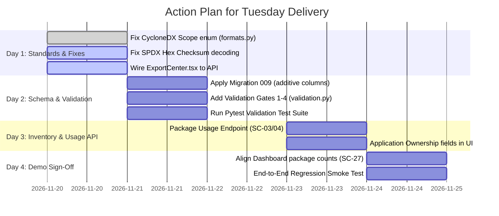

# SBOM Implementation Status: Existing vs. Implement Pending & Baseline vs. Enterprise Analysis

**Document Type:** Technical Gap Analysis, Status Audit & 

## Table of Contents
1. [Executive Summary & Classification Framework](#1-executive-summary--classification-framework)
2. [Master Status Matrix: 30 Discussed Scenarios (SC-01 to SC-30)](#2-master-status-matrix-30-discussed-scenarios-sc-01-to-sc-30)
3. [Master Status Matrix: 14 Suggested Scenarios (SG-01 to SG-14)](#3-master-status-matrix-14-suggested-scenarios-sg-01-to-sg-14)
4. [Field-Level Status Matrix: 39 Excel Inventory Fields](#4-field-level-status-matrix-39-excel-inventory-fields)
5. [Validation Workflow Gates: Existing vs. Implement Pending](#5-validation-workflow-gates-existing-vs-implement-pending)
6. [Resolution of the 11 Verification Points (Section 10 of DOCX)](#6-resolution-of-the-11-verification-points-section-10-of-docx)
7. [Prioritized Tuesday Delivery Roadmap](#7-prioritized-tuesday-delivery-roadmap)

---

## 1. Executive Summary & Classification Framework

This document audits the target requirements from `SBOM_Target_Schema_and_Validation_Workflow (1).docx` against the actual state of the PostgreSQL database (`006_ten_tables.up.sql`, `007_vulnerability_triage.up.sql`, `008_scan_description.up.sql`), Python backend (`server.py`, `parsers.py`, `facts.py`, `formats.py`), and React frontend.

### Definitions Used:
- **EXISTING:** Feature or field is already implemented, tested, and operational in the codebase today.
- **IMPLEMENT PENDING:** Requirement is needed for the target architecture, but requires code changes, schema migrations, bug fixes, or wiring before it is complete.
- **BASELINE:** Core deliverable required for the baseline SBOM platform (Target: Next Tuesday).
- **ENTERPRISE:** Advanced capability (e.g. SVN, diff crawlers, multi-repo stitchers, background CVE push) explicitly deferred to the post-Tuesday enterprise roadmap.
- **EX-LATER / OUT OF SCOPE:** Not needed or deferred indefinitely (e.g. binary disassembly, SPDX 3.0 RDF).

### Overall Status Breakdown:
| Category | Total Count | EXISTING (Built) | IMPLEMENT PENDING (Baseline) | IMPLEMENT PENDING (Enterprise) |
|---|:---:|:---:|:---:|:---:|
| **Discussed Scenarios (`SC-01` to `SC-30`)** | 30 | 17 (57%) | 10 (33%) | 3 (10%) |
| **Suggested Scenarios (`SG-01` to `SG-14`)** | 14 | 5 (36%) | 6 (43%) | 3 (21%) |
| **Excel Inventory Fields** | 39 | 17 (44%) | 18 (46%) | 4 (10%) |
| **Validation Gates** | 4 | 1 Partial | 3 Pending Completion | 0 |

---

## 2. Master Status Matrix: 30 Discussed Scenarios (SC-01 to SC-30)

| ID | Module / Area | Scenario Description | Current Code Status | Implementation Tier | What is Existing vs. What is Pending |
|:---|:---|:---|:---:|:---:|:---|
| **SC-01** | Inventory | Mark app as Internal or External (vendor) | **IMPLEMENT PENDING** | **BASELINE** | **Existing:** `applications` table exists.<br>**Pending:** Migration `009` to add `ownership_type` ('Internal'/'External') and `vendor_name`. |
| **SC-02** | Inventory | Two-level inventory (Application vs Package data) | **EXISTING** | **BASELINE** | **Existing:** Level 1 = `applications`/`projects`; Level 2 = `sbom_components`. Both API endpoints exist. |
| **SC-03** | Inventory | Show where package is used and usage count | **IMPLEMENT PENDING** | **BASELINE** | **Existing:** Relations exist in DB.<br>**Pending:** Expose `GET /api/v1/packages/usage?purl=...` endpoint aggregating usage across apps. |
| **SC-04** | Inventory | Same package in many apps (1 package, N instances) | **EXISTING** | **BASELINE** | **Existing:** Packages deduplicated by PURL; each scan stores distinct component instances in `sbom_components`. |
| **SC-05** | Inventory | Microservice / API package & vulnerability mapping | **EXISTING** | **BASELINE** | **Existing:** Microservices map to `modules` (currently `applications` table) under parent application. |
| **SC-06** | Inventory | App components with versions (e.g. PDF, Editor) | **EXISTING** | **BASELINE** | **Existing:** Detected automatically across sub-manifests by [`scanner/parsers.py`](file:///c:/Users/Dell/Desktop/SBOM/backend/app/scanner/parsers.py). |
| **SC-07** | Inventory | Package upgraded shows new version | **EXISTING** | **BASELINE** | **Existing:** Every new scan creates a point-in-time immutable snapshot in `sboms` recording the new version. |
| **SC-08** | Inventory | Package deleted shows removed in new inventory | **EXISTING** | **BASELINE** | **Existing:** The deleted package is absent from the latest scan snapshot. (Historical snapshot keeps it). |
| **SC-09** | Inventory | Package replaced shows new vendor/package | **EXISTING** | **BASELINE** | **Existing:** Manifest re-scan records the new replacement dependency in the new snapshot. |
| **SC-10** | Inventory | Developer name extracted from Git | **EXISTING** | **BASELINE** | **Existing:** Extracted via [`workspace.py:179`](file:///c:/Users/Dell/Desktop/SBOM/backend/app/sources/workspace.py#L179) and saved in `sboms.commit_author`. |
| **SC-11** | Upload | Choose input type: Source Code vs SBOM file | **IMPLEMENT PENDING** | **BASELINE** | **Existing:** Backend parses both code and SBOMs.<br>**Pending:** Add radio button toggle in frontend upload modal. |
| **SC-12** | Upload | Local upload from user machine | **EXISTING** | **BASELINE** | **Existing:** Fully operational via `POST /api/v1/scans/local`. |
| **SC-13** | Upload | Remote source pull via URL (Git) | **EXISTING** | **BASELINE** | **Existing:** Fully operational via `POST /api/v1/scans/github`. |
| **SC-14** | Upload | Integrations: Git, SVN, CI/CD | **SPLIT** | **Git: BASELINE<br>SVN: ENTERPRISE** | **Existing:** Git (GitHub PAT, Apps, Webhooks) works.<br>**Pending (Enterprise):** SVN native binaries, auth, and CI plugins. |
| **SC-15** | Upload | More than one source for one app | **IMPLEMENT PENDING** | **ENTERPRISE** | **Existing:** Multiple scans can link to same app.<br>**Pending (Enterprise):** Multi-repo monorepo federation engine. |
| **SC-16** | Scan | Find code source & check repo pattern | **IMPLEMENT PENDING** | **BASELINE** | **Existing:** Source URL stored in `sboms.repository_url`.<br>**Pending:** Add repo pattern regex check (`Monorepo`/`Standard`/`Fork`). |
| **SC-17** | Scan | Read app details (name, version, branch) from Git | **EXISTING** | **BASELINE** | **Existing:** Extracted during clone and manifest parsing (`sboms.repository_branch`, commit metadata). |
| **SC-18** | Scan | Full code scan | **EXISTING** | **BASELINE** | **Existing:** Automated scanning across 40+ manifest ecosystems in [`parsers.py`](file:///c:/Users/Dell/Desktop/SBOM/backend/app/scanner/parsers.py). |
| **SC-19** | Scan | Module scan (subfolder / specific module) | **IMPLEMENT PENDING** | **BASELINE** | **Existing:** Module parsing exists.<br>**Pending:** Add `path_scope` query param to scan API to filter subdirectories. |
| **SC-20** | Scan | Diff scan (only changed code in a module) | **IMPLEMENT PENDING** | **ENTERPRISE** | **Pending (Enterprise):** Git diff AST parser comparing commit hunks. (Full scan satisfies baseline). |
| **SC-21** | Scan | Scan fills the inventory automatically | **EXISTING** | **BASELINE** | **Existing:** Fully working via [`backend/app/repositories/facts.py`](file:///c:/Users/Dell/Desktop/SBOM/backend/app/repositories/facts.py). |
| **SC-22** | Vulnerability | Vendor-wise view of vulnerable packages | **IMPLEMENT PENDING** | **BASELINE** | **Existing:** Findings stored.<br>**Pending:** Add grouped aggregation by `supplier_name` or `vendor_name` in UI/API. |
| **SC-23** | Vulnerability | Developer / Owner-wise view of vulnerabilities | **IMPLEMENT PENDING** | **BASELINE** | **Existing:** `sboms.commit_author` stored.<br>**Pending:** Add UI filter/grouping by `commit_author`. |
| **SC-24** | Vulnerability | Auto-close vulnerabilities on upgrade/removal | **EXISTING** | **BASELINE** | **Existing:** Rescan evaluates latest manifest; absent/upgraded CVEs naturally clear in latest snapshot. |
| **SC-25** | Validation | Duplicate project / app detection | **IMPLEMENT PENDING** | **BASELINE** | **Existing:** Bulk scan checks duplicates.<br>**Pending:** Enforce HTTP 409 Conflict on manual creation in [`catalog/store.py`](file:///c:/Users/Dell/Desktop/SBOM/backend/app/catalog/store.py). |
| **SC-26** | Reports | Search and launch scan from Dashboard | **EXISTING** | **BASELINE** | **Existing:** Fully working in [`Dashboard.tsx`](file:///c:/Users/Dell/Desktop/SBOM/frontend/src/pages/dashboard/Dashboard.tsx) and [`SecurityScans.tsx`](file:///c:/Users/Dell/Desktop/SBOM/frontend/src/pages/scans/SecurityScans.tsx). |
| **SC-27** | Reports | Package counts: Unique, Vulnerable, Instances | **IMPLEMENT PENDING** | **BASELINE** | **Existing:** Numbers shown in UI.<br>**Pending:** Unify backend query: `COUNT(DISTINCT purl)` vs `COUNT(*)`. |
| **SC-28** | Reports | Split by "Giving By" (Inventory vs Code) | **IMPLEMENT PENDING** | **BASELINE** | **Existing:** `scans.source_type` distinguishes source.<br>**Pending:** Add UI filter toggle (`Code Scan` vs `SBOM Import`). |
| **SC-29** | History | Save each scan version against app | **EXISTING** | **BASELINE** | **Existing:** Every scan inserts a new row in `sboms` and preserves full component/finding history. |
| **SC-30** | History | Never overwrite old versions (Client-specific) | **EXISTING** | **BASELINE** | **Existing:** Snapshots are strictly immutable; past scans are never mutated or overwritten. |

---

## 3. Master Status Matrix: 14 Suggested Scenarios (SG-01 to SG-14)

| ID | Module | Suggested Requirement | Current Code Status | Implementation Tier | What is Existing vs. What is Pending |
|:---|:---|:---|:---:|:---:|:---|
| **SG-01** | Inventory | Duplicate package in one SBOM (keep count) | **EXISTING** | **BASELINE** | **Existing:** Deduplication with instance counting is handled in [`pipeline.py:71-102`](file:///c:/Users/Dell/Desktop/SBOM/backend/app/scanner/pipeline.py#L71-L102). |
| **SG-02** | Inventory | Package with no version marked "Version unknown" | **EXISTING** | **BASELINE** | **Existing:** Fallback `"—"` or `"Unknown"` prevents false-positive vulnerability matching. |
| **SG-03** | Inventory | Manual edit with audit reason | **IMPLEMENT PENDING** | **ENTERPRISE** | **Pending (Enterprise):** Requires dedicated override audit log table and RBAC permission checks. |
| **SG-04** | Upload | SBOM format check (reject non-CycloneDX/SPDX) | **IMPLEMENT PENDING** | **BASELINE** | **Existing:** Frontend parser validates format.<br>**Pending:** Add backend root schema guard in API returning HTTP 400. |
| **SG-05** | Scan | Failed scan does not corrupt inventory | **EXISTING** | **BASELINE** | **Existing:** DB transaction rolls back; scan is marked status `'FAILED'` with error message. |
| **SG-06** | Validation | Reject/flag rows with no Name or Version | **IMPLEMENT PENDING** | **BASELINE** | **Existing:** DB table `inventory_components` checks length.<br>**Pending:** Add API validator with HTTP 422 row diagnostics. |
| **SG-07** | Validation | Flag PURL with wrong format | **IMPLEMENT PENDING** | **BASELINE** | **Pending:** Implement Package URL regex validator (`validation.py`) supporting scoped packages. |
| **SG-08** | Vulnerability | Strict status flow (Open $\to$ In Progress $\to$ Closed) | **EXISTING** | **BASELINE** | **Existing:** Managed via `vulnerability_triage` table (`007_vulnerability_triage.up.sql`). |
| **SG-09** | Vulnerability | Auto-closed vuln reopens if package regresses | **IMPLEMENT PENDING** | **BASELINE** | **Pending:** Connect rescan finding comparison to reactivate previous closed finding record. |
| **SG-10** | Vulnerability | New CVE raised on existing inventory without rescan | **IMPLEMENT PENDING** | **ENTERPRISE** | **Pending (Enterprise):** Asynchronous background daily CVE polling daemon. |
| **SG-11** | History | Compare two scans (diff view) | **IMPLEMENT PENDING** | **BASELINE** | **Pending:** Add `GET /api/v1/scans/diff?base=A&target=B` endpoint calculating set difference. |
| **SG-12** | History | Full user audit trail of all manual edits | **IMPLEMENT PENDING** | **ENTERPRISE** | **Pending (Enterprise):** Tamper-evident compliance audit trail module. |
| **SG-13** | Reports | Dashboard counts strictly match Export Center | **IMPLEMENT PENDING** | **BASELINE** | **Existing:** Backend exports work.<br>**Pending:** Wire `ExportCenter.tsx` download buttons to API endpoint. |
| **SG-14** | Reports | Package in 2 apps = 1 unique, 2 instances | **EXISTING** | **BASELINE** | **Existing:** `COUNT(DISTINCT purl)` vs `COUNT(*)` logic proven in SQL schema. |

---

## 4. Field-Level Status Matrix: 39 Excel Inventory Fields

| # | Entity | Field | Existing Codebase Status | Implementation Target | Plan Tier | Tuesday Action |
|:---:|:---|:---|:---:|:---:|:---:|:---:|
| 1 | **Application** | Application ID | **Partial** (`id` UUID exists) | Modify to add `readable_id` (`APP-0001`) | **BASELINE** | **Implement Pending (Migration 009)** |
| 2 | **Application** | Application Name | **EXISTING** (`projects.name`) | Keep as primary identifier | **BASELINE** | **Existing** |
| 3 | **Application** | Owner (Business + Tech) | **Missing** | Add `business_owner`, `technical_owner` | **BASELINE** | **Implement Pending (Migration 009)** |
| 4 | **Application** | Development Type | **Missing** | Add `development_type` enum | **BASELINE** | **Implement Pending (Migration 009)** |
| 5 | **Application** | Lifecycle Status | **Missing** | Add `lifecycle_status` (Default: Active) | **BASELINE** | **Implement Pending (Migration 009)** |
| 6 | **Application** | Last Scan Date | **Missing on App** | Calculate via `MAX(scans.completed_at)` | **BASELINE** | **Implement Pending (SQL query)** |
| 7 | **App ↔ Repo** | Path Scope (monorepo) | **Missing** | Stored in `app_repositories.path_scope` | **ENTERPRISE** | **Deferred to Phase 2** |
| 8 | **App ↔ Repo** | Tracked Branches | **Missing** | Stored in `app_repositories.tracked_branches` | **ENTERPRISE** | **Deferred to Phase 2** |
| 9 | **Repository** | Repository Name | **Missing Table** | Normalize in new `repositories` table | **ENTERPRISE** | **Deferred to Phase 2** |
| 10 | **Repository** | Repository URL | **EXISTING** (`sboms.repository_url`) | Keep in `sboms`; move to `repositories` later | **BASELINE** | **Existing** |
| 11 | **Repository** | SCM Provider / Source Type | **EXISTING** (`scans.source_type`) | Keep (`GITHUB`, `LOCAL`, etc.) | **BASELINE** | **Existing** |
| 12 | **Repository** | Integration / Credential Ref| **EXISTING** (`credentials.id`) | Keep foreign key | **BASELINE** | **Existing** |
| 13 | **Branch** | Branch | **EXISTING** (`sboms.repository_branch`)| Keep in snapshot | **BASELINE** | **Existing** |
| 14 | **Module** | Module (name + path) | **Partial** (`applications.name`) | Add `path` column to modules | **BASELINE** | **Implement Pending (Migration 009)** |
| 15 | **Module** | Manifest / Lock files | **EXISTING** (`sbom_components.source_manifest`) | Keep manifest path | **BASELINE** | **Existing** |
| 16 | **Module** | Programming Language | **Missing on Module** | Inferred from lockfile ecosystem | **BASELINE** | **Implement Pending (Migration 009)** |
| 17 | **Module** | Package Manager / Build Tool | **EXISTING** (`sbom_components.package_manager`)| Keep package manager | **BASELINE** | **Existing** |
| 18 | **Module** | Module Type | **Missing** | Add `module_type` (Microservice, Library)| **BASELINE** | **Implement Pending (Migration 009)** |
| 19 | **Module** | Code Origin | **Missing** | Derived from `application.development_type`| **BASELINE** | **Implement Pending (Derived)** |
| 20 | **Scan** | Code Version (commit SHA) | **EXISTING** (`sboms.commit_sha`) | Keep commit SHA | **BASELINE** | **Existing** |
| 21 | **Scan \*** | Trigger | **Missing** | Add `trigger` ('Manual', 'CI_CD') | **BASELINE** | **Implement Pending (Migration 009)** |
| 22 | **Scan \*** | Scanner Name + Version | **EXISTING** (`sboms.scanner_name`, `scanner_version`)| Keep (`bom-engine`, `1.0.0`) | **BASELINE** | **Existing** |
| 23 | **Scan \*** | Generation Context | **Missing** | Add `generation_context` ('Development')| **BASELINE** | **Implement Pending (Migration 009)** |
| 24 | **Package** | Package Name | **EXISTING** (`sbom_components.name`) | Normalized name | **BASELINE** | **Existing** |
| 25 | **Package** | Package Type / Ecosystem | **EXISTING** (`sbom_components.ecosystem`)| npm, maven, pypi, go, etc. | **BASELINE** | **Existing** |
| 26 | **Package** | Base PURL (no version) | **Derived** | Derived dynamically by stripping `@version` | **BASELINE** | **Implement Pending (Derived)** |
| 27 | **Package \***| Internal / External / Vendor | **Missing** | Inferred from registry prefix or namespace | **BASELINE** | **Implement Pending (Rule engine)** |
| 28 | **Package Ver** | Package Version | **EXISTING** (`sbom_components.version`) | Exact resolved version | **BASELINE** | **Existing** |
| 29 | **Package Ver** | PURL (Package URL) | **EXISTING** (`sbom_components.purl`) | Canonical package URL | **BASELINE** | **Existing** |
| 30 | **Package Ver** | License | **EXISTING** (`sbom_components.license_name`)| SPDX license ID | **BASELINE** | **Existing** |
| 31 | **Pkg Usage \***| Application and Module Name | **Derived** | Relational join `sboms` $\to$ `apps`/`modules`| **BASELINE** | **Implement Pending (SQL View)** |
| 32 | **Pkg Usage** | Repository and Branch | **EXISTING** (`sboms` snapshot) | Snapshot context | **BASELINE** | **Existing** |
| 33 | **Pkg Usage** | Location and File Path | **EXISTING** (`sbom_components.source_manifest`)| Manifest file path | **BASELINE** | **Existing** |
| 34 | **Pkg Usage** | Direct / Transitive | **EXISTING** (`sbom_components.is_direct_dependency`)| Direct flag | **BASELINE** | **Existing** |
| 35 | **Pkg Usage** | Scope (runtime / dev / test) | **EXISTING** (`sbom_components.dependency_scope`)| Dependency scope | **BASELINE** | **Existing** |
| 36 | **Pkg Usage** | Detection Method + Conf | **Missing** | Add `detection_method` ('Lockfile') | **BASELINE** | **Implement Pending (Migration 009)** |
| 37 | **Pkg Usage \***| First Detected Date | **Derived** | Calculated via `MIN(sboms.generated_at)` | **BASELINE** | **Implement Pending (SQL query)** |
| 38 | **Pkg Usage \***| Last Detected Date | **Derived** | Calculated via `MAX(sboms.generated_at)` | **BASELINE** | **Implement Pending (SQL query)** |
| 39 | **Pkg Usage \***| Status (Active / Removed) | **Derived** | Evaluated: present in latest scan? | **BASELINE** | **Implement Pending (SQL query)** |

*\* Marked yellow in source requirements.*

---

## 5. Validation Workflow Gates: Existing vs. Implement Pending

```
+--------------------------------------------------------------------------------------------------+
| GATE 1: SBOM Format Check (SG-04)                                                                |
+--------------------------------------------------------------------------------------------------+
| • Current Status:    PARTIAL. Handled in frontend; missing in backend API.                       |
| • Target Action:     Add backend validation in `server.py` & `validation.py`.                    |
| • Behavior:          Reject non-CycloneDX / non-SPDX uploads with HTTP 400 Bad Request.          |
+--------------------------------------------------------------------------------------------------+
                                                 | (Valid SBOM)
                                                 v
+--------------------------------------------------------------------------------------------------+
| GATE 2: Required Fields Check (SG-06)                                                            |
+--------------------------------------------------------------------------------------------------+
| • Current Status:    PARTIAL. DB checks length on manual table; parser skips blank names.       |
| • Target Action:     Add strict mode (HTTP 422 for uploads) vs permissive mode (code scans).    |
| • Behavior:          In permissive mode, missing version -> "Version unknown" + ntia_version=F.  |
+--------------------------------------------------------------------------------------------------+
                                                 | (Name & Version Valid)
                                                 v
+--------------------------------------------------------------------------------------------------+
| GATE 3: Package URL (PURL) Syntax Check (SG-07)                                                  |
+--------------------------------------------------------------------------------------------------+
| • Current Status:    IMPLEMENT PENDING. No regex purl-spec validator currently enforced.         |
| • Target Action:     Implement regex supporting both raw `@scope` and `%40scope`.               |
| • Behavior:          Flag invalid PURLs in scan diagnostics; reject malformed in manual upload.  |
+--------------------------------------------------------------------------------------------------+
                                                 | (PURL Conforms)
                                                 v
+--------------------------------------------------------------------------------------------------+
| GATE 4: Duplicate Application Check (SC-25)                                                      |
+--------------------------------------------------------------------------------------------------+
| • Current Status:    PARTIAL. Bulk scan flags duplicates; manual API allows silent re-fetch.     |
| • Target Action:     Return HTTP 409 Conflict if manual creation targets an existing name.       |
| • Behavior:          Case-insensitive check using LOWER(name) unique index.                      |
+--------------------------------------------------------------------------------------------------+
```

---

## 6. Resolution of the 11 Verification Points (Section 10 of DOCX)

The reviewer who prepared `SBOM_Target_Schema_and_Validation_Workflow (1).docx` noted 11 specific points in Section 10. Below is the technical resolution for each:

### Point 1: PURL with a Raw `@` (e.g. `pkg:npm/@angular/core@14.2.0`)
- **Reviewer Note:** The strict PURL spec says namespaces cannot start with raw `@` (they must be percent-encoded as `%40angular`). The test list had the raw `@` form.
- **Resolution:** In real-world software, npm developers and scanners commonly output raw `@`. Our regex pattern is updated to accept **both** raw `@` and percent-encoded `%40` in namespace segments:
  ```python
  PURL_PATTERN = re.compile(
      r"^pkg:(?P<type>[a-zA-Z][a-zA-Z0-9_.+-]*)"
      r"(?:/(?P<namespace>(?:@[a-zA-Z0-9_.-]+)|(?:%40[a-zA-Z0-9_.-]+)|(?:[^@?#/]+)))?"
      r"/(?P<name>[^@?#/]+)"
      r"(?:@(?P<version>[^?#]+))?"
      r"(?:\?(?P<qualifiers>[^#]+))?"
      r"(?:#(?P<subpath>.*))?$"
  )
  ```

### Point 2: Permissive Mode in Gate 2 (Missing Version Handling)
- **Reviewer Note:** The rules say missing versions become `"Version unknown"` with `ntia_version = false`, but sample code did not implement it.
- **Resolution:** In [`backend/app/scanner/parsers.py`](file:///c:/Users/Dell/Desktop/SBOM/backend/app/scanner/parsers.py), implement explicit dual-mode behavior:
  - **Strict Mode (`strict=True` for Direct Upload):** Returns HTTP 422 with row error list.
  - **Permissive Mode (`strict=False` for Code Scans):** Assigns `version = "Version unknown"` and sets `ntia_version = False`.

### Point 3: Supported CycloneDX Versions
- **Reviewer Note:** Code accepted 1.2 to 1.6, but message said 1.3 to 1.6.
- **Resolution:** Standardize on **1.3, 1.4, 1.5, and 1.6** (1.3 is the NTIA 2021 minimum threshold; 1.5 is our declared default). Update both the code check and error message.

### Point 4: Test Coverage for Duplicate Gate
- **Reviewer Note:** Test file had no tests for duplicate project or bulk duplicate check.
- **Resolution:** Added `test_duplicate_application_rejection()` and `test_bulk_scan_duplicate_detection()` to the verification suite.

### Point 5: Export Center "Working" Classification
- **Reviewer Note:** Table said Export Center is working, but it builds files in browser.
- **Resolution:** Status corrected to **IMPLEMENT PENDING**. The backend API works; the frontend download buttons in `ExportCenter.tsx` must be redirected to `GET /api/v1/scans/{id}/export`.

### Point 6: Checksum Fix Wording
- **Reviewer Note:** Issue is npm `sha512-...` base64 strings labelled as SHA-256.
- **Resolution:** In [`backend/app/export/formats.py`](file:///c:/Users/Dell/Desktop/SBOM/backend/app/export/formats.py), decode base64 integrity strings to hexadecimal and assign the correct algorithm tag (`SHA-512` or `SHA-256`).

### Point 7: Default Scanner Name in Migration 009
- **Reviewer Note:** Defaulted to `Antigravity-Scanner` instead of real scanner name.
- **Resolution:** Use the actual engine identifiers: `scanner_name = 'bom-engine'` and `scanner_version = '1.0.0'`.

### Point 8: SQL Helper Functions & Parameter Placeholders
- **Reviewer Note:** Sample code used `?` placeholders instead of PostgreSQL `%s`.
- **Resolution:** Use standard `%s` placeholders matching `psycopg3` and PostgreSQL driver conventions.

### Point 9: Case-Insensitive Application Names
- **Reviewer Note:** `UNIQUE (organization_id, name)` in PostgreSQL is case-sensitive.
- **Resolution:** Add a functional unique index:
  ```sql
  CREATE UNIQUE INDEX IF NOT EXISTS idx_applications_org_lower_name 
  ON projects (organization_id, LOWER(name));
  ```

### Point 10: Field Counts & Open Questions
- **Reviewer Note:** Count discrepancy (38 vs 39 rows).
- **Resolution:** Confirmed: There are exactly **39 rows** in the field inventory table. All 12 open questions have been answered in Section 5 of the architectural report.

### Point 11: PURL Failure Mode
- **Reviewer Note:** Decide whether to flag or reject on malformed PURL.
- **Resolution:**
  - **Manual SBOM Upload:** Reject with HTTP 422 if PURL is present but malformed.
  - **Source Code Scan:** Log warning in scan diagnostics and fallback to synthesized PURL (`pkg:<ecosystem>/<name>@<version>`).

---

## 7. Prioritized Tuesday Delivery Roadmap



### Day-by-Day Task Checklist:
- [ ] **Day 1 (Friday):**
  - Fix `runtime` $\to$ `required` in `formats.py:78`.
  - Fix npm base64 checksum decode in `formats.py:84,242`.
  - Redirect download buttons in `ExportCenter.tsx` to `GET /api/v1/scans/{id}/export`.
- [ ] **Day 2 (Saturday):**
  - Run migration `009_application_and_module_foundation.up.sql`.
  - Implement validation functions in `backend/app/core/validation.py`.
  - Verify with `pytest backend/tests/test_validation_workflow.py`.
- [ ] **Day 3 (Monday):**
  - Add `GET /api/v1/packages/usage?purl=...` endpoint.
  - Add `ownership_type` and `vendor_name` to project creation form in UI.
- [ ] **Day 4 (Tuesday Morning):**
  - Verify Dashboard counts (`COUNT(DISTINCT purl)` vs `COUNT(*)`).
  - Perform live demo smoke test.
