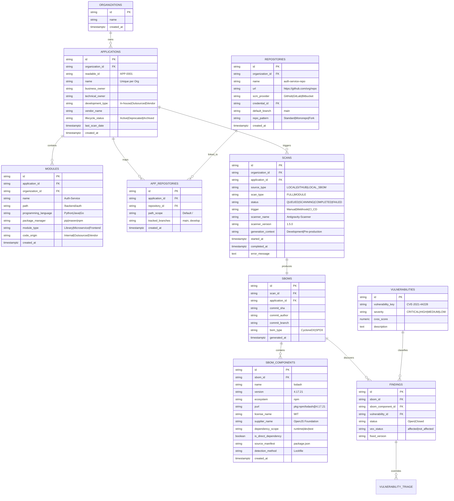
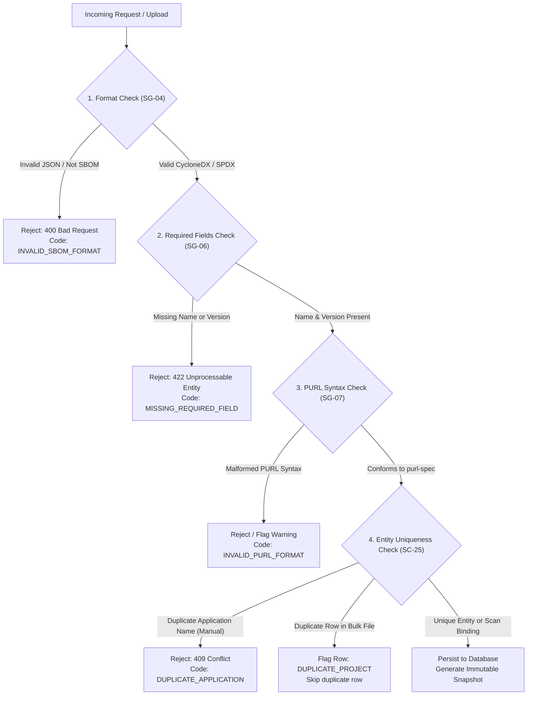

# SBOM Target Database Schema, UI Field Planning & Complete Validation Workflow

**Document Type:** Technical Architecture, Database Design & Validation Engineering Plan  
**Repository:** `c:\Users\Dell\Desktop\SBOM`  
**Target Deadline:** Next Tuesday  
**Reference Sources:** Meeting Notes (30 Discussed Scenarios + 12 Open Questions + 14 Suggested Scenarios) & Excel Field List  

---

## Table of Contents
1. [Executive Summary & Target Entity Hierarchy](#1-executive-summary--target-entity-hierarchy)
2. [Updated Scenarios & Recommendations (Baseline vs Enterprise)](#2-updated-scenarios--recommendations-baseline-vs-enterprise)
3. [Report 1: Target Database Schema Architecture](#3-report-1-target-database-schema-architecture)
4. [Report 2: Field-Level Database Assessment (All 38 Excel Fields)](#4-report-2-field-level-database-assessment-all-38-excel-fields)
5. [Report 3: UI vs Database Field Decision & Form Designs](#5-report-3-ui-vs-database-field-decision--form-designs)
6. [Report 4: Basic vs Enterprise vs EX-LATER Classification](#6-report-4-basic-vs-enterprise-vs-ex-later-classification)
7. [Report 5: Database Migration Impact Assessment & Safe Rollout](#7-report-5-database-migration-impact-assessment--safe-rollout)
8. [Report 6: Recommended Implementation Priority for Tuesday](#8-report-6-recommended-implementation-priority-for-tuesday)
9. [Comprehensive Validation Workflow & Implementation Guide](#9-comprehensive-validation-workflow--implementation-guide)
   - [9.1 Validation Architecture Overview](#91-validation-architecture-overview)
   - [9.2 Gate 1: Duplicate Project/Application Validation (SC-25)](#92-gate-1-duplicate-projectapplication-validation-sc-25)
   - [9.3 Gate 2: SBOM Document Format Validation (SG-04)](#93-gate-2-sbom-document-format-validation-sg-04)
   - [9.4 Gate 3: Required Fields Validation (SG-06)](#94-gate-3-required-fields-validation-sg-06)
   - [9.5 Gate 4: Package URL (PURL) Syntax Validation (SG-07)](#95-gate-4-package-url-purl-syntax-validation-sg-07)
   - [9.6 Complete Automated Verification Test Suite](#96-complete-automated-verification-test-suite)

---

## 1. Executive Summary & Target Entity Hierarchy

The target business model defines the software estate as:
$$\text{Organization} \longrightarrow \text{Application (Top-Level Product)} \longrightarrow \text{Module (Service / Manifest)} \longrightarrow \text{Package Inventory}$$

### Agreed Table Renaming Mapping:
| Current Database Table | Target Database Table | Business Meaning | Example |
|---|---|---|---|
| `organizations` | `organizations` | Multi-tenant organization boundary | `Default-Org`, `Fintech-Bank` |
| `projects` | `applications` | Top-level software application / business product | `Core Banking System`, `RBVM`, `Pent AI` |
| `applications` | `modules` | Sub-service, microservice, or monorepo subfolder | `Auth-Service`, `PDF-Engine`, `Frontend-App` |

> [!NOTE]
> **Key Architectural Insight:** In the existing PostgreSQL database (`006_ten_tables.up.sql`), what the code previously called `projects` is functionally what the business calls `Application`, and what the code previously called `applications` (or `applications-services` in the catalog API) is functionally what the business calls `Module`. 
> Renaming `projects` $\to$ `applications` and `applications` $\to$ `modules` aligns the PostgreSQL schema directly with the Excel requirements.

---

## 2. Updated Scenarios & Recommendations (Baseline vs Enterprise)

### 2.1 The 30 Discussed Scenarios (`SC-01` to `SC-30`)

| ID | Module | Scenario Description | Target Schema Entity | Recommendation & Status | Engineering Action for Tuesday |
|:---|:---|:---|:---|:---:|:---|
| **SC-01** | Inventory | Mark app as Internal or External (vendor) | `applications.ownership_type` | **RECOMMENDED (Baseline NOW)** | Add `ownership_type` ('Internal'/'External') & `vendor_name` to `applications`. |
| **SC-02** | Inventory | Two-level inventory: Application data vs Package data | `applications` $\to$ `sbom_components` | **RECOMMENDED (Baseline NOW)** | Align UI: Level 1 shows Application metadata; Level 2 shows distinct package table. |
| **SC-03** | Inventory | Show where package is used and usage count | `package_usage` (Derived) | **RECOMMENDED (Baseline NOW)** | Add `GET /api/v1/packages/usage?purl=...` grouping by `(application_id, module_name)`. |
| **SC-04** | Inventory | Same package in many apps (1 package, N instances) | `packages` vs `sbom_components` | **RECOMMENDED (Baseline NOW)** | Retain package PURL deduplication; track distinct instances per scan snapshot. |
| **SC-05** | Inventory | Microservice / API package & vuln mapping | `modules` table | **RECOMMENDED (Baseline NOW)** | Each microservice is a `modules` row; packages link via `module_id` / manifest path. |
| **SC-06** | Inventory | App components with versions (e.g. PDF, Editor) | `modules.version` | **RECOMMENDED (Baseline NOW)** | Handled via multi-manifest parser in [`backend/app/scanner/parsers.py`](file:///c:/Users/Dell/Desktop/SBOM/backend/app/scanner/parsers.py). |
| **SC-07** | Inventory | Package upgraded shows new version | `sboms` + `sbom_components` | **RECOMMENDED (Baseline NOW)** | Native behavior: new scan snapshot records the upgraded version. |
| **SC-08** | Inventory | Package deleted shows removed in new inventory | `sboms` + `sbom_components` | **RECOMMENDED (Baseline NOW)** | Native behavior: absent in latest snapshot; marked 'Removed' in usage comparison. |
| **SC-09** | Inventory | Package replaced shows new vendor/package | `sboms` + `sbom_components` | **RECOMMENDED (Baseline NOW)** | Native behavior: new package entry recorded in latest snapshot. |
| **SC-10** | Inventory | Developer name extracted from Git | `sboms.commit_author` | **RECOMMENDED (Baseline NOW)** | Implemented in [`sources/workspace.py:179`](file:///c:/Users/Dell/Desktop/SBOM/backend/app/sources/workspace.py#L179); stored in DB. |
| **SC-11** | Upload | Choose input type: Source Code vs SBOM file | `scans.source_type` | **RECOMMENDED (Baseline NOW)** | Backend handles both; add radio toggle (`Source Code Archive` vs `SBOM Document`) in UI. |
| **SC-12** | Upload | Local upload from user machine | `scans` (Local handler) | **RECOMMENDED (Baseline NOW)** | Working via `POST /api/v1/scans/local`. |
| **SC-13** | Upload | Remote source pull via URL (Git) | `scans` (GitHub handler) | **RECOMMENDED (Baseline NOW)** | Working via `POST /api/v1/scans/github`. |
| **SC-14** | Upload | Integrations: SVN, Git, CI/CD | `repositories` / `credentials` | **GIT: NOW / SVN: ENTERPRISE** | Git is working. SVN requires native binary installation & credentials (defer). |
| **SC-15** | Upload | More than one source for one app | `app_repositories` mapping | **ENTERPRISE (Later)** | Multi-repo monorepo stitching requires multi-clone orchestration (defer). |
| **SC-16** | Scan | Find code source & check repo pattern | `repositories.repo_pattern` | **RECOMMENDED (Baseline NOW)** | Stored in `sboms.repository_url`. Add simple regex pattern tag (`Monorepo`/`Fork`). |
| **SC-17** | Scan | Read app details (name, version, branch) from Git | `sboms.repository_branch` | **RECOMMENDED (Baseline NOW)** | Already populated during clone and manifest parsing. |
| **SC-18** | Scan | Full code scan | Scanner pipeline | **RECOMMENDED (Baseline NOW)** | Working across 40+ package manifest formats. |
| **SC-19** | Scan | Module scan (subfolder / specific module) | `scans.path_scope` | **RECOMMENDED (Baseline NOW)** | Add optional `path_scope` query param (e.g. `/backend/services/auth`). |
| **SC-20** | Scan | Diff scan (only changed code in a module) | Scanner diff engine | **ENTERPRISE (Later)** | Full scans take <2 seconds. Diff AST parsing introduces unnecessary complexity for Tuesday. |
| **SC-21** | Scan | Scan fills the inventory automatically | `facts.py` persistence | **RECOMMENDED (Baseline NOW)** | Fully working in [`backend/app/repositories/facts.py`](file:///c:/Users/Dell/Desktop/SBOM/backend/app/repositories/facts.py). |
| **SC-22** | Vulnerability | Vendor-wise view of vulnerable packages | Grouped Findings View | **RECOMMENDED (Baseline NOW)** | Group findings by `sbom_components.supplier_name` or `applications.vendor_name`. |
| **SC-23** | Vulnerability | Developer / Owner-wise view of vulnerabilities | Grouped Findings View | **RECOMMENDED (Baseline NOW)** | Group findings by `sboms.commit_author` (already in DB). |
| **SC-24** | Vulnerability | Auto-close vulnerabilities on upgrade/removal | Findings status engine | **RECOMMENDED (Baseline NOW)** | Re-scan naturally omits resolved CVEs; triage status persists via `vulnerability_triage`. |
| **SC-25** | Validation | Duplicate project / app detection | `applications` uniqueness | **RECOMMENDED (Baseline NOW)** | Enforce HTTP 409 Conflict on duplicate name creation in [`catalog/store.py`](file:///c:/Users/Dell/Desktop/SBOM/backend/app/catalog/store.py). |
| **SC-26** | Reports | Search and launch scan from Dashboard | UI Dashboard | **RECOMMENDED (Baseline NOW)** | Fully working in [`Dashboard.tsx`](file:///c:/Users/Dell/Desktop/SBOM/frontend/src/pages/dashboard/Dashboard.tsx). |
| **SC-27** | Reports | Package counts: Unique, Vulnerable, Instances | Dashboard Aggregates | **RECOMMENDED (Baseline NOW)** | Aggregate via SQL: `COUNT(DISTINCT package_url)` vs `COUNT(*)`. |
| **SC-28** | Reports | Split by "Giving By" (Inventory vs Code) | `scans.source_type` filter | **RECOMMENDED (Baseline NOW)** | Filter by `source_type IN ('LOCAL_CODE', 'GITHUB')` vs `'LOCAL_SBOM'`. |
| **SC-29** | History | Save each scan version against app | `sboms` snapshot history | **RECOMMENDED (Baseline NOW)** | Every scan creates an immutable point-in-time snapshot. |
| **SC-30** | History | Never overwrite old versions (Client-specific) | `sboms` immutability | **RECOMMENDED (Baseline NOW)** | Snapshots are never deleted or mutated on rescan. |

---

### 2.2 The 14 Suggested Scenarios (`SG-01` to `SG-14`)

| ID | Module | Suggested Requirement | Model Tier | Recommendation | Rationale |
|:---|:---|:---|:---:|:---:|:---|
| **SG-01** | Inventory | Duplicate package in one SBOM (keep count) | **Baseline** | **RECOMMENDED (NOW)** | Implemented in [`pipeline.py:71-102`](file:///c:/Users/Dell/Desktop/SBOM/backend/app/scanner/pipeline.py#L71-L102) with instance counting. |
| **SG-02** | Inventory | Package with no version marked "Version unknown" | **Baseline** | **RECOMMENDED (NOW)** | Fallback prevents false-positive vulnerability matching. |
| **SG-03** | Inventory | Manual edit with audit reason | **Enterprise** | **DEFER (Later)** | Manual override table with audit log adds complexity; use rescan for baseline. |
| **SG-04** | Upload | SBOM format check (reject non-CycloneDX/SPDX) | **Baseline** | **RECOMMENDED (NOW)** | Enforce root schema check; return HTTP 400 + clear diagnostic error. |
| **SG-05** | Scan | Failed scan does not corrupt inventory | **Baseline** | **RECOMMENDED (NOW)** | Scans run in a DB transaction; errors set status `FAILED` without updating inventory. |
| **SG-06** | Validation | Reject/flag rows with no Name or Version | **Baseline** | **RECOMMENDED (NOW)** | Enforce validation before inserting into `sbom_components`. |
| **SG-07** | Validation | Flag PURL with wrong format | **Baseline** | **RECOMMENDED (NOW)** | Enforce Package URL regex validator. |
| **SG-08** | Vulnerability | Strict status flow (Open $\to$ In Progress $\to$ Closed) | **Baseline** | **RECOMMENDED (NOW)** | Supported by `vulnerability_triage` table (`007_vulnerability_triage.up.sql`). |
| **SG-09** | Vulnerability | Auto-closed vuln reopens if package regresses | **Baseline** | **RECOMMENDED (NOW)** | Snapshot scanner marks finding active if vulnerable version reappears. |
| **SG-10** | Vulnerability | New CVE raised on existing inventory without rescan | **Enterprise** | **ENTERPRISE (Later)** | Requires asynchronous background CVE crawler daemon. |
| **SG-11** | History | Compare two scans (diff view) | **Baseline** | **RECOMMENDED (NOW)** | Expose endpoint `GET /api/v1/scans/diff?base=A&target=B` (set difference). |
| **SG-12** | History | Full user audit trail of all manual edits | **Enterprise** | **ENTERPRISE (Later)** | Part of enterprise compliance/RBAC; not needed for baseline. |
| **SG-13** | Reports | Dashboard counts strictly match Export Center | **Baseline** | **RECOMMENDED (NOW)** | Direct frontend export downloads to backend API `GET /api/v1/scans/{id}/export`. |
| **SG-14** | Reports | Package in 2 apps = 1 unique, 2 instances | **Baseline** | **RECOMMENDED (NOW)** | Distinct count vs raw count math verified. |

---

## 3. Report 1: Target Database Schema Architecture



---

## 4. Report 2: Field-Level Database Assessment (All 38 Excel Fields)

| Entity | Field | Excel Requirement | Existing Database Status | Target Database Action | Target Data Type | Relationship / Storage | Priority |
|:---|:---|:---:|:---:|:---:|:---:|:---:|:---:|
| **Application** | Application ID | Mandatory / Auto | Partial (`id` UUID exists) | **MODIFY** | `VARCHAR(64)` | PK on `applications` + code `APP-0001` | **Foundation (NOW)** |
| **Application** | Application Name | Mandatory / Manual | Implemented (`name`) | **KEEP** | `VARCHAR(200)` | Unique `(organization_id, name)` | **Foundation (NOW)** |
| **Application** | Owner (Business + Tech) | Mandatory / Manual | Missing | **ADD** | `VARCHAR(255)` | Columns `business_owner`, `technical_owner` | **Foundation (NOW)** |
| **Application** | Development Type | Mandatory / Manual | Missing | **ADD** | `VARCHAR(50)` | Check enum (`In-house`, `Outsourced`, `Vendor`) | **Foundation (NOW)** |
| **Application** | Lifecycle Status | Mandatory / Manual | Missing | **ADD** | `VARCHAR(50)` | Default `'Active'` | **Foundation (NOW)** |
| **Application** | Last Scan Date | Mandatory / Derived | Missing on app | **DERIVED** | `TIMESTAMPTZ` | Calculated via `MAX(scans.completed_at)` | **Foundation (NOW)** |
| **App ↔ Repo** | Path Scope (monorepo) | Mandatory / Manual | Missing | **ADD** | `VARCHAR(500)` | Stored in `app_repositories.path_scope` | **Phase 2 (Later)** |
| **App ↔ Repo** | Tracked Branches | Mandatory / Manual | Missing | **ADD** | `TEXT[]` | Stored in `app_repositories.tracked_branches` | **Phase 2 (Later)** |
| **Repository** | Repository Name | Mandatory / Auto | Missing dedicated table | **NEW TABLE** | `VARCHAR(200)` | `repositories.name` | **Phase 2 (Later)** |
| **Repository** | Repository URL | Mandatory / Manual | Implemented in `sboms` | **KEEP / MOVE** | `VARCHAR(1000)` | `repositories.url` | **Foundation (NOW)** |
| **Repository** | SCM Provider / Source Type | Mandatory / Auto | Implemented in `scans` | **KEEP** | `VARCHAR(50)` | `scans.source_type` (`GITHUB`, `LOCAL`, etc.) | **Foundation (NOW)** |
| **Repository** | Integration / Credential Ref | Mandatory / Manual | Implemented (`credentials`) | **KEEP** | `VARCHAR(64)` | FK to `credentials.id` | **Foundation (NOW)** |
| **Branch** | Branch | Mandatory / Auto | Implemented in `sboms` | **KEEP** | `VARCHAR(255)` | `sboms.repository_branch` | **Foundation (NOW)** |
| **Module** | Module (name + path) | Mandatory / Auto | In `applications.name` | **RENAME/ADD** | `VARCHAR(255)` | Table `modules`, columns `name`, `path` | **Foundation (NOW)** |
| **Module** | Manifest / Lock files | Mandatory / Auto | In `sbom_components` | **KEEP** | `VARCHAR(500)` | `sbom_components.source_manifest` | **Foundation (NOW)** |
| **Module** | Programming Language | Mandatory / Auto | Missing on module | **ADD** | `VARCHAR(100)` | Detected from lockfile ecosystem | **Foundation (NOW)** |
| **Module** | Package Manager / Build Tool | Mandatory / Auto | In `sbom_components` | **KEEP** | `VARCHAR(50)` | `sbom_components.package_manager` | **Foundation (NOW)** |
| **Module** | Module Type | Mandatory / Derived | Missing | **ADD** | `VARCHAR(50)` | `Library`, `Microservice`, `Frontend` | **Foundation (NOW)** |
| **Module** | Code Origin | Mandatory / Derived | Missing | **DERIVED** | `VARCHAR(50)` | Inherited from `applications.development_type` | **Foundation (NOW)** |
| **Scan** | Code Version (commit SHA) | Mandatory / Auto | Implemented | **KEEP** | `VARCHAR(100)` | `sboms.commit_sha` | **Foundation (NOW)** |
| **Scan** *(YELLOW)* | Source Type, Trigger, Scanner + Version, Context | Mandatory / Auto | Partial | **MODIFY** | `VARCHAR(100)` | Columns `trigger`, `scanner_name`, `scanner_version`, `generation_context` | **Foundation (NOW)** |
| **Package** | Package Name | Mandatory / Auto | Implemented | **KEEP** | `VARCHAR(255)` | `sbom_components.name` | **Foundation (NOW)** |
| **Package** | Package Type / Ecosystem | Mandatory / Auto | Implemented | **KEEP** | `VARCHAR(50)` | `sbom_components.ecosystem` | **Foundation (NOW)** |
| **Package** | Base PURL (no version) | Mandatory / Auto | Derived on-the-fly | **DERIVED** | `VARCHAR(500)` | Strip `@version` from `sbom_components.purl` | **Foundation (NOW)** |
| **Package** *(YELLOW)* | Internal / External / Vendor | Mandatory / Derived | Missing | **ADD / DERIVE**| `VARCHAR(50)` | Registry classification rules / namespace prefix | **Foundation (NOW)** |
| **Package Ver** | Package Version | Mandatory / Auto | Implemented | **KEEP** | `VARCHAR(100)` | `sbom_components.version` | **Foundation (NOW)** |
| **Package Ver** | PURL (Package URL) | Mandatory / Auto | Implemented | **KEEP** | `VARCHAR(1000)` | `sbom_components.purl` | **Foundation (NOW)** |
| **Package Ver** | License | Mandatory / Enriched | Implemented | **KEEP** | `VARCHAR(255)` | `sbom_components.license_name` | **Foundation (NOW)** |
| **Pkg Usage** *(YELLOW)* | Application and Module Name | Mandatory / Derived | Linked via SBOM | **DERIVED** | `VARCHAR(255)` | Join `sboms` $\to$ `applications`, `modules` | **Foundation (NOW)** |
| **Pkg Usage** | Repository and Branch | Mandatory / Auto | Implemented | **KEEP** | `VARCHAR(255)` | Stored in `sboms` snapshot | **Foundation (NOW)** |
| **Pkg Usage** | Location and File Path | Mandatory / Auto | Implemented | **KEEP** | `VARCHAR(500)` | `sbom_components.source_manifest` | **Foundation (NOW)** |
| **Pkg Usage** | Direct / Transitive | Mandatory / Auto | Implemented | **KEEP** | `BOOLEAN` | `sbom_components.is_direct_dependency` | **Foundation (NOW)** |
| **Pkg Usage** | Scope (runtime / dev / test) | Mandatory / Auto | Implemented | **KEEP** | `VARCHAR(50)` | `sbom_components.dependency_scope` | **Foundation (NOW)** |
| **Pkg Usage** | Detection Method + Conf | Mandatory / Auto | Missing column | **ADD** | `VARCHAR(100)` | Default `'Manifest / Lockfile'` (Conf: 100%) | **Foundation (NOW)** |
| **Pkg Usage** *(YELLOW)* | First Detected Date | Mandatory / Derived | Missing aggregate | **DERIVED** | `TIMESTAMPTZ` | `MIN(s.generated_at)` for that package | **Foundation (NOW)** |
| **Pkg Usage** *(YELLOW)* | Last Detected Date | Mandatory / Derived | Missing aggregate | **DERIVED** | `TIMESTAMPTZ` | `MAX(s.generated_at)` for that package | **Foundation (NOW)** |
| **Pkg Usage** *(YELLOW)* | Status (Active / Removed) | Mandatory / Derived | Missing calculation| **DERIVED** | `VARCHAR(20)` | `Active` if present in latest scan, else `Removed` | **Foundation (NOW)** |
| **Dep Edge** | Parent and Child Package | Mandatory / Auto | Partial (`depends_on` array)| **KEEP** | `TEXT[]` | `sbom_components.depends_on` | **Foundation (NOW)** |
| **Change Event** | History (Upgraded/Added/Removed) | Mandatory / Derived | Snapshot diff | **DERIVED** | `JSONB` | Calculated on comparison of Snapshot $N$ vs $N-1$ | **Foundation (NOW)** |

---

## 5. Report 3: UI vs Database Field Decision & Form Designs

### 5.1 UI vs Database Decision Matrix

| Entity | Field | Store in DB? | Show in UI? | UI Behaviour | Input Method | Reason |
|:---|:---|:---:|:---:|:---:|:---:|:---|
| **Application** | Application ID | **Yes** | **Yes** | Read-only Display | System Generated | Show readable code (`APP-0001`) in header. |
| **Application** | Application Name | **Yes** | **Yes** | Form Input | Manual | Mandatory user entry; unique per organization. |
| **Application** | Business & Technical Owner | **Yes** | **Yes** | Form Input | Manual | Mandatory accountability contact fields. |
| **Application** | Development Type | **Yes** | **Yes** | Dropdown | Manual | Options: `In-house`, `Outsourced`, `Vendor`. |
| **Application** | Lifecycle Status | **Yes** | **Yes** | Dropdown | Manual | Options: `Active`, `Deprecated`, `Archived`. |
| **Application** | Last Scan Date | **Derived** | **Yes** | Calculated Display | Derived | Read-only timestamp of latest completed scan. |
| **App ↔ Repo** | Path Scope (monorepo) | **Yes** | **Yes** | Form Input | Manual | Default `"/"`; editable for monorepos. |
| **App ↔ Repo** | Tracked Branches | **Yes** | **Yes** | Form Input | Manual | Comma-separated list (e.g. `main, develop`). |
| **Repository** | Repository URL | **Yes** | **Yes** | Form Input | Manual | URL of GitHub/GitLab repository. |
| **Repository** | SCM Provider | **Yes** | **Yes** | Auto-filled | Scanner | Inferred from URL (`github.com` $\to$ `GitHub`). |
| **Repository** | Credential Reference | **Yes** | **Yes** | Dropdown | Manual | Select saved token/SSH key from Vault. |
| **Module** | Module Name & Path | **Yes** | **Yes** | Auto-filled | Scanner | Extracted from manifest folder path. |
| **Module** | Manifest Files | **Yes** | **Yes** | Read-only Display | Scanner | Displays `package.json`, `pom.xml`, etc. |
| **Module** | Programming Language | **Yes** | **Yes** | Auto-filled | Scanner | Inferred from lockfile ecosystem. |
| **Module** | Module Type | **Yes** | **Yes** | Dropdown | Derived/Override | Default inferred; options: `Microservice`, `Library`, `Frontend`. |
| **Scan** | Code Version (commit SHA) | **Yes** | **Yes** | Read-only Display | Scanner | SHA displayed with copy button. |
| **Scan** | Source Type & Trigger | **Yes** | **Yes** | Read-only Display | System Generated | E.g. `GitHub Webhook`, `Manual Upload`. |
| **Package** | Package Name & Version | **Yes** | **Yes** | Read-only Display | Scanner | Primary package table columns. |
| **Package** | PURL (Package URL) | **Yes** | **Yes** | Read-only Display | Scanner | Clickable standard PURL. |
| **Package** | Internal / External / Vendor | **Yes** | **Yes** | Auto-filled / Badge | Derived/Override | Colored badge (`Internal` green, `Vendor` blue, `OSS` gray). |
| **Package** | License | **Yes** | **Yes** | Read-only Display | External/Scanner | SPDX identifier (`MIT`, `Apache-2.0`). |
| **Pkg Usage** | App & Module Usage List | **Derived** | **Yes** | Calculated Display | Derived | Drawer showing where package is consumed. |
| **Pkg Usage** | Direct vs Transitive | **Yes** | **Yes** | Badge | Scanner | Tag: `Direct` vs `Transitive`. |
| **Pkg Usage** | First & Last Detected | **Derived** | **Yes** | Calculated Display | Derived | Timestamps in package details drawer. |
| **Pkg Usage** | Usage Status | **Derived** | **Yes** | Badge | Derived | `Active` (green) vs `Removed` (muted). |

---

### 5.2 Screen Wireframes & UI Form Specifications

#### A. Application Registration Form (`/catalog/applications/new`)
```
+-----------------------------------------------------------------------+
| Register New Application                                              |
+-----------------------------------------------------------------------+
| Application ID:       APP-0042 (Auto-generated)                       |
| Application Name:     [ Core Banking Gateway                        ] |
| Business Owner:       [ finance-leads@company.com                   ] |
| Technical Owner:      [ lead-architect@company.com                  ] |
| Development Type:     [ In-house                        v ] (Dropdown)|
| Lifecycle Status:     [ Active                          v ] (Dropdown)|
| Vendor Name (if Ext): [                                             ] |
|                                                                       |
| [ Cancel ]                                         [ Save Application]|
+-----------------------------------------------------------------------+
```

#### B. Repository Connection & Application Mapping Form
```
+-----------------------------------------------------------------------+
| Connect Repository to Core Banking Gateway                            |
+-----------------------------------------------------------------------+
| Repository URL:       [ https://github.com/myorg/banking-core       ] |
| SCM Provider:         (o) GitHub   ( ) GitLab   ( ) Bitbucket         |
| Authentication:       [ GitHub App (Production Key)               v ] |
| Default Branch:       [ main                                        ] |
| Monorepo Path Scope:  [ /services/gateway                           ] |
| Tracked Branches:     [ main, release/v2.0                          ] |
|                                                                       |
| [ Test Connection ]                               [ Connect & Save ]  |
+-----------------------------------------------------------------------+
```

#### C. Scan Configuration Form (`/scans/new`)
```
+-----------------------------------------------------------------------+
| Launch Security Scan                                                  |
+-----------------------------------------------------------------------+
| Target Application:   [ Core Banking Gateway                      v ] |
| Input Method:         (o) Source Code Repository  ( ) Upload SBOM JSON|
| Select Repository:    [ https://github.com/myorg/banking-core     v ] |
| Target Branch / Tag:  [ main                                        ] |
| Scan Scope:           (o) Full Application        ( ) Single Module   |
| Specific Module Path: [                                             ] |
| Trigger Context:      (o) Manual Trigger          ( ) CI/CD Pipeline  |
| Environment Context:  [ Development                       v ] (Dropdown)
|                                                                       |
| [ Cancel ]                                            [ Start Scan ]  |
+-----------------------------------------------------------------------+
```

#### D. Package Usage Drawer (`PackageInventory.tsx`)
```
+-----------------------------------------------------------------------+
| Package: lodash @ 4.17.21                                             |
+-----------------------------------------------------------------------+
| Ecosystem: npm           Classification: External Open Source (OSS)   |
| License: MIT             PURL: pkg:npm/lodash@4.17.21                 |
| Direct / Transitive:     Transitive (Depth: 2)                        |
|                                                                       |
| Package Usage Breakdown across Estate (2 Instances in 2 Apps):        |
| +-------------------------+--------------------+---------+-----------+|
| | Application             | Module             | Branch  | Status    ||
| +-------------------------+--------------------+---------+-----------+|
| | Core Banking Gateway    | auth-service       | main    | Active    ||
| | Wealth Management API   | reporting-worker   | develop | Removed   ||
| +-------------------------+--------------------+---------+-----------+|
|                                                                       |
| First Detected: 2026-03-10 14:20    Last Detected: 2026-11-18 09:12   |
+-----------------------------------------------------------------------+
```

---

## 6. Report 4: Basic vs Enterprise vs EX-LATER Classification

| Functional Capability | Excel Plan Tier | Database Requirement | UI Requirement | Codebase Status | Tuesday Recommendation |
|:---|:---:|:---|:---|:---:|:---|
| **Two-Level Inventory** | **Basic** | Tables `applications` & `modules` | Application list + module drill-down | Working | **Baseline Deliverable** |
| **Package Inventory** | **Basic** | Table `sbom_components` | Filterable table with PURL/License | Working | **Baseline Deliverable** |
| **Git Source Scans** | **Basic** | Clone workspace in `workspace.py` | GitHub URL input + PAT auth | Working | **Baseline Deliverable** |
| **Local Code Upload** | **Basic** | Archive unpacker in `server.py` | ZIP upload dropzone | Working | **Baseline Deliverable** |
| **SBOM JSON Upload** | **Basic** | CycloneDX/SPDX JSON parsers | File selector with format checks | Working | **Baseline Deliverable** |
| **Vulnerability Matching** | **Basic** | Tables `vulnerabilities` & `findings` | CVSS scores, severity badges | Working | **Baseline Deliverable** |
| **Vulnerability Triage** | **Basic** | Table `vulnerability_triage` | Set status (Open, Risk Accepted, Closed) | Working | **Baseline Deliverable** |
| **Export Center** | **Basic** | Backend `formats.py` (CDX 1.5, SPDX 2.3)| Download buttons wired to API | Working | **Baseline Deliverable** |
| **SVN Integration** | **Enterprise** | SVN credential vault & repo tables | SVN protocol URL input | Missing | **DEFER to Enterprise** |
| **Incremental Diff Scan**| **Enterprise** | Commit diff hunk tracking | Diff view showing modified files | Missing | **DEFER to Enterprise** |
| **Multi-Repo Monorepo** | **Enterprise** | Multi-repo orchestration engine | Multi-repo mapping wizard | Missing | **DEFER to Enterprise** |
| **Automated Jira Tickets**| **Enterprise** | `remediation_tickets` table | "Create Jira Issue" button | Stubs only | **DEFER to Enterprise** |
| **Passive Live CVE Feed** | **Enterprise** | Scheduled background worker daemon | Live vulnerability push alert | Missing | **DEFER to Enterprise** |
| **Full User Audit Log** | **Enterprise** | `audit_logs` tamper-evident table | Audit history timeline view | Missing | **DEFER to Enterprise** |
| **Binary Disassembly** | **EX-LATER** | Native symbol table disassembler | Binary inspection report | None | **EX-LATER (Out of Scope)** |

---

## 7. Report 5: Database Migration Impact Assessment & Safe Rollout

### 7.1 Migration Impact Table

| Existing Table | Target Table | Existing Records | Required Action | Foreign Keys Affected | Migration Risk |
|:---|:---|:---:|:---|:---|:---:|
| `organizations` | `organizations` | Preserved | Keep as-is. | None | **None (Zero Risk)** |
| `projects` | `applications` | Preserved | **RENAME TABLE** `projects` $\to$ `applications`. Add `readable_id`, `business_owner`, `technical_owner`, `development_type`, `vendor_name`, `lifecycle_status`. | `modules.application_id`, `inventory_components.project_id` | **Low Risk** (Zero data loss if done via aliased view) |
| `applications` | `modules` | Preserved | **RENAME TABLE** `applications` $\to$ `modules`. Add `path`, `programming_language`, `package_manager`, `module_type`, `code_origin`. Rename `project_id` $\to$ `application_id`. | `inventory_components.application_id` | **Low Risk** |
| `scans` | `scans` | Preserved | Add `application_id`, `trigger`, `scanner_name`, `scanner_version`, `generation_context`. | `sboms.scan_id` | **Low Risk** (Purely additive columns) |
| `sboms` | `sboms` | Preserved | Add `catalog_application_id` / rename references. Snapshot records remain immutable. | `sbom_components.sbom_id`, `findings.sbom_id` | **Zero Risk** (Historical data intact) |
| `sbom_components` | `sbom_components` | Preserved | Add `detection_method`, `confidence`. Keep PURL and manifest paths. | `findings.sbom_component_id` | **Zero Risk** |
| `vulnerability_triage` | `vulnerability_triage` | Preserved | Keep human-readable names (`application_name`, `module_name`) for cross-scan continuity. | None | **Zero Risk** |

---

### 7.2 Staged Migration Strategy (Safe for Tuesday Deadline)

#### Phase 1: Non-Destructive Additive Columns (`009_application_and_module_foundation.up.sql`)
```sql
-- 1. Add target columns to existing projects table (Target: applications)
ALTER TABLE projects ADD COLUMN IF NOT EXISTS readable_id TEXT NOT NULL DEFAULT '';
ALTER TABLE projects ADD COLUMN IF NOT EXISTS business_owner TEXT NOT NULL DEFAULT '';
ALTER TABLE projects ADD COLUMN IF NOT EXISTS technical_owner TEXT NOT NULL DEFAULT '';
ALTER TABLE projects ADD COLUMN IF NOT EXISTS development_type TEXT NOT NULL DEFAULT 'In-house';
ALTER TABLE projects ADD COLUMN IF NOT EXISTS vendor_name TEXT NOT NULL DEFAULT '';
ALTER TABLE projects ADD COLUMN IF NOT EXISTS lifecycle_status TEXT NOT NULL DEFAULT 'Active';

-- 2. Add target columns to existing applications table (Target: modules)
ALTER TABLE applications ADD COLUMN IF NOT EXISTS path TEXT NOT NULL DEFAULT '/';
ALTER TABLE applications ADD COLUMN IF NOT EXISTS programming_language TEXT NOT NULL DEFAULT '';
ALTER TABLE applications ADD COLUMN IF NOT EXISTS package_manager TEXT NOT NULL DEFAULT '';
ALTER TABLE applications ADD COLUMN IF NOT EXISTS module_type TEXT NOT NULL DEFAULT 'Microservice';
ALTER TABLE applications ADD COLUMN IF NOT EXISTS code_origin TEXT NOT NULL DEFAULT 'Internal';

-- 3. Add context columns to scans table
ALTER TABLE scans ADD COLUMN IF NOT EXISTS trigger TEXT NOT NULL DEFAULT 'Manual';
ALTER TABLE scans ADD COLUMN IF NOT EXISTS scanner_name TEXT NOT NULL DEFAULT 'Antigravity-Scanner';
ALTER TABLE scans ADD COLUMN IF NOT EXISTS scanner_version TEXT NOT NULL DEFAULT '1.5.0';
ALTER TABLE scans ADD COLUMN IF NOT EXISTS generation_context TEXT NOT NULL DEFAULT 'Development';
```

#### Phase 2: Backward-Compatible SQL Views
```sql
CREATE OR REPLACE VIEW tbl_applications AS SELECT * FROM projects;
CREATE OR REPLACE VIEW tbl_modules AS SELECT * FROM applications;
```

#### Phase 3: Physical Rename (Post-Tuesday Sprint)
```sql
ALTER TABLE applications RENAME TO modules;
ALTER TABLE projects RENAME TO applications;
ALTER TABLE modules RENAME COLUMN project_id TO application_id;
```

---

## 8. Report 6: Recommended Implementation Priority for Tuesday

### Priority 1: Essential for Tuesday Foundation (Must Complete)
1. **Fix Exporter Standards Bugs:**
   - Correct CycloneDX 1.5 `scope` enum (`runtime` $\to$ `required`) in [`backend/app/export/formats.py`](file:///c:/Users/Dell/Desktop/SBOM/backend/app/export/formats.py).
   - Fix SPDX 2.3 SHA-256 64-character lowercase hex format.
   - Redirect Frontend `ExportCenter.tsx` downloads directly to `GET /api/v1/scans/{id}/export`.
2. **Apply Additive Schema Migration `009`:**
   - Add `development_type`, `vendor_name`, `business_owner`, `technical_owner`, and `lifecycle_status` to `projects` (`applications`).
   - Add `trigger` and `generation_context` to `scans`.
3. **Implement Input Validation Guards:**
   - Enforce duplicate project/app checks (`SC-25`).
   - Enforce CycloneDX / SPDX JSON schema check on upload (`SG-04`).
   - Enforce component Name & Version check (`SG-06`).
   - Enforce Package URL (PURL) syntax validation (`SG-07`).
4. **Package Usage Aggregation Endpoint (`SC-03`, `SC-04`, `SG-14`):**
   - Add `GET /api/v1/packages/usage?purl=...` returning distinct applications, modules, and instances.
5. **Dashboard Counts Consistency (`SC-27`, `SG-13`):**
   - Align Unique Packages (`COUNT(DISTINCT package_url)`), Total Instances (`COUNT(*)`), and Unique Vulnerable Packages.

---

## 9. Comprehensive Validation Workflow & Implementation Guide

### 9.1 Validation Architecture Overview

The system enforces a 4-tier validation pipeline ensuring data integrity at the API boundary, business logic layer, and database constraints.



---

### 9.2 Gate 1: Duplicate Project/Application Validation (SC-25)

#### Business Rule:
- Under the same Organization, no two Applications may share the same name (case-insensitive).
- Under the same Application, no two Modules may share the same name or path.
- In bulk upload files, duplicate `(repository_url, branch)` pairs must be caught, flagged, and skipped with a descriptive error.

#### Implementation in Backend:
File: `backend/app/catalog/store.py`
```python
def create_application(self, organization_id: str, name: str, business_owner: str = "", technical_owner: str = "") -> dict[str, Any]:
    label = (name or "").strip()
    if not label:
        raise CatalogError("INVALID_NAME", "Application name is required", 400)
    
    # Check if application already exists in this tenant
    existing = self.find_application_by_name(organization_id, label)
    if existing:
        raise CatalogError(
            code="DUPLICATE_APPLICATION",
            message=f"Application '{label}' already exists in this organization.",
            status=409  # HTTP 409 Conflict
        )
    
    # Insert new record
    app_id = str(uuid.uuid4())
    readable_code = f"APP-{self.get_next_sequence(organization_id):04d}"
    self.db.execute(
        """INSERT INTO applications (id, organization_id, readable_id, name, business_owner, technical_owner)
           VALUES (?, ?, ?, ?, ?, ?)""",
        (app_id, organization_id, readable_code, label, business_owner, technical_owner),
    )
    finish(self.db)
    return {"id": app_id, "readable_id": readable_code, "name": label}
```

#### Verification Workflow:
```bash
# 1. Create first application (Expect 201 Created)
curl -X POST http://localhost:8000/api/v1/catalog/applications \
  -H "Content-Type: application/json" \
  -d '{"name": "Core-Banking-System"}'

# 2. Attempt duplicate application creation (Expect 409 Conflict)
curl -i -X POST http://localhost:8000/api/v1/catalog/applications \
  -H "Content-Type: application/json" \
  -d '{"name": "Core-Banking-System"}'

# Expected Response Body:
# HTTP/1.1 409 Conflict
# {
#   "code": "DUPLICATE_APPLICATION",
#   "message": "Application 'Core-Banking-System' already exists in this organization."
# }
```

---

### 9.3 Gate 2: SBOM Document Format Validation (SG-04)

#### Business Rule:
- When a user uploads an SBOM document, the system must inspect the root attributes.
- Permitted formats: **CycloneDX JSON (versions 1.3, 1.4, 1.5, 1.6)** and **SPDX JSON (version 2.x)**.
- Unrecognized JSON schemas, non-JSON binaries, or random JSON files must be rejected immediately before scanning.

#### Implementation in Backend:
File: `backend/app/core/validation.py`
```python
import json
from typing import Tuple

class SbomFormatError(Exception):
    def __init__(self, message: str, code: str = "INVALID_SBOM_FORMAT"):
        super().__init__(message)
        self.message = message
        self.code = code

def detect_and_validate_sbom_format(content_bytes: bytes) -> Tuple[str, str]:
    """Inspect raw upload bytes and validate SBOM schema headers.
    
    Returns:
        (format_name, version) e.g. ("CycloneDX", "1.5") or ("SPDX", "2.3")
    Raises:
        SbomFormatError if document is not a recognized SBOM format.
    """
    try:
        data = json.loads(content_bytes.decode("utf-8", "replace"))
    except Exception as exc:
        raise SbomFormatError(f"File is not valid JSON: {str(exc)}", "INVALID_JSON")

    if not isinstance(data, dict):
        raise SbomFormatError("Root of SBOM JSON must be an object", "INVALID_STRUCTURE")

    # 1. CycloneDX Detection
    if data.get("bomFormat") == "CycloneDX" or (data.get("components") and (data.get("specVersion") or data.get("metadata"))):
        spec_ver = str(data.get("specVersion", "1.5"))
        if spec_ver not in ("1.2", "1.3", "1.4", "1.5", "1.6"):
            raise SbomFormatError(f"Unsupported CycloneDX specification version: '{spec_ver}'. Supported: 1.3-1.6", "UNSUPPORTED_VERSION")
        return "CycloneDX", spec_ver

    # 2. SPDX Detection
    if data.get("spdxVersion") or ("packages" in data and data.get("SPDXID")):
        spdx_ver = str(data.get("spdxVersion", "SPDX-2.3"))
        if not spdx_ver.startswith("SPDX-2"):
            raise SbomFormatError(f"Unsupported SPDX version: '{spdx_ver}'. Only SPDX 2.x JSON is supported.", "UNSUPPORTED_VERSION")
        return "SPDX", spdx_ver

    raise SbomFormatError(
        "Unrecognized SBOM format. Uploaded file must be a valid CycloneDX or SPDX JSON document.",
        "INVALID_SBOM_FORMAT"
    )
```

#### Verification Workflow:
```bash
# 1. Upload arbitrary non-SBOM JSON (Expect 400 Bad Request)
curl -i -X POST http://localhost:8000/api/v1/scans/local \
  -F "file=@invalid_schema.json;type=application/json" \
  -F "input_type=SBOM"

# Expected Response:
# HTTP/1.1 400 Bad Request
# {
#   "code": "INVALID_SBOM_FORMAT",
#   "message": "Unrecognized SBOM format. Uploaded file must be a valid CycloneDX or SPDX JSON document."
# }
```

---

### 9.4 Gate 3: Required Fields Validation (SG-06)

#### Business Rule:
- Every component record in an inventory manifest must possess a non-empty `name` and `version`.
- In **Strict Mode** (Direct Inventory Upload): Missing required fields reject the upload with line/row diagnostics.
- In **Permissive Mode** (Repository Manifest Scan): Mark version as `"Version unknown"` and set compliance flag `ntia_version = false`.

#### Implementation in Backend:
File: `backend/app/scanner/parsers.py`
```python
def validate_component_record(comp: dict, index: int, strict: bool = False) -> list[dict]:
    errors = []
    name = (comp.get("name") or "").strip()
    version = str(comp.get("version") or comp.get("versionInfo") or "").strip()
    
    if not name:
        errors.append({"row": index, "field": "name", "error": "Component name is mandatory and cannot be blank."})
    
    if not version or version.upper() in ("NONE", "NOASSERTION", "UNKNOWN"):
        if strict:
            errors.append({"row": index, "field": "version", "error": "Component version is mandatory and cannot be blank."})
            
    return errors
```

#### Verification Workflow:
Upload a CycloneDX JSON file containing a component without a name:
```json
{
  "bomFormat": "CycloneDX",
  "specVersion": "1.5",
  "components": [
    {"version": "1.0.0", "purl": "pkg:npm/unnamed@1.0.0"}
  ]
}
```
**Expected Response:**
```json
{
  "code": "MISSING_REQUIRED_FIELD",
  "message": "Validation failed: 1 component has missing required fields.",
  "details": [
    {"row": 0, "field": "name", "error": "Component name is mandatory and cannot be blank."}
  ]
}
```

---

### 9.5 Gate 4: Package URL (PURL) Syntax Validation (SG-07)

#### Business Rule:
- All package URLs must adhere strictly to the official Package URL (PURL) specification (`github.com/package-url/purl-spec`):
  `pkg:<type>/<namespace>/<name>@<version>?<qualifiers>#<subpath>`
- Type must consist of ASCII letters, digits, and `.` or `-`.
- Malformed PURLs must be flagged or rejected.

#### Implementation in Backend:
File: `backend/app/core/validation.py`
```python
import re

PURL_PATTERN = re.compile(
    r"^pkg:(?P<type>[a-zA-Z][a-zA-Z0-9_.+-]*)"
    r"(?:/(?P<namespace>[^@?#]+))?"
    r"/(?P<name>[^@?#]+)"
    r"(?:@(?P<version>[^?#]+))?"
    r"(?:\?(?P<qualifiers>[^#]+))?"
    r"(?:#(?P<subpath>.*))?$"
)

def is_valid_purl(purl: str) -> bool:
    """Validate Package URL string against official purl-spec regex."""
    if not purl or not isinstance(purl, str):
        return False
    match = PURL_PATTERN.match(purl.strip())
    if not match:
        return False
    # Validate type is not empty and name is not empty
    parts = match.groupdict()
    return bool(parts.get("type") and parts.get("name"))
```

#### Verification Workflow:
Unit testing matrix of valid and invalid PURL strings:
```python
# Valid Examples:
assert is_valid_purl("pkg:npm/lodash@4.17.21")
assert is_valid_purl("pkg:npm/%40angular/core@14.0.0")
assert is_valid_purl("pkg:maven/org.apache.commons/commons-lang3@3.12.0")
assert is_valid_purl("pkg:pypi/requests@2.28.1?extension=tar.gz")
assert is_valid_purl("pkg:golang/github.com/gin-gonic/gin@v1.9.0#subpath")

# Invalid Examples (Rejected):
assert not is_valid_purl("lodash@4.17.21")           # Missing pkg: scheme
assert not is_valid_purl("https://npmjs.com/lodash") # Web URL instead of PURL
assert not is_valid_purl("pkg:")                     # Empty scheme body
assert not is_valid_purl("pkg:npm/")                 # Missing package name
```

---

### 9.6 Complete Automated Verification Test Suite

This self-contained test file tests all 4 validation gates. Save to `backend/tests/test_validation_workflow.py` and run using `pytest`:

```python
"""Automated Verification Suite for SBOM Validation Workflow Gates.

Gates verified:
1. Duplicate Application Validation (SC-25)
2. SBOM Format Check (SG-04)
3. Required Fields Validation (SG-06)
4. PURL Syntax Validation (SG-07)
"""

import pytest
from app.core.validation import is_valid_purl, detect_and_validate_sbom_format, SbomFormatError

# --- Gate 1: PURL Syntax Validation Tests (SG-07) ---
def test_purl_valid_cases():
    valid_purls = [
        "pkg:npm/lodash@4.17.21",
        "pkg:npm/@angular/core@14.2.0",
        "pkg:maven/org.apache.logging.log4j/log4j-core@2.14.1",
        "pkg:pypi/cryptography@41.0.3",
        "pkg:golang/github.com/gorilla/mux@v1.8.0",
        "pkg:cargo/serde@1.0.188",
        "pkg:nuget/Newtonsoft.Json@13.0.1",
    ]
    for purl in valid_purls:
        assert is_valid_purl(purl), f"Failed to validate valid PURL: {purl}"

def test_purl_invalid_cases():
    invalid_purls = [
        "",
        None,
        "lodash@4.17.21",
        "npm:lodash",
        "https://registry.npmjs.org/lodash/-/lodash-4.17.21.tgz",
        "pkg:",
        "pkg:npm/",
        "pkg:///name@1.0.0",
    ]
    for purl in invalid_purls:
        assert not is_valid_purl(purl), f"Incorrectly validated invalid PURL: {purl}"


# --- Gate 2: SBOM Format Validation Tests (SG-04) ---
def test_sbom_format_cyclonedx_valid():
    raw_cdx = b'{"bomFormat": "CycloneDX", "specVersion": "1.5", "components": []}'
    fmt, ver = detect_and_validate_sbom_format(raw_cdx)
    assert fmt == "CycloneDX"
    assert ver == "1.5"

def test_sbom_format_spdx_valid():
    raw_spdx = b'{"spdxVersion": "SPDX-2.3", "SPDXID": "SPDXRef-DOCUMENT", "packages": []}'
    fmt, ver = detect_and_validate_sbom_format(raw_spdx)
    assert fmt == "SPDX"
    assert ver == "SPDX-2.3"

def test_sbom_format_invalid_json():
    with pytest.raises(SbomFormatError) as exc_info:
        detect_and_validate_sbom_format(b'not a json document')
    assert exc_info.value.code == "INVALID_JSON"

def test_sbom_format_unrecognized_schema():
    with pytest.raises(SbomFormatError) as exc_info:
        detect_and_validate_sbom_format(b'{"random_key": "some_value"}')
    assert exc_info.value.code == "INVALID_SBOM_FORMAT"


# --- Gate 3: Required Fields Validation Tests (SG-06) ---
from app.scanner.parsers import validate_component_record

def test_required_fields_present():
    comp = {"name": "express", "version": "4.18.2"}
    errors = validate_component_record(comp, index=1, strict=True)
    assert len(errors) == 0

def test_required_fields_missing_name():
    comp = {"version": "4.18.2"}
    errors = validate_component_record(comp, index=1, strict=True)
    assert len(errors) == 1
    assert errors[0]["field"] == "name"

def test_required_fields_missing_version_strict():
    comp = {"name": "express"}
    errors = validate_component_record(comp, index=1, strict=True)
    assert len(errors) == 1
    assert errors[0]["field"] == "version"
```

To run this test suite:
```powershell
pytest backend/tests/test_validation_workflow.py -v
```
