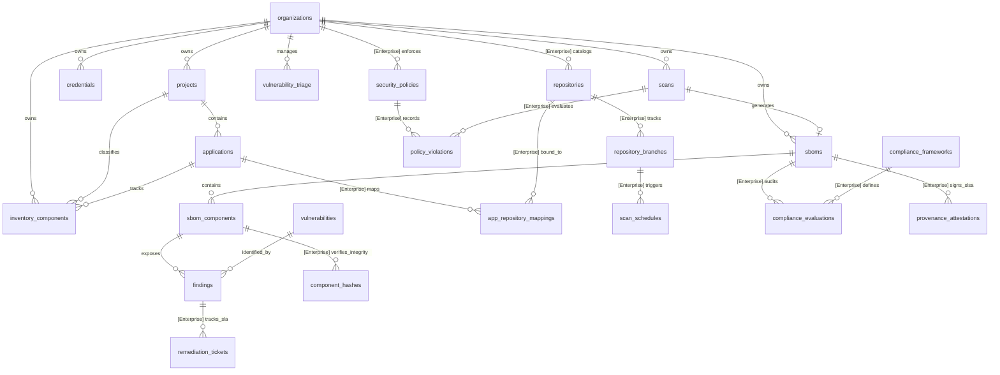
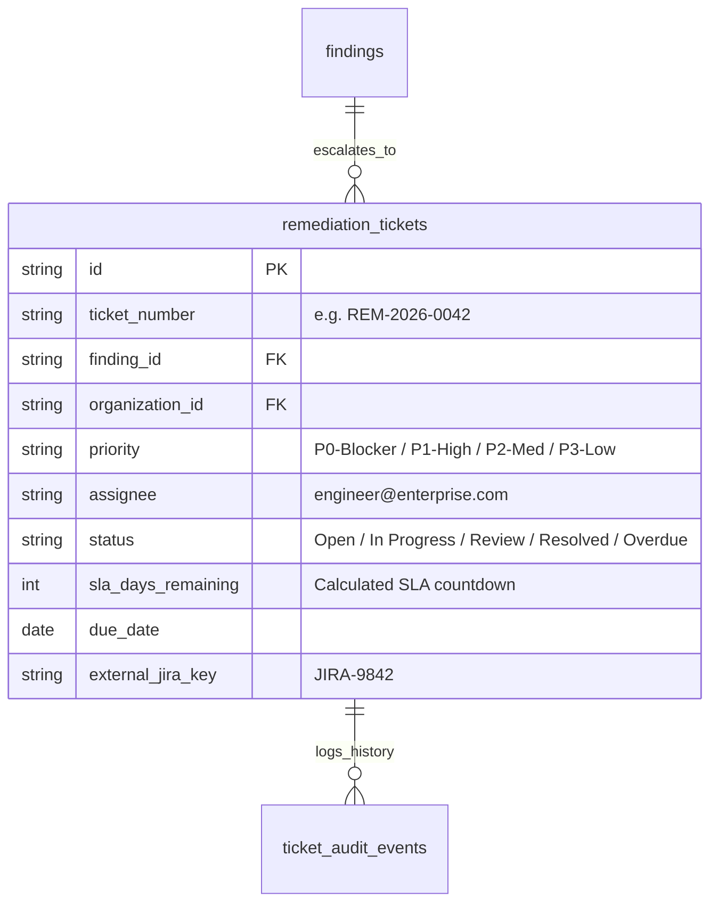
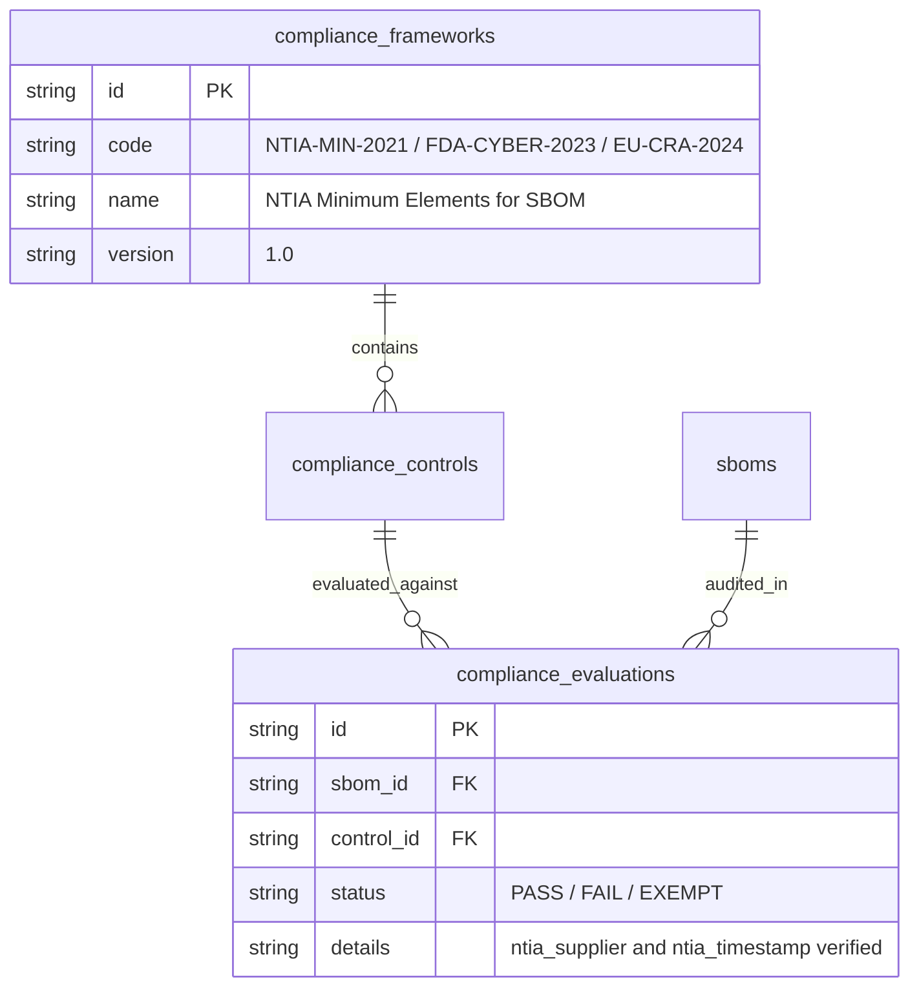
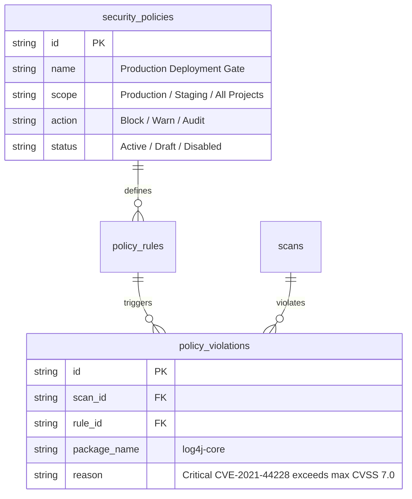
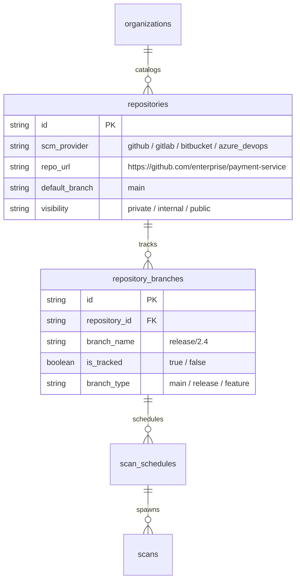
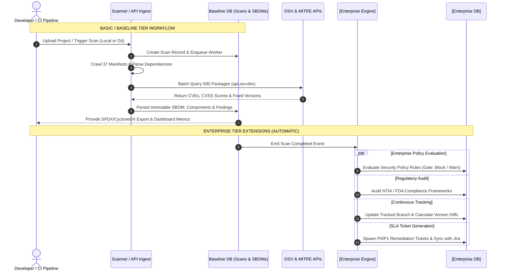

# Software Bill of Materials (SBOM) Platform
## Tiered Database Schema & Subscription Model Architecture

**Document Version:** 2.0  
**Classification:** Technical Architecture & Product Packaging Specification  
**Target Audience:** Product Management, Enterprise Architects, Security Engineering & Sales Engineering  
**File Location:** `docs/SBOM_TIERED_SCHEMA_ARCHITECTURE.md`  

---

## 1. Executive Summary & Subscription Model Overview

This document specifies the database schema architecture for the SBOM platform, clearly dividing the persistence tier into:
1. **Baseline (Basic Tier):** The core foundational schema providing scan orchestration, package manifest parsing, OSV/MITRE vulnerability correlation, multi-format SBOM exports, and GitHub/GitLab integrations.
2. **Enterprise Tier:** Advanced governance extensions providing policy enforcement, regulatory compliance tracking (NTIA/EO 14028/FDA/CRA), remediation ticket management with SLA tracking, supply chain cryptographic provenance, and 24/7 continuous monitoring.

```
┌────────────────────────────────────────────────────────────────────────┐
│                        ENTERPRISE SUBSCRIPTION                         │
│  ┌──────────────────────────────────────────────────────────────────┐  │
│  │                     BASIC / BASELINE TIER                        │  │
│  │ • Executive Dashboard             • Vulnerability Management     │  │
│  │ • Security Scans (Queue/Engine)   • GitHub & GitLab Integrations │  │
│  │ • Multi-format Export Center      • Continuous Inventory Updates │  │
│  │ • Software Package Inventory                                     │  │
│  └──────────────────────────────────────────────────────────────────┘  │
│  • Remediation Tickets (Jira / SLA)  • Security Policy Engine (Block/Warn)│
│  • Regulatory Compliance (NTIA/FDA)  • Supply Chain & SLSA Provenance     │
│  • Continuous Monitoring & Webhooks  • All Integrations (Bitbucket, Azure)│
└────────────────────────────────────────────────────────────────────────┘
```

---

## 2. Subscription Feature Matrix & Data Alignment

| Feature Category | Capability | Basic / Baseline | Enterprise | Primary Database Entities |
|---|---|:---:|:---:|---|
| **Executive Dashboard** | Risk scoring, summary counts, portfolio roll-up | ✅ Included | ✅ Included | `projects`, `applications`, `scans` |
| **Security Scans** | Local folder/zip upload, Git URL scan, job queue | ✅ Included | ✅ Included | `scans`, `sboms` |
| **Export Center** | SPDX 2.3, CycloneDX 1.5, CSV, Excel XLSX | ✅ Included | ✅ Included | `sboms`, `sbom_components` |
| **Software Inventory** | Discovered components, dependency tree, manual inventory | ✅ Included | ✅ Included | `sbom_components`, `inventory_components` |
| **Vulnerability Management** | OSV & MITRE CVE matching, CVSS scores, VEX triage | ✅ Included | ✅ Included | `vulnerabilities`, `findings`, `vulnerability_triage` |
| **SCM Integrations** | GitHub & GitLab repository access via encrypted tokens | ✅ Included | ✅ Included | `credentials` |
| **Continuous Inventory** | Auto-ingest new components into catalog on scan | ✅ Included | ✅ Included | `applications`, `sbom_components` |
| **Remediation Tickets** | SLA tracking, P0-P3 priority, assignee, Jira/ServiceNow sync | ❌ *Not Included* | ✅ **Enterprise** | `remediation_tickets`, `ticket_events` |
| **Regulatory Compliance** | NTIA 7 Elements, EO 14028, FDA, EU CRA, PCI-DSS compliance | ❌ *Not Included* | ✅ **Enterprise** | `compliance_frameworks`, `compliance_evaluations` |
| **Security Policies** | Build gates (`Block`, `Warn`, `Audit`), license & CVE rules | ❌ *Not Included* | ✅ **Enterprise** | `security_policies`, `policy_violations` |
| **Supply Chain & Provenance**| SLSA provenance, Cosign signatures, SHA-512 hashes | ❌ *Not Included* | ✅ **Enterprise** | `component_hashes`, `provenance_attestations` |
| **Continuous Monitoring** | Scheduled cron scans, tracked branches, zero-day CVE alerts | ❌ *Not Included* | ✅ **Enterprise** | `repositories`, `repository_branches`, `scan_schedules` |
| **Enterprise Integrations** | Bitbucket, Azure DevOps, Artifactory, Nexus, Harbor, Jira | ❌ *GitHub/GitLab only* | ✅ **All Integrations** | `enterprise_integrations`, `credentials` |

---

## 3. Tiered Entity-Relationship Architecture Diagram

The diagram below highlights the boundary between **Baseline Entities** (in green) and **Enterprise Extension Entities** (in purple).



---

## 4. Baseline Schema Specification (Basic Tier)

The Baseline Tier consists of the **11 core relational tables** currently active in the database.

```
┌────────────────────────────────────────────────────────────────────────┐
│                        BASELINE CORE TABLES                            │
├──────────────────────────┬─────────────────────────────────────────────┤
│ 1. organizations         │ Multi-tenant isolation root                 │
│ 2. projects              │ Portfolio / business project groupings      │
│ 3. applications          │ Specific microservices and applications     │
│ 4. credentials           │ Encrypted GitHub & GitLab access tokens     │
│ 5. scans                 │ Scan orchestrator, durable queue & logs     │
│ 6. sboms                 │ Certified immutable SBOM snapshot headers   │
│ 7. sbom_components       │ Discovered packages, dependency tree, PURLs │
│ 8. inventory_components  │ Static/spreadsheet software inventory       │
│ 9. vulnerabilities       │ Canonical CVE intelligence & CVSS metrics   │
│ 10. findings             │ Snapshot-to-vulnerability mappings          │
│ 11. vulnerability_triage │ Persistent VEX remediation overrides        │
└──────────────────────────┴─────────────────────────────────────────────┘
```

### Table 1: `organizations` (Baseline)
* **Purpose:** Multi-tenant boundary isolating all catalog, scan, and security data.
* **Key Columns:**
  * `id TEXT PRIMARY KEY`: Tenant identifier (e.g., `'default'`, UUID, or organization slug).
  * `name TEXT NOT NULL`: Display name of the enterprise or department.
  * `created_at TIMESTAMPTZ NOT NULL DEFAULT CURRENT_TIMESTAMP`.

### Table 2: `projects` (Baseline)
* **Purpose:** Logical grouping of related software systems, microservices, or products.
* **Key Columns:**
  * `id TEXT PRIMARY KEY`: Canonical project UUID.
  * `organization_id TEXT NOT NULL`: Foreign key referencing `organizations(id) ON DELETE CASCADE`.
  * `name TEXT NOT NULL`: Project display name (unique per organization).
  * `created_at`, `updated_at TIMESTAMPTZ`.

### Table 3: `applications` (Baseline + Enhanced Fields)
* **Purpose:** Specific applications, build targets, or deployable microservices.
* **Key Columns:**
  * `id TEXT PRIMARY KEY`: Unique application UUID.
  * `project_id TEXT NOT NULL`: Foreign key referencing `projects(id) ON DELETE CASCADE`.
  * `organization_id TEXT NOT NULL`: Foreign key referencing `organizations(id)`.
  * `name TEXT NOT NULL`: Application name (unique per project).
  * `created_at TIMESTAMPTZ NOT NULL`.
  * *(Baseline Enhancements)*: `business_unit TEXT`, `criticality VARCHAR(20) DEFAULT 'TIER_3'`, `technical_owner TEXT`, `business_owner TEXT`.

### Table 4: `credentials` (Baseline - GitHub & GitLab)
* **Purpose:** Securely manages encrypted access tokens for source code cloning.
* **Key Columns:**
  * `id TEXT PRIMARY KEY`: Credential UUID.
  * `organization_id TEXT NOT NULL`: Foreign key referencing `organizations(id)`.
  * `provider TEXT NOT NULL`: `'GITHUB'` or `'GITLAB'`.
  * `credential_type TEXT NOT NULL`: `'PAT'` or `'APP'`.
  * `name TEXT NOT NULL`: User label for the key.
  * `secret_nonce BYTEA`, `secret_ciphertext BYTEA`: AES-256-GCM encrypted secret tokens.
  * `status TEXT NOT NULL DEFAULT 'ACTIVE'`: `'ACTIVE'` or `'REVOKED'`.

### Table 5: `scans` (Baseline)
* **Purpose:** Scan execution engine, durable background worker queue, and execution logs.
* **Key Columns:**
  * `id TEXT PRIMARY KEY`: Scan UUID.
  * `organization_id TEXT NOT NULL`: Foreign key referencing `organizations(id)`.
  * `project_id TEXT NOT NULL`, `application_id TEXT NOT NULL`: Associated catalog targets.
  * `source_type TEXT NOT NULL`: `'LOCAL'` (uploaded files/zips) or `'GIT'` (remote repo).
  * `scan_status TEXT NOT NULL`: `'PENDING'`, `'RUNNING'`, `'COMPLETED'`, `'FAILED'`, `'CANCELLED'`.
  * `scan_stage TEXT NOT NULL`: Real-time stage (`'crawl'`, `'parse'`, `'dedupe'`, `'graph'`, `'enrich'`, `'compliance'`).
  * `repository_url TEXT`, `branch TEXT`: Scanned source location.
  * `description TEXT NOT NULL DEFAULT ''`: Audit description.
  * `job_status TEXT`, `job_payload JSON`, `attempts INT`, `max_attempts INT`: Durable worker state.
  * `events JSONB NOT NULL DEFAULT '[]'::jsonb`: Real-time execution event logs.

### Table 6: `sboms` (Baseline)
* **Purpose:** Certified, immutable SBOM document snapshot header generated by a completed scan.
* **Key Columns:**
  * `id TEXT PRIMARY KEY`: Snapshot UUID.
  * `organization_id TEXT NOT NULL`: Foreign key referencing `organizations(id)`.
  * `scan_id TEXT NOT NULL UNIQUE`: Foreign key referencing `scans(id) ON DELETE CASCADE`.
  * `repository_url TEXT`, `repository_branch TEXT`: Provenance repo and branch.
  * `commit_sha TEXT NOT NULL DEFAULT ''`: Git commit hash.
  * `commit_author TEXT`, `commit_email TEXT`, `commit_message TEXT`: Git author metadata.
  * `scanner_name TEXT NOT NULL`, `scanner_version TEXT NOT NULL`: Engine version.
  * `bom_format_version TEXT NOT NULL DEFAULT '1.5'`: CycloneDX/SPDX compliance level.
  * `raw_metadata TEXT`: Summary JSON (manifests detected, timing, parser logs).
  * `generated_at TIMESTAMPTZ NOT NULL`.

### Table 7: `sbom_components` (Baseline)
* **Purpose:** Individual software packages discovered within a specific SBOM snapshot.
* **Key Columns:**
  * `id TEXT PRIMARY KEY`: Component UUID.
  * `sbom_id TEXT NOT NULL`: Foreign key referencing `sboms(id) ON DELETE CASCADE`.
  * `name TEXT NOT NULL`: Package name (e.g., `'axios'`, `'spring-core'`).
  * `version TEXT NOT NULL`: Exact resolved version (e.g., `'1.7.7'`).
  * `ecosystem TEXT NOT NULL`: Ecosystem (`'npm'`, `'pypi'`, `'maven'`, `'go'`, `'cargo'`, `'nuget'`, etc.).
  * `package_manager TEXT`: Build tool (`'npm'`, `'pip'`, `'poetry'`, `'maven'`, `'gradle'`).
  * `package_url TEXT NOT NULL`: Standardized Package URL (PURL).
  * `license_name TEXT NOT NULL DEFAULT ''`: Normalized SPDX license identifier.
  * `is_direct_dependency BOOLEAN NOT NULL DEFAULT FALSE`: `TRUE` for direct, `FALSE` for transitive.
  * `dependency_depth INT DEFAULT 0`: Depth in dependency graph (`0` = root dependency).
  * `depends_on TEXT[] NOT NULL DEFAULT '{}'`: Array of child component IDs.
  * `source_manifest TEXT NOT NULL DEFAULT ''`: Relative manifest file path (`'package-lock.json'`).
  * `supplier_name TEXT NOT NULL DEFAULT ''`: Author/publisher.

### Table 8: `inventory_components` (Baseline)
* **Purpose:** Manually registered components or spreadsheet uploads in the Software Inventory.
* **Key Columns:**
  * `id TEXT PRIMARY KEY`: UUID.
  * `organization_id`, `project_id`, `application_id`: Foreign keys.
  * `name TEXT NOT NULL`, `version TEXT NOT NULL`, `package_url TEXT`.
  * `component_type TEXT DEFAULT 'Library'`, `risk_level TEXT`, `vulnerability_count INT`.

### Table 9: `vulnerabilities` (Baseline)
* **Purpose:** Canonical database of global CVE security advisories from OSV and MITRE.
* **Key Columns:**
  * `id TEXT PRIMARY KEY`: UUID.
  * `vulnerability_key TEXT NOT NULL UNIQUE`: Canonical CVE or advisory ID (e.g., `'CVE-2023-45133'`).
  * `source TEXT NOT NULL`: `'osv'` or `'mitre'`.
  * `severity TEXT NOT NULL CHECK (severity IN ('CRITICAL', 'HIGH', 'MEDIUM', 'LOW', 'UNKNOWN'))`.
  * `cvss_score NUMERIC(4,1)`, `cvss_vector TEXT`.
  * `description TEXT NOT NULL DEFAULT ''`.
  * `reference_urls TEXT[] NOT NULL DEFAULT '{}'`.

### Table 10: `findings` (Baseline)
* **Purpose:** Component-level vulnerability findings binding `sbom_components` to `vulnerabilities`.
* **Key Columns:**
  * `id TEXT PRIMARY KEY`: UUID.
  * `sbom_id TEXT NOT NULL`: Foreign key referencing `sboms(id) ON DELETE CASCADE`.
  * `sbom_component_id TEXT NOT NULL`: Foreign key referencing `sbom_components(id) ON DELETE CASCADE`.
  * `vulnerability_id TEXT NOT NULL`: Foreign key referencing `vulnerabilities(id) ON DELETE RESTRICT`.
  * `severity TEXT NOT NULL`, `cvss_score NUMERIC(4,1)`, `fixed_version TEXT`.
  * `status TEXT NOT NULL DEFAULT 'Open'`: Finding lifecycle state.
  * `vex_status TEXT NOT NULL DEFAULT 'affected'`: VEX status (`'not_affected'`, `'affected'`, `'fixed'`).

### Table 11: `vulnerability_triage` (Baseline)
* **Purpose:** Persistent VEX justifications and override statuses that survive rescans and new snapshots.
* **Key Columns:**
  * `id TEXT PRIMARY KEY`: UUID.
  * `organization_id TEXT NOT NULL`, `vulnerability_key TEXT NOT NULL`.
  * `project_name TEXT NOT NULL DEFAULT ''`, `application_name TEXT NOT NULL DEFAULT ''`.
  * `status TEXT NOT NULL`, `vex_status TEXT NOT NULL`, `justification TEXT`, `owner TEXT`.
  * `UNIQUE (organization_id, vulnerability_key, project_name, application_name)`.

---

## 5. Enterprise Schema Extensions (Enterprise Tier)

The Enterprise Tier builds on top of the Baseline schema by adding **7 dedicated capability modules**:

```
┌────────────────────────────────────────────────────────────────────────┐
│                      ENTERPRISE EXTENSION TABLES                       │
├──────────────────────────┬─────────────────────────────────────────────┤
│ 1. remediation_tickets   │ SLA-driven vulnerability remediation tasks  │
│ 2. compliance_frameworks │ Regulatory frameworks (NTIA, FDA, CRA, etc.)│
│ 3. compliance_evaluations│ Per-snapshot regulatory control pass/fails  │
│ 4. security_policies     │ Automated CI/CD gate rules (Block/Warn)     │
│ 5. policy_violations     │ Audit logs of triggered policy violations   │
│ 6. repositories          │ Centralized SCM asset catalog               │
│ 7. repository_branches   │ Tracked branches for 24/7 continuous scans  │
│ 8. scan_schedules        │ Automated cron schedules & webhook triggers │
│ 9. provenance_attestations│ Cryptographic signatures (Cosign) & SLSA    │
└──────────────────────────┴─────────────────────────────────────────────┘
```

---

### Module A: Remediation Tickets & SLA Management (Enterprise)

Tracks actionable vulnerability remediation workflows with SLA countdowns and Jira/ServiceNow synchronization.



* **Table: `remediation_tickets`**
  * `id TEXT PRIMARY KEY`: Ticket UUID.
  * `ticket_number TEXT NOT NULL UNIQUE`: Human-readable identifier (`'REM-2026-0042'`).
  * `finding_id TEXT NOT NULL`: Foreign key referencing `findings(id) ON DELETE CASCADE`.
  * `priority TEXT NOT NULL CHECK (priority IN ('P0_BLOCKER', 'P1_HIGH', 'P2_MEDIUM', 'P3_LOW'))`.
  * `assignee TEXT NOT NULL`: Assigned engineer email or team.
  * `status TEXT NOT NULL DEFAULT 'OPEN' CHECK (status IN ('OPEN', 'IN_PROGRESS', 'REVIEW', 'RESOLVED', 'OVERDUE'))`.
  * `sla_days_total INT NOT NULL`: Target SLA window (e.g., P0 = 7 days, P1 = 30 days, P2 = 60 days).
  * `due_date TIMESTAMPTZ NOT NULL`: Enforced SLA expiration timestamp.
  * `external_system TEXT`: `'JIRA'`, `'SERVICENOW'`, or `'GITHUB_ISSUES'`.
  * `external_issue_key TEXT`: Remote ticket key for bidirectional status synchronization.

---

### Module B: Regulatory Compliance & Certification (Enterprise)

Evaluates snapshots against official government and industrial standards (NTIA Minimum Elements, Executive Order 14028, FDA Premarket Cyber, EU CRA, and PCI-DSS 4.0).



* **Table: `compliance_frameworks`**
  * `id TEXT PRIMARY KEY`, `code TEXT NOT NULL UNIQUE`, `name TEXT NOT NULL`, `version TEXT NOT NULL`.
  * Active Pre-seeded Frameworks:
    * `NTIA_MIN_ELEMENTS`: US NTIA 7 Minimum Elements for SBOM.
    * `US_EO_14028`: Executive Order on Improving the Nation's Cybersecurity.
    * `FDA_PREMARKET_524B`: FDA Medical Device Software Cybersecurity Requirements.
    * `EU_CRA`: European Union Cyber Resilience Act.
    * `PCI_DSS_V4`: PCI-DSS Requirement 6.3.2 Software Component Inventory.
* **Table: `compliance_evaluations`**
  * `id TEXT PRIMARY KEY`.
  * `sbom_id TEXT NOT NULL`: Foreign key referencing `sboms(id) ON DELETE CASCADE`.
  * `framework_id TEXT NOT NULL`: Foreign key referencing `compliance_frameworks(id)`.
  * `compliance_score NUMERIC(5,2) NOT NULL`: Percentage score (0.00% to 100.00%).
  * `status TEXT NOT NULL CHECK (status IN ('COMPLIANT', 'NEEDS_REVIEW', 'NON_COMPLIANT', 'EXEMPT'))`.
  * `mandatory_fields_coverage NUMERIC(5,2) NOT NULL`.
  * `evaluated_at TIMESTAMPTZ NOT NULL DEFAULT CURRENT_TIMESTAMP`.

---

### Module C: Security Policies & CI/CD Gates (Enterprise)

Enforces corporate security baselines at build time, with configurable actions (`BLOCK`, `WARN`, `AUDIT`).



* **Table: `security_policies`**
  * `id TEXT PRIMARY KEY`, `organization_id TEXT NOT NULL`.
  * `name TEXT NOT NULL`: Policy label (e.g., `'Production Zero-Critical Gate'`).
  * `scope TEXT NOT NULL CHECK (scope IN ('ALL_PROJECTS', 'PRODUCTION', 'STAGING', 'CUSTOM'))`.
  * `action TEXT NOT NULL CHECK (action IN ('BLOCK', 'WARN', 'AUDIT'))`: CI/CD outcome.
  * `status TEXT NOT NULL DEFAULT 'ACTIVE' CHECK (status IN ('ACTIVE', 'DRAFT', 'DISABLED'))`.
* **Table: `policy_rules`**
  * `id TEXT PRIMARY KEY`, `policy_id TEXT NOT NULL`.
  * `rule_type TEXT NOT NULL`: `'MAX_CVSS'`, `'FORBIDDEN_LICENSE'`, `'DISALLOW_UNRESOLVED'`, `'REQUIRE_PURL'`.
  * `rule_condition JSONB NOT NULL`: e.g., `{"max_score": 7.0, "blocked_licenses": ["GPL-3.0-only"]}`.
* **Table: `policy_violations`**
  * `id TEXT PRIMARY KEY`, `scan_id TEXT NOT NULL`, `rule_id TEXT NOT NULL`.
  * `component_name TEXT NOT NULL`, `severity TEXT NOT NULL`, `reason TEXT NOT NULL`.

---

### Module D: Supply Chain Integrity & Cryptographic Provenance (Enterprise)

Guarantees tamper-evidence and supply-chain attestations using Cosign, Sigstore, and SLSA standards.

* **Table: `provenance_attestations`**
  * `id TEXT PRIMARY KEY`.
  * `sbom_id TEXT NOT NULL UNIQUE`: Foreign key referencing `sboms(id) ON DELETE CASCADE`.
  * `slsa_level TEXT NOT NULL CHECK (slsa_level IN ('SLSA_L1', 'SLSA_L2', 'SLSA_L3'))`.
  * `signature_format TEXT NOT NULL`: `'COSIGN'`, `'X509_PKI'`, `'PGP'`.
  * `signature_payload TEXT NOT NULL`: Base64 cryptographic signature.
  * `signing_certificate TEXT`: Public cert / Sigstore Fulcio leaf certificate.
  * `verification_status TEXT NOT NULL CHECK (verification_status IN ('VERIFIED', 'FAILED', 'UNSIGNED'))`.
  * `signed_at TIMESTAMPTZ NOT NULL`.

---

### Module E: Continuous Monitoring & Asset Inventory (Enterprise)

Transforms on-demand scans into an automated 24/7 background security sentry.



* **Table: `repositories`**
  * `id TEXT PRIMARY KEY`, `organization_id TEXT NOT NULL`.
  * `scm_provider TEXT NOT NULL`: `'GITHUB'`, `'GITLAB'`, `'BITBUCKET'`, `'AZURE_DEVOPS'`.
  * `name TEXT NOT NULL`, `url TEXT NOT NULL UNIQUE`, `default_branch TEXT NOT NULL DEFAULT 'main'`.
  * `visibility TEXT NOT NULL CHECK (visibility IN ('PRIVATE', 'INTERNAL', 'PUBLIC'))`.
* **Table: `repository_branches`**
  * `id TEXT PRIMARY KEY`, `repository_id TEXT NOT NULL`.
  * `branch_name TEXT NOT NULL`, `branch_type TEXT NOT NULL CHECK (branch_type IN ('MAIN', 'RELEASE', 'FEATURE'))`.
  * `is_tracked BOOLEAN NOT NULL DEFAULT FALSE`: Continuous monitoring toggle.
* **Table: `scan_schedules`**
  * `id TEXT PRIMARY KEY`, `branch_id TEXT NOT NULL`.
  * `cron_expression TEXT NOT NULL DEFAULT '0 2 * * *'`: e.g., Daily at 2:00 AM UTC.
  * `is_enabled BOOLEAN NOT NULL DEFAULT TRUE`, `last_run_at TIMESTAMPTZ`, `next_run_at TIMESTAMPTZ`.

---

## 6. End-to-End Tiered Data Flow



---

## 7. Migration & Upgrade Path: Baseline to Enterprise

Because the persistence tier has been designed modularly:
1. **Zero Downtime Upgrade:** Upgrading an installation from Basic to Enterprise does **not** alter or reload existing `scans`, `sboms`, or `sbom_components` records.
2. **Additive Schema Migrations:** Enterprise features are added via non-destructive SQL migrations creating the new extension tables (`remediation_tickets`, `security_policies`, etc.).
3. **Retroactive Compliance & Triage:** Existing Baseline scan snapshots can be retroactively evaluated against enterprise regulatory frameworks (NTIA 7 elements) without re-running scans.
