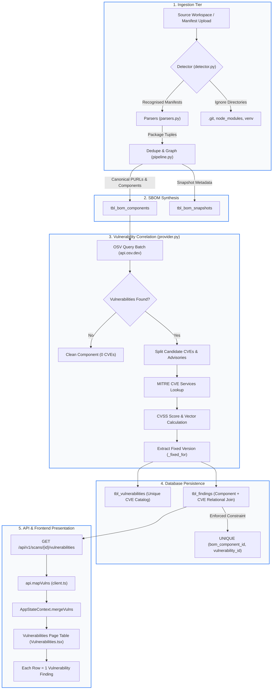

# SBOM Dependency Extraction, Component Identification, and Vulnerability Detection Workflow

This technical specification details the complete end-to-end data flow of the S-BOM application: from source file ingestion and manifest parsing, to SBOM component generation, vulnerability database correlation (OSV/MITRE), database persistence, API transmission, and frontend presentation.

---

## Table of Contents

1. [Executive Architectural Overview](#1-executive-architectural-overview)
2. [Source Input and Dependency Extraction Workflow](#2-source-input-and-dependency-extraction-workflow)
3. [SBOM Component Generation and Deduplication](#3-sbom-component-generation-and-deduplication)
4. [Vulnerability Database Integration (OSV & MITRE)](#4-vulnerability-database-integration-osv--mitre)
5. [Vulnerability Matching and Version Comparison Logic](#5-vulnerability-matching-and-version-comparison-logic)
6. [Database Models, Schema Constraints, and Relational Storage](#6-database-models-schema-constraints-and-relational-storage)
7. [API Request & Response Data Flow](#7-api-request--response-data-flow)
8. [Frontend State Management & Vulnerability Table Rendering](#8-frontend-state-management--vulnerability-table-rendering)
9. [Unique Components vs. Vulnerability Findings (Core Concepts)](#9-unique-components-vs-vulnerability-findings-core-concepts)
10. [Why One Dependency Has Multiple CVEs](#10-why-one-dependency-has-multiple-cves)
11. [Legitimate Multiple Findings vs. Duplicate Records](#11-legitimate-multiple-findings-vs-duplicate-records)
12. [Fixed-Version Selection and Branch-Handling Analysis](#12-fixed-version-selection-and-branch-handling-analysis)
13. [Rescan Behaviour and Duplicate Generation](#13-rescan-behaviour-and-duplicate-generation)
14. [Identified Bottlenecks and Potential Improvements](#14-identified-bottlenecks-and-potential-improvements)
15. [Complete End-to-End Workflow Diagram](#15-complete-end-to-end-workflow-diagram)

---

## 1. Executive Architectural Overview

The application is structured into three primary tiers:

```
┌─────────────────────────────────────────────────────────────┐
│                    Frontend Presentation                    │
│   React 18 SPA + Vite + TailwindCSS (Port 5173 / Proxy)     │
│   Pages: SecurityScans, Vulnerabilities, SoftwareInventory  │
│   State: AppStateContext (In-Memory Client Aggregator)      │
└──────────────────────────────▲──────────────────────────────┘
                               │ HTTP / JSON API (/api/v1/...)
┌──────────────────────────────▼──────────────────────────────┐
│                    Backend REST Engine                      │
│   FastAPI (Python 3.11+, Port 8080)                         │
│   Endpoints: /api/v1/scans, /vulnerabilities/triage, etc.   │
│   Scanner Pipeline: Detector, Parsers, Dedupe, Graph        │
│   Vulnerability Engine: VulnProvider (OSV Batch + MITRE)    │
└──────────────────────────────▲──────────────────────────────┘
                               │ SQL Queries & Connection Pool
┌──────────────────────────────▼──────────────────────────────┐
│                    Database Persistence                     │
│   PostgreSQL (Port 5432, Database: local-SBOM)              │
│   Relational Schema: Scans, Snapshots, Components,          │
│   Vulnerabilities, Findings, Packages, Triage Overrides     │
└─────────────────────────────────────────────────────────────┘
```

The system ingests source code or manifest files, discovers software dependencies, structures them into an internal Software Bill of Materials (SBOM) model conforming to CycloneDX 1.5 / SPDX 2.3 principles, correlates them against global vulnerability databases, and surfaces security findings to engineering and security teams.

---

## 2. Source Input and Dependency Extraction Workflow

### A. Source Ingestion Methods
Source files enter the pipeline through three routes in [`backend/app/api/server.py`](file:///c:/Users/Dell/Desktop/SBOM/backend/app/api/server.py):

1. **Local File / Archive Upload (`POST /api/v1/scans/local`)**:
   - The user uploads a single manifest file (e.g., `requirements.txt`), a zip/tar archive of a workspace, or an entire directory of files.
   - For folder uploads, [`frontend/src/api/client.ts`](file:///c:/Users/Dell/Desktop/SBOM/frontend/src/api/client.ts) (`createLocalScan`) packs the non-empty files into a `multipart/form-data` payload preserving relative file paths.
   - The backend unpacks the payload to an ephemeral directory via [`backend/app/sources/workspace.py`](file:///c:/Users/Dell/Desktop/SBOM/backend/app/sources/workspace.py) (`pack_folder` / `materialize_workspace`).
2. **Remote Git Repository (`POST /api/v1/scans/github`)**:
   - The user provides a Git repository URL, branch, and optional access token.
   - The repository is cloned shallowly (`--depth 1`) into a secure temporary workspace.
3. **Bulk Scan Batch (`POST /api/v1/scans/bulk`)**:
   - A CSV or JSON template containing multiple projects and repository URLs is processed sequentially by worker threads.

### B. Manifest Detection
Once the workspace directory is prepared, the engine calls `detect(root)` in [`backend/app/scanner/detector.py`](file:///c:/Users/Dell/Desktop/SBOM/backend/app/scanner/detector.py):

- **Directory Traversal**: The detector recursively walks the workspace directory up to a depth of 30 levels.
- **Ignore Rules**: It skips non-manifest, build, and version-control directories:
  - System directories: `.git`, `.svn`, `__pycache__`, `dist`, `build`, `bin`, `obj`, etc.
  - Installed dependencies (unless `scan_installed=True`): `node_modules`, `venv`, `.venv`, `vendor`.
- **Manifest Signatures (`BY_FILENAME`)**: Files are matched against known ecosystem manifests:
  - **JavaScript / Node**: `package.json`, `package-lock.json`, `yarn.lock`, `pnpm-lock.yaml`, `bun.lock`
  - **Python**: `requirements.txt`, `Pipfile`, `Pipfile.lock`, `poetry.lock`, `pyproject.toml`, `uv.lock`, `pdm.lock`
  - **Java / JVM**: `pom.xml`, `build.gradle`, `gradle.lockfile`
  - **Go**: `go.mod`, `go.sum`
  - **Rust**: `Cargo.toml`, `Cargo.lock`
  - **.NET**: `packages.config`, `packages.lock.json`, `*.csproj`
  - **PHP**: `composer.json`, `composer.lock`
  - **Ruby**: `Gemfile`, `Gemfile.lock`
  - **Dart / Flutter**: `pubspec.yaml`, `pubspec.lock`
  - **Others**: Swift (`Package.resolved`), C/C++ (`conan.lock`), Elixir (`mix.lock`), R (`DESCRIPTION`), Haskell (`cabal.project`).

### C. Parsing and Extraction
Each detected file is dispatched to [`backend/app/scanner/parsers.py`](file:///c:/Users/Dell/Desktop/SBOM/backend/app/scanner/parsers.py) via `parse_manifest(kind, path, rel)`:

- **Ecosystem Parsing**:
  - Python `requirements.txt`: Evaluates PEP 508 dependency specifications, stripping version constraint operators (`==`, `>=`, `~=`) using regex.
  - Node `package.json` vs `package-lock.json`: `package.json` reads declared dependencies (`dependencies`, `devDependencies`); `package-lock.json` traverses the resolved dependency tree (`packages` and `dependencies` blocks), extracting exact resolved versions and cryptographic integrity hashes (SHA-512 / SHA-1).
  - Maven `pom.xml`: Parses XML namespaces, resolves `<groupId>`, `<artifactId>`, and `<version>`.
- **Component Tuple Creation**: Every dependency is parsed into a standardized component dictionary:
  ```python
  {
      "id": str(uuid.uuid4()),
      "name": package_name,
      "version": version_string,
      "ecosystem": ecosystem_name,       # "pypi", "npm", "maven", "go", etc.
      "package_manager": package_manager, # "pip", "npm", "maven", etc.
      "purl": canonical_purl_string,     # e.g., "pkg:pypi/django@3.0.5"
      "direct": is_direct_flag,          # True if top-level, False if transitive
      "source_manifest": relative_path,  # e.g., "backend/requirements.txt"
      "license": license_string,
      "hash": content_hash,
  }
  ```

---

## 3. SBOM Component Generation and Deduplication

When multiple manifests exist within a repository (e.g., both `package.json` and `package-lock.json`, or root requirements and nested microservice requirements), duplicate dependency declarations occur.

The application executes deduplication in [`backend/app/scanner/pipeline.py`](file:///c:/Users/Dell/Desktop/SBOM/backend/app/scanner/pipeline.py) (`dedupe`):

```python
def dedupe(comps: list[dict], deps: list[dict]) -> tuple[list[dict], list[dict]]:
    seen: dict[tuple[str, str, str], int] = {}
    out: list[dict] = []
    for comp in comps:
        # Deduplication Key: (name, version, ecosystem)
        key = (comp.get("name", "").lower(), comp.get("version", ""), str(comp.get("ecosystem", "")).lower())
        if key in seen:
            merge_component(out[seen[key]], comp)
            continue
        seen[key] = len(out)
        out.append(comp)
    out, dropped = _prefer_resolved_version(out)
    return out, deps
```

### Key Principles of Component Identity:
1. **Intra-Scan Deduplication**: If `django 3.0.5` is declared in `requirements.txt` and also referenced in another manifest with the same version, `merge_component()` merges them into **one component record**, preserving `direct=True` if either was direct.
2. **Version Resolution Preference (`_prefer_resolved_version`)**: If `package.json` declared `express: ^4.18.2` (a range) and `package-lock.json` declared `express: 4.18.2` (exact lockfile version), the system drops the loose range component in favour of the locked component.
3. **Different Versions Are Different Components**: If `service-a` uses `urllib3 1.26.5` and `service-b` uses `urllib3 2.0.0`, they produce **two distinct component records** in the SBOM snapshot because their version strings differ.

---

## 4. Vulnerability Database Integration (OSV & MITRE)

The application implements a dedicated vulnerability provider in [`backend/app/vulnerabilities/provider.py`](file:///c:/Users/Dell/Desktop/SBOM/backend/app/vulnerabilities/provider.py) (`VulnProvider`).

```
┌────────────────────────────────────────────────────────┐
│               VulnProvider (provider.py)               │
└───────────────────────────┬────────────────────────────┘
                            │
            ┌───────────────┴───────────────┐
            ▼                               ▼
┌───────────────────────────────┐ ┌───────────────────────────────┐
│     OSV.dev REST API          │ │     MITRE CVE Services API    │
│  https://api.osv.dev/v1/      │ │  https://cveawg.mitre.org/    │
│  Batch Query: /querybatch     │ │  /api/cve/{cve_id}            │
│  Advisory: /vulns/{id}        │ └───────────────────────────────┘
└───────────────────────────────┘
```

### The Data Sources:
1. **OSV (Open Source Vulnerabilities - Google / OpenSSF)**:
   - Primary package vulnerability database aggregating GitHub Security Advisories (GHSA), PyPA/PyPI advisories, RustSec, Go Vulnerability Database, Debian, and Alpine security trackers.
   - Queried in batches of up to 500 packages per HTTP request via `POST https://api.osv.dev/v1/querybatch`.
2. **MITRE CVE Services API**:
   - Authoritative source for official CVE records (`CVE-YYYY-NNNNN`), descriptions, CWE IDs, and CNA metrics.
   - Queried concurrently (with a thread pool of 8 workers) to enrich candidate CVEs identified via OSV.

---

## 5. Vulnerability Matching and Version Comparison Logic

This is the central detection mechanism. The matching proceeds through four precise stages:

### Step 1: Target Normalization (`_targets`)
In [`provider.py`](file:///c:/Users/Dell/Desktop/SBOM/backend/app/vulnerabilities/provider.py):
The engine maps the component's internal ecosystem name to the OSV ecosystem vocabulary:
- `pypi` $\rightarrow$ `PyPI`
- `npm` $\rightarrow$ `npm`
- `maven` $\rightarrow$ `Maven`
- `cargo` $\rightarrow$ `crates.io`
- `go` $\rightarrow$ `Go`

The version constraint is stripped of manifest qualifiers via `query_version()` (e.g., `^3.0.5` becomes `3.0.5`).

### Step 2: Batch Lookup on OSV (`_query_batch`)
The engine sends:
```json
{
  "queries": [
    {
      "package": {
        "name": "django",
        "ecosystem": "PyPI"
      },
      "version": "3.0.5"
    }
  ]
}
```
OSV performs the version comparison against its database of affected ranges (using SemVer or ecosystem version schemes). It returns all vulnerabilities where `3.0.5` falls between `events.introduced` and `events.fixed`.

### Step 3: Candidate Disaggregation (`_correlate_mitre` / `_correlate_osv`)
A single package query to OSV often matches **multiple security advisories**. Furthermore, each advisory may list multiple alias IDs (e.g., `GHSA-wpjr-j57x-wjc5` and `CVE-2020-13254`).

The application splits these identifiers (`_split_ids`) so each distinct `CVE-YYYY-NNNN` becomes an independent candidate finding:
```python
key = component_id + "|" + cand["cve"]
if key not in seen:
    seen.add(key)
    out.append(cand)
```

### Step 4: Metric Enrichment & Severity Classification
For each matched CVE:
- The base CVSS score (v3.1, v3.0, or v2.0) is extracted from MITRE container metrics or OSV CVSS vector strings.
- If CVSS vector strings exist, [`backend/app/vulnerabilities/cvss.py`](file:///c:/Users/Dell/Desktop/SBOM/backend/app/vulnerabilities/cvss.py) calculates the numeric base score ($0.0 - 10.0$).
- Severity tiers are strictly assigned based on industry CVSS thresholds:
  - **Critical**: CVSS $9.0 - 10.0$
  - **High**: CVSS $7.0 - 8.9$
  - **Medium**: CVSS $4.0 - 6.9$
  - **Low**: CVSS $0.1 - 3.9$

---

## 6. Database Models, Schema Constraints, and Relational Storage

The relational schema in PostgreSQL strictly distinguishes between a **Component** and a **Vulnerability Finding**.

```
┌─────────────────────────────────┐
│        tbl_scan_runs            │
│  id, project_id, application_id │
└────────────────▲────────────────┘
                 │ 1-to-1
┌────────────────┴────────────────┐
│       tbl_bom_snapshots         │
│  id, scanner_name, generated_at │
└────────────────▲────────────────┘
                 │ 1-to-many
┌────────────────┴────────────────┐       1-to-many       ┌────────────────────────┐
│       tbl_bom_components        │◄──────────────────────┤      tbl_findings      │
│  id, component_name, version    │                       │  id, bom_snapshot_id,  │
│  package_url, ecosystem         │                       │  bom_component_id,     │
└─────────────────────────────────┘                       │  vulnerability_id,     │
                                                          │  severity, cvss_score, │
┌─────────────────────────────────┐                       │  fixed_version         │
│      tbl_vulnerabilities        │◄──────────────────────┤                        │
│  id, vulnerability_key (CVE)    │       1-to-many       │  UNIQUE constraint:    │
│  severity, cvss_score, desc     │                       │  (bom_component_id,    │
└─────────────────────────────────┘                       │   vulnerability_id)    │
                                                          └────────────────────────┘
```

### Database Tables Breakdown:

1. **`tbl_bom_components`** ([`001_initial.up.sql`](file:///c:/Users/Dell/Desktop/SBOM/backend/migrations/001_initial.up.sql)):
   - Stores the unique software package installed in a specific scan snapshot.
   - Primary Key: `id` (UUID).
   - Columns: `component_name`, `component_version`, `ecosystem`, `package_url`, `is_direct_dependency`.
   - **Constraint**: `UNIQUE (id, bom_snapshot_id)`.

2. **`tbl_vulnerabilities`** ([`005_relational_facts.up.sql`](file:///c:/Users/Dell/Desktop/SBOM/backend/migrations/005_relational_facts.up.sql)):
   - Global catalog of unique security flaws.
   - Primary Key: `id`.
   - Columns: `vulnerability_key` (e.g., `CVE-2020-13254`), `severity`, `cvss_score`, `cvss_vector`, `description`.
   - **Constraint**: `UNIQUE (vulnerability_key)`. Each CVE is stored **exactly once** in this catalog.

3. **`tbl_findings`** ([`005_relational_facts.up.sql`](file:///c:/Users/Dell/Desktop/SBOM/backend/migrations/005_relational_facts.up.sql)):
   - The relational join table connecting a component in a snapshot to a CVE flaw.
   - Foreign Keys:
     - `bom_component_id` $\rightarrow$ `tbl_bom_components(id)`
     - `vulnerability_id` $\rightarrow$ `tbl_vulnerabilities(id)`
     - `bom_snapshot_id` $\rightarrow$ `tbl_bom_snapshots(id)`
   - Columns: `severity`, `cvss_score`, `fixed_version`.
   - **Enforced Database Constraint**:
     ```sql
     UNIQUE (bom_component_id, vulnerability_id)
     ```
     **This database constraint guarantees that within a single scan snapshot, a component can never have duplicate rows for the exact same CVE ID.**

4. **`vulnerability_triage`** ([`007_vulnerability_triage.up.sql`](file:///c:/Users/Dell/Desktop/SBOM/backend/migrations/007_vulnerability_triage.up.sql)):
   - Stores human triage decisions (Open, In Progress, Closed, False Positive) across scans.
   - **Constraint**: `UNIQUE (organization_id, vulnerability_key, project_name, application_name)`.

---

## 7. API Request & Response Data Flow

When a scan finishes, the frontend retrieves findings via REST:

1. **Scan Vulnerabilities Endpoint (`GET /api/v1/scans/{scan_id}/vulnerabilities`)**:
   - The handler in [`server.py`](file:///c:/Users/Dell/Desktop/SBOM/backend/app/api/server.py) retrieves `snap["raw_metadata"]["vulnerability_matches"]`.
   - Returns a JSON array of raw finding objects:
     ```json
     [
       {
         "component_id": "c4b8e21a-...",
         "vulnerability_id": "CVE-2020-13254",
         "source": "mitre",
         "severity": "HIGH",
         "cvss_score": 7.5,
         "cvss_vector": "CVSS:3.1/AV:N/AC:L/PR:N/UI:N/S:U/C:N/I:H/A:N",
         "description": "A flaw was found in Django...",
         "fixed_version": "2.2.13"
       },
       {
         "component_id": "c4b8e21a-...",
         "vulnerability_id": "CVE-2020-13596",
         "source": "mitre",
         "severity": "MEDIUM",
         "cvss_score": 6.5,
         "cvss_vector": "CVSS:3.1/AV:N/AC:L/PR:N/UI:R/S:U/C:N/I:H/A:N",
         "description": "An issue was discovered in Django...",
         "fixed_version": "2.2.13"
       }
     ]
     ```

2. **Frontend Client Normalization (`api.mapVulns`)**:
   - In [`frontend/src/api/client.ts`](file:///c:/Users/Dell/Desktop/SBOM/frontend/src/api/client.ts), `mapVulns()` joins the raw matches with the component metadata (`byId.get(m.component_id)`) to produce frontend `Vulnerability` objects:
     ```typescript
     {
       id: `${m.vulnerability_id}-${i}`,
       cve: m.vulnerability_id,
       name: cleanName,
       package: comp?.name || m.component_id, // "Django"
       version: comp?.version || '',          // "3.0.5"
       project: project,
       application: application,
       scanId: scanId,
       cvss: m.cvss_score || 0,
       severity: titleSeverity(m.severity),
       fixVersion: m.fixed_version,
       status: 'Open'
     }
     ```

---

## 8. Frontend State Management & Vulnerability Table Rendering

In the frontend, vulnerabilities are managed centrally inside [`frontend/src/context/AppStateContext.tsx`](file:///c:/Users/Dell/Desktop/SBOM/frontend/src/context/AppStateContext.tsx):

### State Aggregation:
When a scan is loaded or executed (`loadScanResults`):
```typescript
setVulnerabilities(prev => mergeVulns(prev, mappedVulns));
```

The merge function dedupes incoming vulnerabilities using `vulnKey(v)`:
```typescript
function vulnKey(vuln: Vulnerability): string {
  return `${vuln.scanId || ''}|${(vuln.project || '').toLowerCase()}|${(vuln.application || '').toLowerCase()}|${vuln.cve.toUpperCase()}|${vuln.package.toLowerCase()}|${vuln.version}`;
}
```

### Table Rendering:
In [`frontend/src/pages/vulnerabilities/Vulnerabilities.tsx`](file:///c:/Users/Dell/Desktop/SBOM/frontend/src/pages/vulnerabilities/Vulnerabilities.tsx):
- The page reads `vulnerabilities` from `AppStateContext`.
- Filters by project, severity, and search query.
- Renders `paginatedVulnerabilities.map(v => <tr key={v.id}>...</tr>)`.
- **Each row represents one Vulnerability Finding (`Vulnerability`), NOT a unique component.**

---

## 9. Unique Components vs. Vulnerability Findings (Core Concepts)

A major source of confusion is treating the Vulnerability Management table as an inventory catalog. They represent two fundamentally different data models:

```
┌────────────────────────────────────────────────────────┐
│                   Software Inventory                   │
│       Entity: One Unique Installed Software Package    │
├────────────────────────────────────────────────────────┤
│  Component Name │ Version │ Ecosystem │ License        │
│  Django         │ 3.0.5   │ pypi      │ BSD-3-Clause   │
│  Flask          │ 1.0.2   │ pypi      │ BSD-3-Clause   │
│  SQLAlchemy     │ 1.3.0   │ pypi      │ MIT            │
└────────────────────────────────────────────────────────┘
                            │
              Has 1-to-Many Relationship
                            │
                            ▼
┌────────────────────────────────────────────────────────┐
│                Vulnerability Management                │
│       Entity: One Security Finding (Flaw on Package)   │
├────────────────────────────────────────────────────────┤
│  CVE ID         │ Component │ Version │ Severity │ Fix │
│  CVE-2020-13254 │ Django    │ 3.0.5   │ HIGH     │ 3.0.7│
│  CVE-2020-13596 │ Django    │ 3.0.5   │ MEDIUM   │ 3.0.7│
│  CVE-2020-24583 │ Django    │ 3.0.5   │ HIGH     │ 3.0.7│
│  CVE-2020-24584 │ Django    │ 3.0.5   │ MEDIUM   │ 3.0.7│
│  CVE-2021-28658 │ Django    │ 3.0.5   │ HIGH     │ 3.0.7│
└────────────────────────────────────────────────────────┘
```

- **Software Inventory Component**: Represents the asset (*"What code do we ship?"*). There is exactly 1 row per unique `(package_name, version, ecosystem)`.
- **Vulnerability Finding**: Represents an exposure (*"What security flaws exist in that asset?"*). A single component can contain 0, 1, or 50 distinct CVEs.

---

## 10. Why One Dependency Has Multiple CVEs

A software package such as `Django 3.0.5` consists of tens of thousands of lines of code handling HTTP requests, cookie parsing, SQL query generation, file uploads, cache backends, and HTML template rendering.

Multiple CVEs for the same version exist because:
1. **Different Flaws**: One CVE might be an open-redirect vulnerability in the auth view, another might be a cache key collision DoS, and a third might be a directory traversal in file uploads.
2. **Different Discovery Dates**: Security researchers uncover vulnerabilities over months and years. Each flaw is submitted to MITRE/NVD and assigned its own independent CVE ID.
3. **Different Impact**: Each flaw has different attack complexities, privileges required, and CVSS scores.

**Conclusion:** Having multiple rows for `Django 3.0.5` where each row has a **different CVE ID** is **100% correct and expected security behaviour**.

---

## 11. Legitimate Multiple Findings vs. Duplicate Records

To distinguish correct behavior from bugs:

### ✅ Legitimate Multiple Rows
- **Condition**: Same Component + Same Version + **Different CVE IDs**.
  - Example: `Django 3.0.5` with `CVE-2020-13254` (CVSS 7.5) and `CVE-2020-13596` (CVSS 6.5).
  - Verdict: **Legitimate**. These are separate vulnerabilities requiring separate tracking and triage.
- **Condition**: Same CVE ID + **Different Projects or Applications**.
  - Example: Service A and Service B both use `Django 3.0.5`.
  - Verdict: **Legitimate**. Each microservice team must patch their respective service.

### ❌ Illegitimate Duplicate Rows
- **Condition**: Same Component + Same Version + **Identical CVE ID** in the **same project and scan**.
  - Example:
    - Row 1: `Django 3.0.5` — `CVE-2020-13254`
    - Row 2: `Django 3.0.5` — `CVE-2020-13254`
  - Verdict: **Duplicate Defect**.

---

## 12. Fixed-Version Selection and Branch-Handling Analysis

The user asked:
> *"Why can the same package and version have different fixed versions (e.g., 2.2.13, 2.2.16, 2.2.20) for Django 3.0.5?"*

### Root Cause in Codebase:
Look at [`backend/app/vulnerabilities/provider.py`](file:///c:/Users/Dell/Desktop/SBOM/backend/app/vulnerabilities/provider.py), lines 448–466:

```python
def _fixed_for(adv: dict, name: str) -> str:
    fallback = ""
    for affected in adv.get("affected") or []:
        fixed = ""
        for rng in affected.get("ranges") or []:
            for event in rng.get("events") or []:
                if event.get("fixed"):
                    val = str(event["fixed"]).strip()
                    if val and val not in {"*", "None", "unknown"}:
                        fixed = val
        if not fixed:
            continue
        pkg = ((affected.get("package") or {}).get("name") or "")
        if pkg.lower() == name.lower():
            return fixed
        if not fallback:
            fallback = fixed
    return fallback
```

### Why This Produces Confusing Fixed Versions:
1. When a security advisory affects multiple release streams (e.g. Django 2.2 LTS, 3.0, and 3.1), OSV provides multiple ranges in the advisory:
   - Branch 2.2: affected `< 2.2.13`, fixed in `2.2.13`
   - Branch 3.0: affected `< 3.0.7`, fixed in `3.0.7`
   - Branch 3.1: affected `< 3.1b1`, fixed in `3.1b1`
2. **The Flaw**: `_fixed_for()` iterates over the ranges and returns the **first range where `pkg == name`** without checking the installed component's version!
3. If the advisory listed the 2.2 LTS branch first, `_fixed_for` picks `2.2.13` as the fix version for a user running `Django 3.0.5`.
4. Furthermore, different CVEs for Django 3.0.5 had different advisories ordered differently in OSV, leading to:
   - CVE-A showing fixed version `2.2.13`
   - CVE-B showing fixed version `2.2.16`
   - CVE-C showing fixed version `3.0.7`
5. **Impact**: An engineer on `3.0.5` is told to "upgrade" to `2.2.13` (a downgrade).

---

## 13. Rescan Behaviour and Duplicate Generation

The user asked:
> *"Why does the exact same CVE and component sometimes appear more than once?"*

### Root Cause in Codebase:
Look at [`frontend/src/context/AppStateContext.tsx`](file:///c:/Users/Dell/Desktop/SBOM/frontend/src/context/AppStateContext.tsx), line 40:

```typescript
function vulnKey(vuln: Vulnerability): string {
  return `${vuln.scanId || ''}|${(vuln.project || '').toLowerCase()}|${(vuln.application || '').toLowerCase()}|${vuln.cve.toUpperCase()}|${vuln.package.toLowerCase()}|${vuln.version}`;
}

function mergeVulns(current: Vulnerability[], incoming: Vulnerability[]): Vulnerability[] {
  const map = new Map<string, Vulnerability>();
  for (const v of current) {
    map.set(vulnKey(v), v);
  }
  for (const v of incoming) {
    map.set(vulnKey(v), v);
  }
  return Array.from(map.values());
}
```

### The Mechanism:
1. In the database, `tbl_findings` has `UNIQUE (bom_component_id, vulnerability_id)`. Within a single scan run, the database prevents duplicate CVE rows.
2. **However**, each time a user clicks **"Run Security Scan"** or **"Rescan"**, a brand new scan is created with a new `scanId` (e.g. `scan-001` and `scan-002`).
3. In the frontend global state (`AppStateContext`), both scans load into the `vulnerabilities` array.
4. Because `vulnKey` includes `${vuln.scanId}`, `scan-001|...|django|3.0.5` and `scan-002|...|django|3.0.5` produce **two different keys** in `mergeVulns`.
5. When the user navigates to `/vulnerabilities` with **All Projects** or without filtering by a specific scan, the table displays the finding from Scan 1 and the exact duplicate from Scan 2.

---

## 14. Identified Bottlenecks and Potential Improvements

| Area | Current Implementation | Proposed Enhancement |
|:---|:---|:---|
| **Branch-Aware Fixed Versions** | `_fixed_for()` in `provider.py` returns the first fixed version string found in the advisory. | Compare the installed version (`3.0.5`) with the advisory range bounds so that a 3.0.x install only selects a fix in the 3.0.x or next major branch (e.g. `3.0.7`). |
| **Rescan Finding Deduplication** | `AppStateContext.tsx` uses `vulnKey` containing `scanId`, keeping old scan findings in memory. | Deduplicate findings across scans by scoping the global view to the latest scan per project, or updating the key to `(project, application, cve, package, version)`. |
| **Direct CVE Deep-Link Fetch** | `VulnerabilityDetail.tsx` only searches client context; if not in memory, shows 404 card. | Query a dedicated backend endpoint `GET /api/v1/vulnerabilities/{cve_id}` so direct bookmarked URLs load instantly. |
| **Triage State Persistence** | Finding triage updates are held in frontend React state. | Synchronize status changes directly with `PATCH /api/v1/vulnerabilities/{cve_id}/status` and table `vulnerability_triage`. |

---

## 15. Complete End-to-End Workflow Diagram



