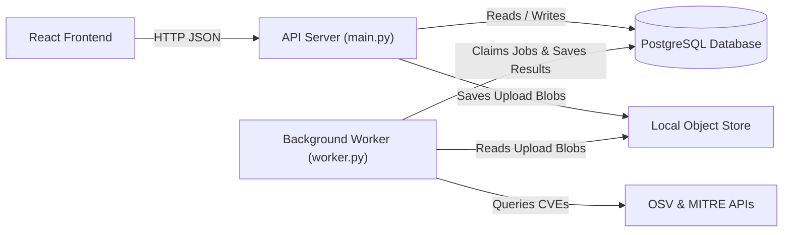

# Backend Architecture & Code Review Guide

This guide explains **every Python file** in `backend/app/`, **what logic each file holds**, **how the major flows connect end-to-end**, and **whether each flow is working properly**. It is structured so you can walk through the backend confidently in a code review from top to bottom.

---

## 1. The Big Picture (How the Backend Runs)

The backend runs as **two separate Python processes** that talk through a shared **PostgreSQL database** and a local **object storage folder** (`data/objects/`):

1. **Web API Server (`backend/app/main.py`)**
   - Handles all HTTP requests from the React frontend (dashboard data, scan uploads, vulnerability updates, exports).
   - Responds immediately. When a user starts a scan, the API saves the uploaded file, writes a `PENDING` job into the database queue, and returns `202 Accepted` right away so the browser never freezes.
2. **Background Worker (`backend/app/worker.py`)**
   - Polls the database queue every few milliseconds using multiple worker threads.
   - Picks up `PENDING` scan jobs, extracts files, parses manifests (`package.json`, `requirements.txt`, `pom.xml`, etc.), looks up CVEs from OSV/MITRE, calculates compliance, and saves the results back into PostgreSQL.

---

## 2. File-by-File Guide (`backend/app/`)

### A. Entry Points & App Startup

| File | What Logic It Holds |
|---|---|
| [`backend/app/main.py`](file:///c:/Users/Dell/Desktop/SBOM/backend/app/main.py) | **API Server Entry Point.** Loads `.env` settings (`load()`), builds the FastAPI app (`create_app()`), and starts `uvicorn` on the configured host/port. |
| [`backend/app/worker.py`](file:///c:/Users/Dell/Desktop/SBOM/backend/app/worker.py) | **Background Worker Entry Point.** Starts `cfg.scanner_workers` background threads. Each thread checks database health (`ensure_alive`), claims the next queued job (`queue.claim`), runs the scan pipeline (`orch.execute`), and marks the job completed, failed, or cancelled. |
| [`backend/app/api/server.py`](file:///c:/Users/Dell/Desktop/SBOM/backend/app/api/server.py) | **App Factory & Dependency Wiring.** Contains `build()`, which connects to PostgreSQL, runs schema migrations (`migrate`), initializes all repositories and services, attaches them to `app.state`, configures CORS and `X-Request-ID` middleware, registers `v1_router`, and sets up global error handling. |
| [`backend/app/api/common.py`](file:///c:/Users/Dell/Desktop/SBOM/backend/app/api/common.py) | **Shared HTTP Helpers.** Formats every API response into the standard envelope (`{"success": true, "data": ..., "request_id": ...}`), builds error responses, extracts the tenant header (`X-Organization-Id`, defaulting to `"default"`), checks scan ownership, and verifies GitHub webhook HMAC signatures. |
| [`backend/app/api/v1/router.py`](file:///c:/Users/Dell/Desktop/SBOM/backend/app/api/v1/router.py) | **Master API Router.** Combines all 10 domain endpoint files into one `v1_router` mounted onto the FastAPI app. |

---

### B. API Endpoints (`backend/app/api/v1/endpoints/`)

Each file here is intentionally thin: it reads the HTTP request, delegates work to a service or repository, and returns the JSON envelope.

| File | Endpoints & Logic |
|---|---|
| [`health.py`](file:///c:/Users/Dell/Desktop/SBOM/backend/app/api/v1/endpoints/health.py) | `GET /health/live`, `GET /health/ready`, `GET /metrics.json`. Checks if the process is alive, if PostgreSQL is reachable (`SELECT 1`), and exposes scan/queue counters. |
| [`scans.py`](file:///c:/Users/Dell/Desktop/SBOM/backend/app/api/v1/endpoints/scans.py) | Single-scan lifecycle: `POST /api/v1/scans/preflight-check` (SHA-256 duplicate check), `POST /api/v1/scans/local` (file/zip upload), `POST /api/v1/scans/github` (repo URL + branch), `GET /api/v1/scans`, `GET /api/v1/scans/{id}/status`, `/events`, `/components`, `/vulnerabilities`, `POST .../rescan`, and `POST .../cancel`. |
| [`bulk_scans.py`](file:///c:/Users/Dell/Desktop/SBOM/backend/app/api/v1/endpoints/bulk_scans.py) | Batch scanning via Excel/CSV: `POST /api/v1/scans/bulk` (parses spreadsheet rows and queues child scans), `GET /api/v1/bulk-scans`, `GET /api/v1/bulk-scans/{id}`, `POST .../cancel`. |
| [`boms.py`](file:///c:/Users/Dell/Desktop/SBOM/backend/app/api/v1/endpoints/boms.py) | SBOM snapshots & exports: `GET /api/v1/boms/{id}`, `GET /api/v1/applications/{name}/boms`, and `GET /api/v1/boms/{id}/export?format=cyclonedx-json\|spdx-json\|csv\|xlsx`. |
| [`inventory.py`](file:///c:/Users/Dell/Desktop/SBOM/backend/app/api/v1/endpoints/inventory.py) | Manual Software Inventory & package tracking: `GET /api/v1/inventory/components`, `POST /api/v1/inventory/components`, `DELETE /api/v1/inventory/components/{id}`, `GET /api/v1/inventory/audit-log`, `GET /api/v1/packages/{name}/history`, and `GET /api/v1/packages/{name}/occurrences`. |
| [`vulnerabilities.py`](file:///c:/Users/Dell/Desktop/SBOM/backend/app/api/v1/endpoints/vulnerabilities.py) | Vulnerability management: `GET /api/v1/scans/{id}/vulnerabilities`, `GET /api/v1/vulnerabilities/triage`, and `PATCH /api/v1/vulnerabilities/{cve}/status` (Open / In Progress / Resolved + VEX status + justification). |
| [`applications.py`](file:///c:/Users/Dell/Desktop/SBOM/backend/app/api/v1/endpoints/applications.py) | Projects & Applications dashboard: `GET /api/v1/projects` (aggregated KPIs and project risk rows) and `PATCH /api/v1/applications/{target}/lifecycle-status` (`Active` vs `Decommissioned`). |
| [`catalog.py`](file:///c:/Users/Dell/Desktop/SBOM/backend/app/api/v1/endpoints/catalog.py) | Dropdown catalog management: `GET/POST /api/v1/catalog/projects` and `GET/POST /api/v1/catalog/projects/{id}/applications-services` (powers the Application & Module searchable dropdowns). |
| [`credentials.py`](file:///c:/Users/Dell/Desktop/SBOM/backend/app/api/v1/endpoints/credentials.py) | GitHub token management: `POST /api/v1/credentials/github`, `GET /api/v1/credentials/github/status`, and `DELETE /api/v1/credentials/github`. Tokens are encrypted before saving and never returned in plaintext. |
| [`webhooks.py`](file:///c:/Users/Dell/Desktop/SBOM/backend/app/api/v1/endpoints/webhooks.py) | `POST /api/v1/github/webhooks`. Verifies GitHub's `X-Hub-Signature-256` HMAC header and triggers scans when code is pushed. |

---

### C. Business Logic Services (`backend/app/services/`)

Services hold the business rules so endpoints don't have to deal with validation details or multi-step logic.

| File | What Logic It Holds |
|---|---|
| [`scan_service.py`](file:///c:/Users/Dell/Desktop/SBOM/backend/app/services/scan_service.py) | **Scan Preparation & Duplicate Detection.** Sanitizes uploaded filenames (`safe_upload_name`), validates non-empty uploads, checks SHA-256 hashes against previous scans (`preflight_check`), binds Application/Module IDs via `CatalogRepo`, and normalizes manual inventory items (`bind_inventory_item`). |
| [`bulk_scan_service.py`](file:///c:/Users/Dell/Desktop/SBOM/backend/app/services/bulk_scan_service.py) | **Bulk Spreadsheet Orchestration.** Validates each parsed Excel/CSV row (`row_problems`), creates the parent `bulk_scans` batch record, inserts `bulk_scan_items`, and spawns individual `PENDING` child scan jobs for valid rows. |
| [`vulnerability_service.py`](file:///c:/Users/Dell/Desktop/SBOM/backend/app/services/vulnerability_service.py) | **Triage Rules & Audit Logging.** Validates status transitions (for example, closing an `Open` CVE requires a non-empty justification), saves the triage override, syncs `findings` rows, and records a `VULN_STATUS_CHANGE` entry in the audit log. |
| [`inventory_service.py`](file:///c:/Users/Dell/Desktop/SBOM/backend/app/services/inventory_service.py) | **Package Timeline & Occurrences.** Builds the chronological version history for a package across scans and manual inventory edits (`get_package_history`) and finds every application/module/location where a package is used (`get_package_occurrences`). |

---

### D. Database & Data Access (`backend/app/repositories/`, `core/db.py`, `catalog/`, `projects/`)

| File | What Logic It Holds |
|---|---|
| [`core/db.py`](file:///c:/Users/Dell/Desktop/SBOM/backend/app/core/db.py) | **Database Connection & Migrations.** Connects to PostgreSQL via `psycopg`, wraps queries with a thread lock (`threading.RLock()`), translates `?` placeholders to `%s`, auto-reconnects on dropped connections, and runs SQL migration files (`backend/migrations/*.up.sql`) on startup. |
| [`repositories/store.py`](file:///c:/Users/Dell/Desktop/SBOM/backend/app/repositories/store.py) | **Core Repositories (`ScanRepo`, `JobQueue`, `BomRepo`).** Handles CRUD for `scans`, claims jobs atomically with `SELECT ... FOR UPDATE SKIP LOCKED` (so two worker threads never grab the same scan), saves SBOM snapshots (`sboms`, `sbom_components`, `sbom_dependencies`), manages `inventory_components`, and computes batched project stats (`get_snapshots_stats_batch`). |
| [`repositories/facts.py`](file:///c:/Users/Dell/Desktop/SBOM/backend/app/repositories/facts.py) | **Relational Facts & Findings Persistence.** Normalizes SBOM components with NTIA compliance flags, batches first-detection date lookups, upserts CVE records into `vulnerabilities` and `findings`, and overlays live triage statuses onto snapshots (`overlay_snapshot_facts`). |
| [`repositories/triage_repo.py`](file:///c:/Users/Dell/Desktop/SBOM/backend/app/repositories/triage_repo.py) | **Triage & Audit Log Queries.** Reads/writes `vulnerability_triage`, updates `findings` across matching project IDs/names, and records/lists `inventory_change_log` with `LEFT JOIN` name resolution. |
| [`catalog/store.py`](file:///c:/Users/Dell/Desktop/SBOM/backend/app/catalog/store.py) | **Catalog Repository (`CatalogRepo`).** Manages `organizations`, `applications`, and `modules`. Ensures tenant isolation and prevents mismatched Application/Module pairs. |
| [`projects/dashboard.py`](file:///c:/Users/Dell/Desktop/SBOM/backend/app/projects/dashboard.py) | **Projects Aggregation.** Groups scans by application/module, loads application governance metadata, fetches batched snapshot stats, and calculates risk (`High Risk`, `Needs Attention`, `Healthy`) and compliance percentages. |

---

### E. Scanning, Vulnerability Matching & Export Engines

| File | What Logic It Holds |
|---|---|
| [`scans/orchestrator.py`](file:///c:/Users/Dell/Desktop/SBOM/backend/app/scans/orchestrator.py) | **Scan Pipeline Conductor.** Runs the 4 stages of a scan (`SOURCE_FETCH` → `SBOM_PARSE` → `VULN_LOOKUP` → `PERSIST`), checks for user cancellation between stages, triggers auto-closure of fixed CVEs when a new scan resolves an old vulnerability, and logs `scan_events`. |
| [`scanner/detector.py`](file:///c:/Users/Dell/Desktop/SBOM/backend/app/scanner/detector.py) | **Manifest File Detector.** Walks a project folder safely and identifies supported dependency files (`package.json`, `package-lock.json`, `requirements.txt`, `pyproject.toml`, `pom.xml`, `build.gradle`, `go.mod`, `Cargo.toml`, `Gemfile.lock`, `composer.lock`, CycloneDX/SPDX JSON, etc.) while skipping `node_modules` and `.git`. |
| [`scanner/parsers.py`](file:///c:/Users/Dell/Desktop/SBOM/backend/app/scanner/parsers.py) | **Static Manifest Parsers.** Reads manifest files strictly as text (never executes code) and extracts package names, versions, ecosystems, licenses, and dependency relationships. |
| [`scanner/pipeline.py`](file:///c:/Users/Dell/Desktop/SBOM/backend/app/scanner/pipeline.py) | **SBOM Builder & NTIA Checker.** Deduplicates parsed components, builds PURLs, checks the 7 NTIA minimum fields (Supplier, Name, Version, Identifier, Relationship, Author, Timestamp), and computes a compliance pass/fail flag per component. |
| [`vulnerabilities/provider.py`](file:///c:/Users/Dell/Desktop/SBOM/backend/app/vulnerabilities/provider.py) | **CVE Lookup Engine.** Queries OSV (`api.osv.dev`) and MITRE (`cveawg.mitre.org`) in parallel using `ThreadPoolExecutor`, extracts severity/CVSS/fixed versions, and matches affected version ranges. |
| [`vulnerabilities/cvss.py`](file:///c:/Users/Dell/Desktop/SBOM/backend/app/vulnerabilities/cvss.py) | **CVSS Calculator.** Computes exact CVSS v3.1/v3.0 base scores from vector strings and maps numeric scores to `Critical`, `High`, `Medium`, `Low`. |
| [`export/formats.py`](file:///c:/Users/Dell/Desktop/SBOM/backend/app/export/formats.py) | **SBOM & Report Exporters.** Converts a snapshot into CycloneDX 1.5 JSON, SPDX 2.3 JSON, CSV, or multi-sheet XLSX files. |

---

### F. Security, Storage & Core Utilities

| File | What Logic It Holds |
|---|---|
| [`security/archives.py`](file:///c:/Users/Dell/Desktop/SBOM/backend/app/security/archives.py) | **Security Guards.** Protects against Zip-Slip (path traversal), Zip Bombs (max file count and max uncompressed size), and SSRF (blocks GitHub fetches to private/local IP addresses). |
| [`sources/workspace.py`](file:///c:/Users/Dell/Desktop/SBOM/backend/app/sources/workspace.py) | **Source Workspace Prep.** Extracts uploaded `.zip`/`.tar.gz` files into temporary workspaces, downloads GitHub repo tarballs securely using stored tokens, and parses bulk Excel/CSV templates. |
| [`storage/object_store.py`](file:///c:/Users/Dell/Desktop/SBOM/backend/app/storage/object_store.py) | **Local Object Store.** Saves and retrieves uploaded source archives on disk under `data/objects/`. |
| [`credentials/service.py`](file:///c:/Users/Dell/Desktop/SBOM/backend/app/credentials/service.py) | **Credential Encryption.** Encrypts/decrypts GitHub PAT tokens using AES-256-GCM (`CREDENTIAL_KEK`) and records credential audit events. |
| [`core/config.py`](file:///c:/Users/Dell/Desktop/SBOM/backend/app/core/config.py) | **Configuration Loader.** Reads `.env` and environment variables (`DATABASE_URL`, `CREDENTIAL_KEK`, `VULN_PROVIDER`, worker count, timeout limits). |
| [`core/metrics.py`](file:///c:/Users/Dell/Desktop/SBOM/backend/app/core/metrics.py) | **Metrics Counter.** Thread-safe in-memory counters for `/metrics.json`. |
| [`core/validation.py`](file:///c:/Users/Dell/Desktop/SBOM/backend/app/core/validation.py) | **SBOM & PURL Validators.** Validates CycloneDX/SPDX document schemas and official `pkg:...` Package URL syntax (including scoped `@npm/pkg`). |
| [`core/inventory_derived.py`](file:///c:/Users/Dell/Desktop/SBOM/backend/app/core/inventory_derived.py) | **Derived Inventory Logic.** Computes base PURLs, classifies packages (`Internal` / `External` / `Vendor`), and calculates package diffs (`Added`, `Upgraded`, `Removed`) between consecutive scans. |

---

## 3. How the Flows Connect (End-to-End)

### Flow 1: Launching & Completing a Security Scan
1. **Frontend → Pre-flight Check:** `POST /api/v1/scans/preflight-check` (`scans.py` → `scan_service.py`) hashes the file (SHA-256) to check if the same file was already scanned.
2. **Submission:** `POST /api/v1/scans/local` or `/github` (`scans.py`) validates inputs, binds the Application & Module via `CatalogRepo`, saves the file blob in `LocalStore`, and calls `Orchestrator.create_scan()`.
3. **Queueing:** `ScanRepo.create_scan()` writes a `PENDING` row in `scans`, and `JobQueue.enqueue()` creates a job in `job_queue`. API returns `202 Accepted`.
4. **Worker Pickup:** `worker.py` claims the job via `JobQueue.claim()` (`FOR UPDATE SKIP LOCKED`) and runs `Orchestrator.execute()`.
5. **Pipeline Execution:**
   - `workspace.py` + `archives.py` safely unpack the archive or download the GitHub tarball.
   - `detector.py` + `parsers.py` + `pipeline.py` parse all manifests, build the dependency graph, and check NTIA compliance.
   - `provider.py` + `cvss.py` query OSV/MITRE for CVEs matching those packages and versions.
   - `BomRepo.save_snapshot()` + `facts.py` store the SBOM, components, vulnerabilities, and findings in PostgreSQL.
   - `Orchestrator._auto_close_remediated_vulnerabilities()` checks if any previously open CVEs disappeared in this new scan and automatically marks them `Resolved`.
6. **Frontend Live Polling:** The UI polls `GET /api/v1/scans/{id}/status` and `/events` until `COMPLETED`, then loads `/components` and `/vulnerabilities`.

### Flow 2: Manual Software Inventory Addition & Audit Trail
1. **API Call:** User submits `AddInventoryComponent` → `POST /api/v1/inventory/components` (`inventory.py`).
2. **Binding & Storage:** `scan_service.bind_inventory_item()` ensures the Application and Module exist in `applications`/`modules`. `BomRepo.add_inventory_components()` inserts the row into `inventory_components`.
3. **Audit Logging:** `triage_repo.record_audit_log()` writes an `ADD` record into `inventory_change_log` with the user's mandatory justification reason.
4. **Viewing History:** `GET /api/v1/inventory/audit-log` joins `applications` and `modules` so the UI displays human-readable names.

### Flow 3: Vulnerability Triage (`Open` → `Resolved`)
1. **API Call:** User updates status in UI → `PATCH /api/v1/vulnerabilities/{cve}/status` (`vulnerabilities.py`).
2. **Validation:** `vulnerability_service.py` enforces that moving from `Open` to `Resolved`/`Closed` requires a non-empty justification.
3. **Persistence:** `triage_repo.upsert_triage()` updates `vulnerability_triage`, `update_findings_for_triage()` updates matching `findings` rows (matching by project name, lowercase name, or catalog UUID), and `record_audit_log()` logs `VULN_STATUS_CHANGE`.

### Flow 4: Projects & Microservices Dashboard
1. **API Call:** `GET /api/v1/projects` (`applications.py` → `projects/dashboard.py`).
2. **Aggregation:** Loads scans (`ScanRepo.list_scans`), groups them by Application + Module, loads governance metadata from `applications`, fetches all latest snapshot stats in **2 batched SQL queries** (`BomRepo.get_snapshots_stats_batch`), and computes summary KPIs and risk levels.

---

## 4. Flow Status Check (Is Everything Working Properly?)

| Flow | Status | Verification & Notes |
|---|---|---|
| **Single Scan (Local & GitHub)** | **Working Properly** | Verified end-to-end in `test_local_scan.py`, `test_single_manifest.py`, and `test_json_and_export.py`. Safe against Zip-Slip, Zip Bombs, and SSRF. |
| **Bulk Scan (Excel/CSV)** | **Working Properly** | Verified in `test_bulk_rows.py`. Rejects empty/malformed spreadsheets cleanly and skips duplicate rows while processing valid ones. |
| **Catalog Binding (App & Module)** | **Working Properly** | Verified in `test_catalog.py`. Prevents stale/cross-tenant Application-Module mismatches. |
| **Software Inventory & Audit Log** | **Working Properly** | Verified in `test_inventory.py` and `test_inventory_schema_and_derived.py`. All inputs enforced, audit trail persisted, human-readable names resolved via SQL joins. |
| **Vulnerability Triage & Auto-Closure** | **Working Properly** | Verified in `test_vulnerability_status.py` and `test_relational_facts.py`. Status overrides persist and re-scans auto-close fixed CVEs. |
| **Projects Dashboard** | **Working Properly** | Verified in `test_projects.py`. Optimized in Phase 5 from `6N` queries down to 2 batched queries. |
| **Exports (SPDX, CycloneDX, CSV, XLSX)** | **Working Properly** | Verified in `test_json_and_export.py`. |

### Two Things Worth Mentioning If Reviewers Ask
1. **Database Connection Model (`core/db.py`):** Currently uses one shared `psycopg` connection guarded by a `threading.RLock()` with automatic reconnect on connection drops. It is rock-solid for current scale and passes all 73 tests, though under very high concurrent user traffic in production, swapping to `psycopg_pool` would allow parallel DB queries.
2. **UI-Only Modules:** The Compliance, Policies, Monitoring, Integrations, Scan Schedules, and Users pages in the frontend are UI-only / `localStorage`-backed right now—there are no backend API routes for them yet.
