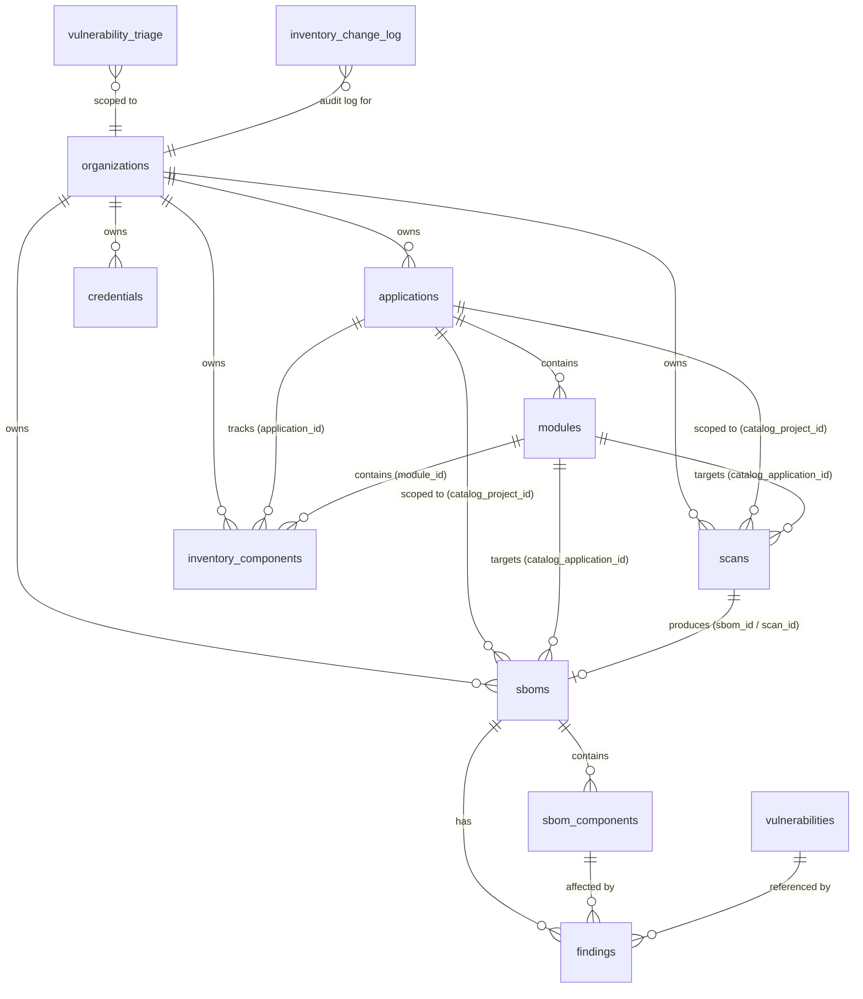

# SBOM Platform – Database Data Dictionary & Schema Specification

> **Database:** PostgreSQL (`S-BOM`)  
> **Schema Migration Baseline:** `001_initial.up.sql` through `010_baseline_improvements.up.sql`  
> **Target Audience:** Backend Engineers, Security Analysts, and Database Administrators  

---

## 1. Executive Summary & Architecture Overview

The SBOM Platform database models organizations, software applications, sub-modules (microservices/libraries), automated security scans, generated Software Bill of Materials (SPDX 2.3 & CycloneDX 1.5 snapshots), components (dependencies), known vulnerabilities (CVE/GHSA/OSV), triage determinations (VEX), manual software inventory, and tamper-evident audit logs.

### Key Architectural Conventions & Quirks
1. **Primary Keys:** Almost all primary keys are `TEXT` fields populated with `gen_random_uuid()::text` (UUIDv4 as string), preserving portability between PostgreSQL and application layers without requiring binary UUID conversions.
2. **Naming Evolution (Migration 009 & 010):**
   - The table originally created as `projects` was renamed to **`applications`** in migration 009.
   - The table originally created as `applications` was renamed to **`modules`** in migration 009.
   - A backward-compatible view named **`projects`** exists over `applications` for read compatibility.
3. **Legacy Column Mappings in `scans` and `sboms` (Crucial for Developers):**
   - `scans.project_id` and `sboms.project_id`: **Stores the Application Name** (text, e.g. `"WorkforceEdge"`). It is NOT an application UUID.
   - `scans.catalog_project_id` and `sboms.catalog_project_id`: **Stores the actual Application UUID** (`applications.id`).
   - `scans.application_id` and `sboms.application_id`: **Stores the Module Name** (text, e.g. `"core-api"`). It is NOT a module UUID.
   - `scans.catalog_application_id` and `sboms.catalog_application_id`: **Stores the actual Module UUID** (`modules.id`).
4. **Human-Readable Application IDs:**
   - Applications carry a trigger-generated human-readable ID (`APP-0001`, `APP-0002`, etc.) via trigger function `generate_next_readable_app_id()`.

---

## 2. Complete Entity-Relationship Diagram (ERD)



---

## 3. Table Catalog & Data Dictionaries

### 3.1 `organizations`
Tenant/organization root record. All applications, scans, and inventory belong to an organization (defaults to `'default'`).

| Column | Type | Nullable | Default | Constraints & Keys | Description |
|---|---|---|---|---|---|
| `id` | `text` | No | None | `PRIMARY KEY (organizations_pkey)` | Unique tenant identifier (e.g. `'default'`) |
| `name` | `text` | No | None | | Display name of the organization |
| `created_at` | `timestamptz` | No | `CURRENT_TIMESTAMP` | | Timestamp when the tenant was registered |

---

### 3.2 `applications` (Formerly `projects`)
Top-level software products or platforms tracked in the SBOM catalog.

| Column | Type | Nullable | Default | Constraints & Keys | Description |
|---|---|---|---|---|---|
| `id` | `text` | No | `gen_random_uuid()::text` | `PRIMARY KEY (projects_pkey)` | Application UUID string |
| `organization_id` | `text` | No | None | `FOREIGN KEY` → `organizations(id)` | Parent organization |
| `name` | `text` | No | None | `UNIQUE (organization_id, name)` | Unique application name within tenant |
| `readable_id` | `text` | Yes | None | `UNIQUE (organization_id, readable_id)` | Human-readable ID (e.g. `APP-0001`) generated by trigger |
| `business_owner` | `text` | Yes | `NULL` | | Business owner/team accountable for this application |
| `technical_owner`| `text` | Yes | `NULL` | | Technical lead or engineering team responsible |
| `development_type`| `text`| Yes | `'In-house'` | `CHECK (In-house, Outsourced, Vendor)` | Classification of development model |
| `vendor_name` | `text` | Yes | `NULL` | | Vendor or 3rd-party vendor name if outsourced |
| `lifecycle_status`| `text`| Yes | `'Active'` | `CHECK (Active, Inactive, Deprecated, Archived, Planned, Decommissioned)` | Current lifecycle state |
| `created_at` | `timestamptz` | No | `CURRENT_TIMESTAMP` | | Record creation timestamp |
| `updated_at` | `timestamptz` | No | `CURRENT_TIMESTAMP` | | Last update timestamp |

**Indexes & Triggers:**
- `idx_projects_organization`: `(organization_id)`
- `idx_applications_name`: `(name)`
- `idx_applications_readable_id`: `(readable_id)`
- Trigger: `trg_applications_readable_id` BEFORE INSERT executes `generate_next_readable_app_id()`.

---

### 3.3 `modules` (Formerly `applications`)
Specific components, services, microservices, or repositories constituting an application.

| Column | Type | Nullable | Default | Constraints & Keys | Description |
|---|---|---|---|---|---|
| `id` | `text` | No | `gen_random_uuid()::text` | `PRIMARY KEY (applications_pkey)` | Module UUID string |
| `application_id` | `text` | No | None | `FOREIGN KEY` → `applications(id)` | Parent application reference |
| `organization_id` | `text` | No | None | `FOREIGN KEY` → `applications(organization_id)` | Tenant scope |
| `name` | `text` | No | None | `UNIQUE (application_id, name)` | Module / microservice name |
| `path` | `text` | Yes | `'/'` | | Subdirectory path within repo |
| `programming_language` | `text` | Yes | `NULL` | | Primary language (e.g. `Python`, `TypeScript`) |
| `package_manager` | `text` | Yes | `NULL` | | Package manager (e.g. `npm`, `pip`, `maven`) |
| `module_type` | `text` | Yes | `'Service'` | `CHECK (Library, Microservice, Frontend, Service, Backend, Mobile, Other)` | Module architectural type |
| `created_at` | `timestamptz` | No | `CURRENT_TIMESTAMP` | | Creation timestamp |

---

### 3.4 `projects` (Compatibility View)
Compatibility view created in migration 009 to prevent breaking existing queries:
```sql
CREATE OR REPLACE VIEW projects AS 
SELECT id, organization_id, name, created_at, updated_at,
       business_owner, technical_owner, development_type,
       vendor_name, lifecycle_status, readable_id
FROM applications;
```

---

### 3.5 `scans`
Security scan jobs, queue state machine, bulk execution tracking, and stage event logs.

| Column | Type | Nullable | Default | Constraints & Keys | Description |
|---|---|---|---|---|---|
| `id` | `text` | No | `gen_random_uuid()::text` | `PRIMARY KEY` | Scan job identifier |
| `organization_id` | `text` | No | None | `FOREIGN KEY` → `organizations(id)` | Tenant ID |
| `project_id` | `text` | No | None | **Legacy Alias** | Stores **Application Name** (e.g. `"WorkforceEdge"`) |
| `application_id` | `text` | No | None | **Legacy Alias** | Stores **Module Name** (e.g. `"core-api"`) |
| `application_name` | `text` | Yes | `NULL` | | Secondary module/app label |
| `catalog_project_id`| `text` | Yes | `NULL` | `FOREIGN KEY` → `applications(id)` | Real Application UUID in catalog |
| `catalog_application_id`| `text`| Yes | `NULL` | `FOREIGN KEY` → `modules(id)` | Real Module UUID in catalog |
| `application_version` | `text` | Yes | `NULL` | | Scanned version (e.g. `"1.0.0"`) |
| `version_strategy` | `text` | Yes | `NULL` | | Semantic, commit, or timestamp versioning |
| `bom_type` | `text` | No | `'CYCLONEDX'` | `CHECK (CYCLONEDX, SPDX)` | Default output SBOM format |
| `source_type` | `text` | No | `'LOCAL'` | `CHECK (LOCAL, GITHUB)` | Ingestion source type |
| `scan_status` | `text` | No | `'QUEUED'` | `CHECK (PENDING, QUEUED, RUNNING, COMPLETED, FAILED, CANCELLED, SKIPPED, IGNORED, DEAD_LETTER)` | Top-level job status |
| `scan_stage` | `text` | Yes | `NULL` | | Detailed stage (e.g. `DETECTING`, `PARSING`, `CORRELATING`, `STORING`) |
| `idempotency_key` | `text` | Yes | `NULL` | `UNIQUE` | Hash of source files to avoid duplicate scans |
| `bulk_scan_id` | `text` | Yes | `NULL` | `INDEX` | Parent bulk scan identifier if part of a bulk batch |
| `bulk_row_number` | `int` | Yes | `NULL` | | Spreadsheet row index |
| `bulk_file_name` | `text` | Yes | `NULL` | | Name of the bulk upload spreadsheet file |
| `bulk_status` | `text` | Yes | `NULL` | | Bulk child execution status |
| `bulk_total_rows` | `int` | Yes | `NULL` | | Total rows in the bulk batch |
| `bulk_invalid_rows` | `int` | Yes | `NULL` | | Count of invalid rows in batch |
| `bulk_errors` | `text` | Yes | `NULL` | | JSON string of bulk validation errors |
| `sbom_id` | `text` | Yes | `NULL` | `FOREIGN KEY` → `sboms(id)` | Associated SBOM snapshot ID once completed |
| `repository_url` | `text` | Yes | `NULL` | | Remote Git repository URL |
| `branch` | `text` | Yes | `NULL` | | Git branch scanned |
| `job_status` | `text` | No | `'QUEUED'` | | Worker queue status (`QUEUED`, `RUNNING`, `COMPLETED`, `FAILED`) |
| `job_payload` | `text` | Yes | `NULL` | | Serialized scan parameters and file references |
| `priority` | `int` | No | `10` | | Worker priority (lower is higher priority) |
| `attempts` | `int` | No | `0` | | Retry attempt counter |
| `max_attempts` | `int` | No | `3` | | Maximum permitted worker retries |
| `next_attempt_at` | `timestamptz` | Yes | `CURRENT_TIMESTAMP` | | Retry backoff schedule timestamp |
| `events` | `jsonb` | Yes | `'[]'::jsonb` | | Array of timestamped scan events |
| `description` | `text` | Yes | `NULL` | | User-supplied scan description |
| `trigger` | `text` | Yes | `'MANUAL'` | | Trigger source (`MANUAL`, `WEBHOOK`, `SCHEDULED`, `API`) |
| `generation_context`| `text` | Yes | `NULL` | | Metadata context from CI/CD pipeline |
| `created_at` | `timestamptz` | No | `CURRENT_TIMESTAMP` | | Scan submission timestamp |
| `updated_at` | `timestamptz` | No | `CURRENT_TIMESTAMP` | | Scan last modified timestamp |

---

### 3.6 `sboms`
Metadata header for generated Software Bill of Materials documents.

| Column | Type | Nullable | Default | Constraints & Keys | Description |
|---|---|---|---|---|---|
| `id` | `text` | No | `gen_random_uuid()::text` | `PRIMARY KEY` | SBOM snapshot UUID |
| `organization_id` | `text` | No | None | | Tenant ID |
| `project_id` | `text` | No | None | **Legacy Alias** | Stores **Application Name** (e.g. `"WorkforceEdge"`) |
| `application_id` | `text` | No | None | **Legacy Alias** | Stores **Module Name** (e.g. `"core-api"`) |
| `scan_id` | `text` | Yes | `NULL` | `FOREIGN KEY` → `scans(id)` | Generating scan job |
| `catalog_project_id`| `text` | Yes | `NULL` | `FOREIGN KEY` → `applications(id)` | Real Application UUID |
| `catalog_application_id`| `text`| Yes | `NULL` | `FOREIGN KEY` → `modules(id)` | Real Module UUID |
| `bom_type` | `text` | No | `'CYCLONEDX'` | | Primary format (`CYCLONEDX`, `SPDX`) |
| `application_version` | `text` | Yes | `NULL` | | Target application version |
| `repository_url` | `text` | Yes | `NULL` | | Git repository URL |
| `repository_branch`| `text` | Yes | `NULL` | | Git branch |
| `commit_sha` | `text` | Yes | `NULL` | | Git commit hash |
| `scanner_name` | `text` | Yes | `'squad1-scanner'`| | Name of scanner engine |
| `scanner_version` | `text` | Yes | `'1.0.0'` | | Scanner version |
| `raw_metadata` | `text` | Yes | `NULL` | | JSON string of raw scanner facts |
| `facts_normalized` | `boolean` | No | `false` | | Flag indicating relational normalization completed |
| `generated_at` | `timestamptz` | No | `CURRENT_TIMESTAMP` | | Generation timestamp |

---

### 3.7 `sbom_components`
Normalized dependency components discovered in an SBOM, complete with NTIA minimum element checks.

| Column | Type | Nullable | Default | Constraints & Keys | Description |
|---|---|---|---|---|---|
| `id` | `text` | No | `gen_random_uuid()::text` | `PRIMARY KEY` | Component row UUID |
| `sbom_id` | `text` | No | None | `FOREIGN KEY` → `sboms(id) ON DELETE CASCADE` | Parent SBOM snapshot |
| `name` | `text` | No | None | | Component package name (e.g. `"express"`) |
| `version` | `text` | No | None | | Component package version (e.g. `"4.18.2"`) |
| `ecosystem` | `text` | Yes | `NULL` | | Ecosystem (e.g. `npm`, `pypi`, `maven`, `rubygems`) |
| `package_manager` | `text` | Yes | `NULL` | | Package manager tool name |
| `package_url` | `text` | Yes | `NULL` | | Standard Package URL (PURL) |
| `cpe` | `text` | Yes | `NULL` | | Common Platform Enumeration string |
| `content_hash` | `text` | Yes | `NULL` | | SHA-1 / SHA-256 integrity hash of component |
| `license_name` | `text` | Yes | `NULL` | | Declared license (e.g. `MIT`, `Apache-2.0`) |
| `supplier_name` | `text` | Yes | `NULL` | | Author, publisher, or vendor |
| `dependency_scope` | `text` | Yes | `'runtime'` | | Scope (`runtime`, `dev`, `test`, `provided`) |
| `is_direct_dependency` | `boolean` | Yes | `true` | | True if declared directly in manifest |
| `source_manifest` | `text` | Yes | `NULL` | | File path where component was declared |
| `raw_component` | `text` | Yes | `NULL` | | Raw JSON dump from parser |
| `dependency_depth` | `int` | Yes | `0` | | Graph depth (0 = direct, 1+ = transitive) |
| `ntia_supplier_name`| `boolean` | Yes | `false` | | NTIA Element 1: Supplier defined |
| `ntia_component_name`| `boolean`| Yes | `true` | | NTIA Element 2: Name defined |
| `ntia_version` | `boolean` | Yes | `true` | | NTIA Element 3: Version defined |
| `ntia_other_identifiers`| `boolean`| Yes| `false` | | NTIA Element 4: PURL / CPE defined |
| `ntia_dependency_relationship`| `boolean`| Yes| `false` | | NTIA Element 5: Dependency edges tracked |
| `ntia_author_of_metadata`| `boolean`| Yes| `true` | | NTIA Element 6: Author tracked |
| `ntia_timestamp` | `boolean` | Yes | `true` | | NTIA Element 7: Generation timestamp tracked |
| `depends_on` | `text[]` | Yes | `'{}'::text[]`| | Array of child component IDs or PURLs |
| `detection_method` | `text` | Yes | `'manifest'` | | How component was found (`manifest`, `lockfile`, `binary`) |
| `confidence` | `int` | Yes | `100` | | Detection confidence percentage (0-100) |
| `classification` | `text` | Yes | `'Third-Party'` | | `First-Party`, `Third-Party`, `Open Source` |
| `first_detected_at` | `timestamptz` | Yes | `CURRENT_TIMESTAMP` | | First observation in historical scans |
| `last_detected_at` | `timestamptz` | Yes | `CURRENT_TIMESTAMP` | | Most recent observation |

**Unique Identity Index:**
- `uq_sbom_components_identity`: `UNIQUE (sbom_id, name, version, COALESCE(ecosystem, ''), COALESCE(source_manifest, ''))`

---

### 3.8 `vulnerabilities`
Deduplicated advisory definitions from OSV, CVE, GHSA, and NVD.

| Column | Type | Nullable | Default | Constraints & Keys | Description |
|---|---|---|---|---|---|
| `id` | `text` | No | `gen_random_uuid()::text` | `PRIMARY KEY` | Vulnerability catalog UUID |
| `vulnerability_key`| `text` | No | None | `UNIQUE` | Unique identifier (e.g. `CVE-2023-26159`, `GHSA-...`) |
| `source` | `text` | Yes | `'OSV'` | | Advisory source (`OSV`, `MITRE`, `NVD`, `GITHUB`) |
| `severity` | `text` | Yes | `'UNKNOWN'` | | Severity (`CRITICAL`, `HIGH`, `MEDIUM`, `LOW`, `UNKNOWN`) |
| `cvss_score` | `numeric(3,1)`| Yes | `NULL` | | CVSS v3/v2 base numerical score (0.0 - 10.0) |
| `cvss_vector` | `text` | Yes | `NULL` | | CVSS vector string (e.g. `CVSS:3.1/AV:N/AC:L...`) |
| `description` | `text` | Yes | `NULL` | | Advisory narrative summary |
| `reference_urls` | `text[]` | Yes | `'{}'::text[]`| | Links to advisories, patches, and disclosures |

---

### 3.9 `findings`
Junction table linking a detected `sbom_component` to a `vulnerability` in a given `sbom`.

| Column | Type | Nullable | Default | Constraints & Keys | Description |
|---|---|---|---|---|---|
| `id` | `text` | No | `gen_random_uuid()::text` | `PRIMARY KEY` | Finding finding UUID |
| `sbom_id` | `text` | No | None | `FOREIGN KEY` → `sboms(id) ON DELETE CASCADE` | Snapshot where finding occurred |
| `sbom_component_id`| `text`| No | None | `FOREIGN KEY` → `sbom_components(id) ON DELETE CASCADE` | Affected package |
| `vulnerability_id` | `text` | No | None | `FOREIGN KEY` → `vulnerabilities(id)` | Advisory reference |
| `source` | `text` | Yes | `NULL` | | Advisory source |
| `severity` | `text` | Yes | `NULL` | | Finding severity |
| `cvss_score` | `numeric(3,1)`| Yes | `NULL` | | CVSS score |
| `cvss_vector` | `text` | Yes | `NULL` | | CVSS vector string |
| `description` | `text` | Yes | `NULL` | | Vulnerability details |
| `fixed_version` | `text` | Yes | `NULL` | | Recommended upgrade version fixing the issue |
| `status` | `text` | No | `'Open'` | `CHECK (Open, In Progress, Closed, Under Review, Mitigated, False Positive)` | Triage status |
| `vex_status` | `text` | Yes | `'affected'` | `CHECK (not_affected, affected, fixed, under_investigation)` | CycloneDX/OpenVEX status |
| `ticket_id` | `text` | Yes | `NULL` | | Issue tracker ticket (Jira, GitHub issue, etc.) |
| `owner` | `text` | Yes | `NULL` | | Assigned remediation engineer or team |
| `created_at` | `timestamptz` | No | `CURRENT_TIMESTAMP` | | Finding creation timestamp |
| `updated_at` | `timestamptz` | No | `CURRENT_TIMESTAMP` | | Last update timestamp |

**Unique Index:**
- `uq_findings_component_vuln`: `UNIQUE (sbom_component_id, vulnerability_id)`

---

### 3.10 `vulnerability_triage`
Persistent vulnerability triage determinations applied across scans for an organization, application, or module.

| Column | Type | Nullable | Default | Constraints & Keys | Description |
|---|---|---|---|---|---|
| `id` | `text` | No | `gen_random_uuid()::text` | `PRIMARY KEY` | Triage record UUID |
| `organization_id` | `text` | No | None | | Tenant ID |
| `vulnerability_key`| `text` | No | None | | Advisory key (e.g. `CVE-2023-26159`) |
| `project_name` | `text` | No | None | | Application Name |
| `application_name`| `text` | No | None | | Module Name |
| `module_name` | `text` | Yes | `NULL` | | Secondary module name |
| `status` | `text` | No | `'Open'` | | Determined status (`Open`, `In Progress`, `Closed`, etc.) |
| `vex_status` | `text` | Yes | `'affected'` | | VEX determination (`not_affected`, `affected`, `fixed`, etc.) |
| `ticket_id` | `text` | Yes | `NULL` | | Remediation ticket |
| `owner` | `text` | Yes | `NULL` | | Assigned owner / team |
| `justification` | `text` | Yes | `NULL` | | Mandatory rationale required when closing/mitigating |
| `updated_at` | `timestamptz` | No | `CURRENT_TIMESTAMP` | | Last update timestamp |

**Unique Constraint:**
- `uq_vulnerability_triage`: `UNIQUE (organization_id, vulnerability_key, project_name, application_name)`

---

### 3.11 `inventory_components`
Manually managed or independently imported software components outside automated CI/CD scans.

| Column | Type | Nullable | Default | Constraints & Keys | Description |
|---|---|---|---|---|---|
| `id` | `text` | No | `gen_random_uuid()::text` | `PRIMARY KEY` | Inventory component UUID |
| `organization_id` | `text` | No | None | `FOREIGN KEY` → `organizations(id)` | Tenant ID |
| `application_id` | `text` | No | None | `FOREIGN KEY` → `applications(id)` | Parent application UUID |
| `module_id` | `text` | No | None | `FOREIGN KEY` → `modules(id)` | Parent module UUID |
| `name` | `text` | No | None | | Component name |
| `package_name` | `text` | Yes | `NULL` | | Package name if different from component name |
| `version` | `text` | No | None | | Component version |
| `component_type` | `text` | Yes | `'library'` | | `library`, `framework`, `application`, `operating-system` |
| `source_file_name`| `text` | Yes | `NULL` | | Origin file or upload document |
| `license_name` | `text` | Yes | `NULL` | | License |
| `package_url` | `text` | Yes | `NULL` | | PURL |
| `ecosystem` | `text` | Yes | `NULL` | | Ecosystem (`npm`, `pypi`, etc.) |
| `risk_level` | `text` | Yes | `'LOW'` | | Assessed risk (`LOW`, `MEDIUM`, `HIGH`, `CRITICAL`) |
| `vulnerability_count`| `int` | Yes | `0` | | Known vulnerability count |
| `is_direct_dependency`| `boolean`| Yes | `true` | | Direct vs transitive indicator |
| `supplier_name` | `text` | Yes | `NULL` | | Supplier or vendor name |
| `created_by` | `text` | Yes | `NULL` | | User who entered the component |
| `created_at` | `timestamptz` | No | `CURRENT_TIMESTAMP` | | Creation timestamp |

**Unique Identity Index:**
- `uq_inventory_components_identity`: `UNIQUE (application_id, module_id, name, version, COALESCE(ecosystem, ''))`

---

### 3.12 `inventory_change_log`
Tamper-evident audit log tracking additions, removals, and vulnerability status transitions.

| Column | Type | Nullable | Default | Constraints & Keys | Description |
|---|---|---|---|---|---|
| `id` | `text` | No | `gen_random_uuid()::text` | `PRIMARY KEY` | Audit log event UUID |
| `organization_id` | `text` | No | None | | Tenant ID |
| `application_id` | `text` | Yes | `NULL` | | Application identifier (UUID or Name) |
| `module_id` | `text` | Yes | `NULL` | | Module identifier (UUID or Name) |
| `component_name` | `text` | Yes | `NULL` | | Component or CVE subject |
| `component_version`| `text`| Yes | `NULL` | | Component version or target |
| `action` | `text` | No | None | `CHECK (ADD, REMOVE, UPDATE, VULN_STATUS_CHANGE)` | Audit action |
| `old_value` | `jsonb` | Yes | `NULL` | | JSON snapshot before modification |
| `new_value` | `jsonb` | Yes | `NULL` | | JSON snapshot after modification |
| `reason` | `text` | Yes | `NULL` | | User explanation or justification |
| `changed_by` | `text` | No | `'admin'` | | Identity of actor making the change |
| `created_at` | `timestamptz` | No | `CURRENT_TIMESTAMP` | | Audit log creation timestamp |

---

### 3.13 `credentials`
Encrypted GitHub App private keys and Fine-Grained Personal Access Tokens (PAT).

| Column | Type | Nullable | Default | Constraints & Keys | Description |
|---|---|---|---|---|---|
| `id` | `text` | No | `gen_random_uuid()::text` | `PRIMARY KEY` | Credential UUID |
| `organization_id` | `text` | No | None | `FOREIGN KEY` → `organizations(id)` | Tenant ID |
| `provider` | `text` | No | `'GITHUB'` | | Integration provider (`GITHUB`, `GITLAB`, etc.) |
| `credential_type`| `text` | No | None | | Type (`PAT`, `APP_PRIVATE_KEY`, `OAUTH`) |
| `name` | `text` | No | None | | Friendly label |
| `secret_reference`| `text` | Yes | `NULL` | | Non-secret key reference |
| `secret_nonce` | `bytea` | Yes | `NULL` | | AES-GCM encryption nonce |
| `secret_ciphertext`| `bytea`| Yes | `NULL` | | AES-GCM encrypted payload |
| `repository_scope`| `text` | Yes | `NULL` | | Allowed repository regex or exact match |
| `status` | `text` | No | `'ACTIVE'` | | Status (`ACTIVE`, `REVOKED`, `EXPIRED`) |
| `created_at` | `timestamptz` | No | `CURRENT_TIMESTAMP` | | Created timestamp |
| `updated_at` | `timestamptz` | No | `CURRENT_TIMESTAMP` | | Updated timestamp |

---

### 3.14 `schema_migrations`
Tracking table for executed SQL migration files.

| Column | Type | Nullable | Default | Constraints & Keys | Description |
|---|---|---|---|---|---|
| `version` | `text` | No | None | `PRIMARY KEY` | Migration file identifier (e.g. `001_initial.up.sql`) |
| `applied_at` | `timestamptz` | No | `CURRENT_TIMESTAMP` | | Timestamp migration was executed |

---

## 4. Integrity Best Practices & Developer Rules

1. **Never drop or modify foreign keys without migration tests.**
2. **When querying scans or SBOMs by application/module:**
   - Always prefer `catalog_project_id` and `catalog_application_id` when linking to `applications` and `modules`.
   - Maintain compatibility with `project_id` and `application_id` (which store string names) for legacy scan records.
3. **Audit Log Consistency:**
   - All status changes or manual additions must append a row to `inventory_change_log`.
4. **VEX Status Alignment:**
   - When updating finding status to `Closed` or `Mitigated`, a valid VEX status (`not_affected`, `fixed`) and a non-empty `justification` string are required.

