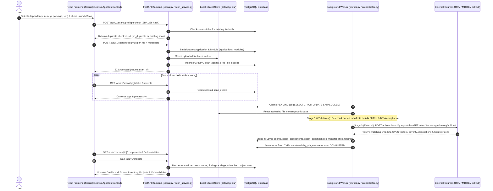

# End-to-End Functional Flow: From Uploading a Dependency File to Viewing Results

This guide walks step-by-step through **what happens when a user uploads a dependency file** (such as `package.json`, `requirements.txt`, `pom.xml`, `go.mod`, or a `.zip` archive), **which APIs are called and when**, **what data comes from internal parsing vs. external sources**, and **exactly where everything is stored in PostgreSQL**.

---

## 1. Visual End-to-End Sequence

---

## 2. Step-by-Step Breakdown: Which API Hits When

### Step 1: Selecting Application & Module (Before Upload)
- **Trigger:** User opens **Security Scans → Launch New Scan** and types or selects an Application and Module.
- **Internal APIs Hit:**
  - `GET /api/v1/catalog/projects?q=...` (`catalog.py`)
  - `GET /api/v1/catalog/projects/{project_id}/applications-services?q=...` (`catalog.py`)
- **Database Tables Read:** `applications`, `modules`.

---

### Step 2: Duplicate Check (When User Clicks "Launch Scan")
- **Trigger:** User clicks **Launch Scan** in `SecurityScans.tsx`.
- **Internal API Hit:**
  - `POST /api/v1/scans/preflight-check` (`scans.py` → `scan_service.py`)
- **What Happens Internally:**
  - Computes a **SHA-256 hash** of the uploaded file (or folder) and checks `scans` in PostgreSQL to see if this exact file was scanned before for this Application/Module.
  - If a match is found, the UI shows a confirmation dialog asking whether to reuse/rescan or proceed.
- **Database Tables Read:** `scans`.

---

### Step 3: Submitting the Dependency File (`202 Accepted`)
- **Trigger:** User confirms and submits the scan.
- **Internal API Hit:**
  - For file/folder/zip upload: `POST /api/v1/scans/local` (`scans.py`)
  - For remote repository: `POST /api/v1/scans/github` (`scans.py`)
  - For Excel/CSV batch: `POST /api/v1/scans/bulk` (`bulk_scans.py`)
- **What Happens Internally:**
  1. Validates that the file is non-empty and has a supported filename/extension.
  2. Calls `CatalogRepo.bind()` to ensure the Application (`applications`) and Module (`modules`) exist and belong to the organization.
  3. Saves the raw file bytes to local disk (`data/objects/<org>/<uuid>-<filename>`) via `LocalStore`.
  4. Calls `Orchestrator.create_scan()`, which inserts a `PENDING` scan record and places a job in the queue, then immediately returns `202 Accepted` with the `scan_id`.
- **Database Tables Written:**
  - `organizations` (ensures tenant exists)
  - `applications` (application name, `business_owner`, `technical_owner`, `development_type`, `lifecycle_status`)
  - `modules` (module/service name linked to `application_id`)
  - `scans` (`id`, `project_id`, `application_id`, `application_version`, `source_type`, `scan_status='PENDING'`, `stage='QUEUED'`, `idempotency_key`, `job_payload`)
  - `job_queue` (`id`, `scan_id`, `status='QUEUED'`)

---

### Step 4: Background Worker Execution (`worker.py` → `orchestrator.py`)
While the UI polls `GET /api/v1/scans/{id}/status` and `GET /api/v1/scans/{id}/events`, a background worker thread picks up the job using `SELECT ... FOR UPDATE SKIP LOCKED` and runs **4 stages**:

#### Stage 1 — Source Fetch (`SOURCE_FETCH`)
- **Local Upload:** Reads the file/zip from `LocalStore` (`data/objects/`), checks against Zip-Slip and Zip-Bomb limits (`security/archives.py`), and unpacks it into a temporary workspace.
- **GitHub Scan (External Hit):** Decrypts the stored GitHub PAT (if configured) using AES-256-GCM (`credentials/service.py`), validates the URL against SSRF rules (`security/archives.py`), and downloads the repository tarball from GitHub.
- **DB Written:** `scan_events` (logs `"Fetching source"`), updates `scans.stage = 'SOURCE_FETCH'`.

#### Stage 2 — Manifest Detection & Parsing (`SBOM_PARSE` — 100% Internal)
- **What Happens Internally:**
  - `scanner/detector.py` walks the workspace (skipping `node_modules`, `.git`, `venv`) and identifies manifest files (`package.json`, `package-lock.json`, `requirements.txt`, `pyproject.toml`, `pom.xml`, `build.gradle`, `go.mod`, `Cargo.toml`, `Gemfile.lock`, `composer.lock`, CycloneDX/SPDX JSON).
  - `scanner/parsers.py` reads the files strictly as text (never executes code) and extracts every dependency's **name, version, ecosystem, license, scope (direct vs. transitive), and dependency edges**.
  - `scanner/pipeline.py` deduplicates packages, builds canonical **PURLs** (e.g., `pkg:npm/lodash@4.17.21`), and checks the **7 NTIA minimum fields** (Supplier, Name, Version, Identifier, Relationship, Author, Timestamp) to compute `compliance_pass`.
- **DB Written:** `scan_events` (logs `"Parsing manifests & building SBOM"`), updates `scans.stage = 'SBOM_PARSE'`.

#### Stage 3 — Vulnerability Lookup (`VULN_LOOKUP` — External API Hits)
This is where the backend calls **external vulnerability databases** (`vulnerabilities/provider.py` + `cvss.py`):

| External API Endpoint | When Called | What Data Comes Back |
|---|---|---|
| `POST https://api.osv.dev/v1/querybatch` | Always (for all parsed packages in batches) | List of OSV advisory IDs / CVE IDs affecting each `(package, ecosystem, version)` |
| `GET https://api.osv.dev/v1/vulns/{advisory_id}` | For each matched advisory ID | Full advisory JSON: CVE alias, summary/description, CVSS v3/v4 vector, severity, `fixed` version, and reference URLs |
| `GET https://cveawg.mitre.org/api/cve/{cve_id}` | When `VULN_PROVIDER=mitre` or enriching CVE records | Official MITRE CVE JSON: description, CVSS metrics/vector, published date, and references |

- **Internal Calculation (`cvss.py`):** If an external record provides a CVSS vector without a numeric score (or vice versa), `calculate_cvss3_score()` computes the exact base score (`0.0–10.0`) and maps it to `Critical`, `High`, `Medium`, or `Low`.
- **DB Written:** `scan_events` (logs `"Correlating vulnerabilities"`), updates `scans.stage = 'VULN_LOOKUP'`.

#### Stage 4 — Persistence & Auto-Closure (`PERSIST`)
`BomRepo.save_snapshot()` and `facts.py` save everything relationally into PostgreSQL:

| PostgreSQL Table | What Gets Stored Here |
|---|---|
| `sboms` | Snapshot header (`id`, `scan_id`, `organization_id`, `project_id`, `application_id`, `application_version`, `generated_at`, `raw_metadata`) |
| `sbom_components` | Every discovered package (`name`, `version`, `ecosystem`, `package_url` PURL, `license_name`, `is_direct_dependency`, `source_manifest`, 7 `ntia_*` boolean flags, `first_detected_at`, `last_detected_at`) |
| `sbom_dependencies` | Parent → child dependency edges (`from_component_id`, `to_component_id`) |
| `vulnerabilities` | Master CVE catalog (`vulnerability_key` e.g. `CVE-2021-44228`, `title`, `description`, `severity`, `cvss_score`, `cvss_vector`, `source`, `reference_urls`) |
| `findings` | Link between a specific snapshot component and a CVE (`sbom_id`, `sbom_component_id`, `vulnerability_id`, `severity`, `cvss_score`, `fixed_version`, `status='Open'`, `vex_status='affected'`) |
| `vulnerability_triage` | Auto-closure updates: if an older scan had an `Open` CVE that is now gone in this new scan, `Orchestrator._auto_close_remediated_vulnerabilities()` marks it `Resolved` (`vex_status='fixed'`, `owner='SYSTEM_AUTO_CLOSURE'`) |
| `scans` & `job_queue` | Updates `scans.scan_status = 'COMPLETED'`, `scans.snapshot_id`, `scans.completed_at`, and marks `job_queue.status = 'COMPLETED'` |

---

### Step 5: Frontend Loads Completed Results
Once the UI poller sees `status === 'completed'`:
1. `AppStateContext.tsx` calls:
   - `GET /api/v1/scans/{id}/components` (`scans.py`) → populates **Software Inventory** & **Dashboard**.
   - `GET /api/v1/scans/{id}/vulnerabilities` (`vulnerabilities.py`) → overlays `vulnerability_triage` onto `findings` and populates **Vulnerabilities** & **Remediation**.
   - `GET /api/v1/projects` (`applications.py`) → refreshes **Projects & Microservices** KPIs using the batched query in `BomRepo.get_snapshots_stats_batch()`.
2. When the user clicks **Export** on any scan or artifact:
   - `GET /api/v1/boms/{snapshot_id}/export?format=cyclonedx-json|spdx-json|csv|xlsx` (`boms.py` → `export/formats.py`) generates and downloads the file on the fly from the stored PostgreSQL snapshot.

---

## 3. Summary: Internal vs. External Data Sources

| Data Category | Source | Examples | Where Stored in DB |
|---|---|---|---|
| **Application, Module & Governance Metadata** | Internal (User input + Catalog) | App Name, Module Name, Version, Business Owner, Development Type | `applications`, `modules`, `scans` |
| **Packages, Versions, Licenses & Dependency Tree** | Internal (Static file parsers) | `axios@1.7.4`, `MIT`, `Direct`, `package.json`, PURL, NTIA checks | `sbom_components`, `sbom_dependencies`, `sboms` |
| **Source Code Archive (GitHub)** | External (`github.com` tarball) | Repository source files downloaded via HTTPS | `data/objects/` (temp unpacked) |
| **CVE IDs, Severity, CVSS & Fixed Versions** | External (`api.osv.dev` & `cveawg.mitre.org`) | `CVE-2024-...`, `High`, `CVSS 7.5`, `fixed_version: 1.7.5` | `vulnerabilities`, `findings` |
| **Triage Overrides & Audit Trail** | Internal (User actions + Auto-closure) | `Open` → `Resolved`, justification, VEX status, timestamp | `vulnerability_triage`, `inventory_change_log` |
