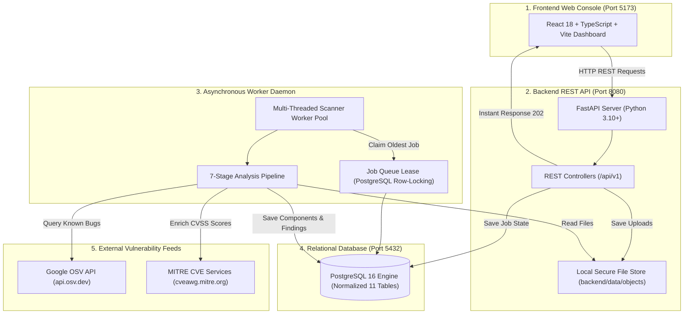
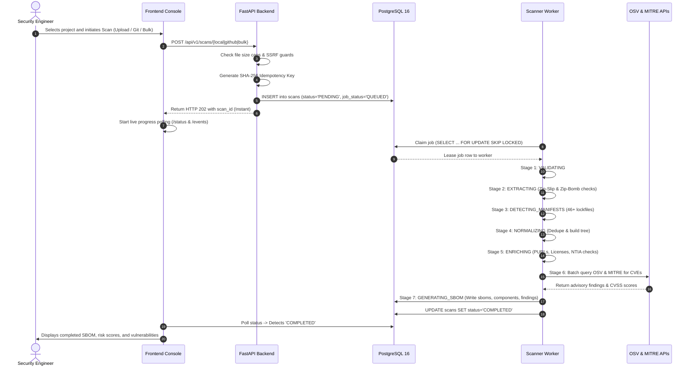
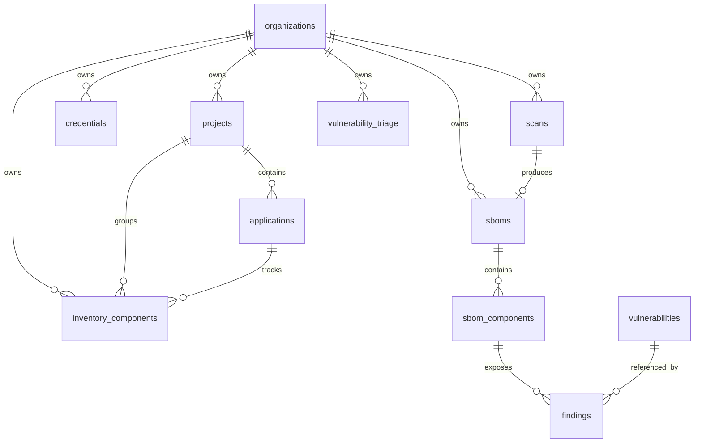

# S-BOM System Handover & Operational Architecture Guide

> **Document Purpose**: This guide provides a clear, concise, and in-depth explanation of how the entire S-BOM system works, how and where all data is stored in the database, and how each major feature operates in production. It is written in plain, accessible language with visual diagrams and zero unnecessary jargon.

---

## 1. System Overview & Architecture

### What is S-BOM?
**S-BOM (Software Bill of Materials)** is an automated cybersecurity platform. It inspects software codebases, detects every library and third-party package being used, checks them against global security advisory databases (OSV and MITRE CVE), audits them for legal and regulatory compliance, and provides ongoing vulnerability management and monitoring.

### High-Level System Architecture
The system consists of three interconnected processes that coordinate smoothly:



### Core Architecture Roles:
1. **Frontend (Port 5173)**: Clean Single Page Application built with React 18, TailwindCSS, and Lucide icons. It delivers dashboards, scan management, interactive tables, and risk visualizers.
2. **Backend API (Port 8080)**: Fast, lightweight FastAPI server. It accepts files and scan requests, validates inputs, and immediately returns a job ID (`202 Accepted`) so the browser never freezes.
3. **Background Worker**: Dedicated threaded daemon that continuously pulls pending scan jobs from the PostgreSQL queue, extracts archives safely, parses dependencies, and cross-references them with vulnerability databases.
4. **PostgreSQL Database**: The single source of truth storing projects, applications, scan runs, components, vulnerabilities, and triage decisions.

---

## 2. End-to-End Workflow: The Life of a Scan

Here is the exact journey of a scan from start to finish:



---

## 3. Database Architecture & Data Storage Breakdown

The database is built on **PostgreSQL 16** and uses a clean, normalized structure consisting of **11 primary tables** (plus migration history).

### Entity Relationship Diagram (ERD)



---

### Detailed Breakdown of Every Table

#### 1. `organizations`
* **What it stores**: Tenant boundaries.
* **Why it exists**: Ensures strict multi-tenant isolation. All projects, scans, and credentials belong to an organization (defaults to `'default'`).
* **Key Columns**:
  * `id` (TEXT, PK): Unique organization identifier.
  * `name` (TEXT): Display name of the organization.
  * `created_at` (TIMESTAMPTZ): Registration timestamp.

#### 2. `projects`
* **What it stores**: High-level software projects or repositories.
* **Why it exists**: Organizes microservices and software packages into logical business groups (e.g. "Payments System", "Customer Portal").
* **Key Constraints**: Unique `(organization_id, name)`. Deletes cascade from `organizations`.

#### 3. `applications`
* **What it stores**: Specific build targets, microservices, or modules within a project.
* **Why it exists**: Large systems have multiple services. A project can have several applications (e.g. `auth-service`, `billing-api`).
* **Key Constraints**: Unique `(organization_id, project_id, name)`. Deletes cascade from `projects`.

#### 4. `inventory_components`
* **What it stores**: Persistent, continuously tracked software packages in the organization's global Software Inventory.
* **Why it exists**: Provides an ongoing catalog of all approved or active components, their licenses, ecosystem, and risk ratings across the enterprise.
* **Key Columns**:
  * `name`, `package_name`, `version`: Component identity.
  * `ecosystem`: Packaging ecosystem (`npm`, `pypi`, `maven`, `go`, etc.).
  * `license_name`: Declared open-source license (e.g., `MIT`, `Apache-2.0`, `GPL-3.0`).
  * `package_url` (`purl`): Standardized package identifier.
  * `risk_level`: Calculated risk (`Safe`, `Low`, `Medium`, `High`, `Critical`).
  * `vulnerability_count`: Number of known vulnerabilities currently open.
  * `is_direct_dependency`: `TRUE` if top-level, `FALSE` if transitive.

#### 5. `credentials`
* **What it stores**: Encrypted Git tokens and access secrets.
* **Why it exists**: Allows authenticated cloning of private Git repositories without storing plaintext tokens.
* **Security Design**: Uses **AES-256-GCM** encryption. Plaintext secrets are encrypted with a 32-byte Key Encryption Key (KEK).
* **Key Columns**:
  * `secret_nonce` (BYTEA): 12-byte random cryptographic initialization vector.
  * `secret_ciphertext` (BYTEA): Encrypted credential payload.
  * `repository_scope`: Allowed repositories (`*` or comma-separated names).
  * `status`: `ACTIVE` or `REVOKED`.

#### 6. `scans`
* **What it stores**: Scan records and the durable asynchronous background job queue.
* **Why it exists**: Tracks every scan attempt, its parameters, current stage, error states, and worker queue lease.
* **Key Columns & Behavior**:
  * `idempotency_key` (TEXT, UNIQUE): SHA-256 hash of scan parameters. Prevents duplicate jobs from being queued.
  * `scan_status`: Current lifecycle (`PENDING`, `QUEUED`, `RUNNING`, `COMPLETED`, `FAILED`, `CANCELLED`).
  * `scan_stage`: Granular real-time progress (`VALIDATING`, `EXTRACTING`, `DETECTING_MANIFESTS`, `NORMALIZING`, `ANALYZING_VULNERABILITIES`, `GENERATING_SBOM`, `COMPLETED`).
  * `job_status`: Queue state (`QUEUED`, `RUNNING`, `COMPLETED`, `FAILED`, `DEAD_LETTER`).
  * `priority`, `attempts`, `max_attempts`: Queue retry mechanics.
  * `events` (JSONB): Chronological audit trail of stage transitions with timestamps.

#### 7. `sboms`
* **What it stores**: Completed Software Bill of Materials snapshots.
* **Why it exists**: Represents the frozen, immutable state of a software release's components, commit information, and metadata.
* **Key Columns**:
  * `scan_id`: One-to-one foreign key linking back to `scans`.
  * `bom_type`: Standard type (`SBOM`).
  * `repository_url`, `repository_branch`, `commit_sha`, `commit_author`: Complete provenance trail.
  * `scanner_name`, `scanner_version`: Audit proof of tool versioning.
  * `facts_normalized` (BOOLEAN): Flag indicating components and findings have been normalized into relational tables.

#### 8. `sbom_components`
* **What it stores**: Every individual package discovered inside an SBOM snapshot.
* **Why it exists**: Normalizes dependencies into easily searchable relational rows.
* **Key Columns**:
  * `name`, `version`, `ecosystem`, `package_url` (`purl`), `cpe`, `content_hash`: Precise identity.
  * `license_name`, `supplier_name`, `source_manifest`: Provenance and source file (e.g. `package-lock.json`).
  * `dependency_scope`: `runtime` or `dev`.
  * `is_direct_dependency`: `TRUE` (direct) or `FALSE` (transitive).
  * `dependency_depth`: Distance from root (`1` = direct, `2+` = transitive).
  * `depends_on` (TEXT[]): Array of component IDs that this package depends on.
  * `ntia_supplier`, `ntia_name`, `ntia_version`, `ntia_identifier`, `ntia_relationship`, `ntia_author`, `ntia_timestamp`: Seven boolean compliance checks for US Executive Order 14028.

#### 9. `vulnerabilities`
* **What it stores**: Canonical security advisories and CVE definitions.
* **Why it exists**: Serves as a local deduplicated dictionary of known vulnerabilities across all scans.
* **Key Columns**:
  * `vulnerability_key` (TEXT, UNIQUE): CVE or advisory ID (e.g. `CVE-2023-45133` or `GHSA-xxx`).
  * `severity`: Check constraint (`CRITICAL`, `HIGH`, `MEDIUM`, `LOW`, `UNKNOWN`).
  * `cvss_score` (NUMERIC): CVSS score strictly validated between `0.0` and `10.0`.
  * `cvss_vector`: CVSS v3.1 vector string (e.g. `CVSS:3.1/AV:N/AC:L/...`).
  * `description`: Advisory description.
  * `reference_urls` (TEXT[]): Advisory links.

#### 10. `findings`
* **What it stores**: The join record linking a specific component in a specific SBOM to a vulnerability.
* **Why it exists**: Records where a vulnerability exists in an application and tracks its remediation status.
* **Key Columns & Constraints**:
  * `sbom_component_id` & `vulnerability_id`: Joint unique link.
  * `fixed_version`: The patch version that remediates the CVE.
  * `status`: Triage state (`Open`, `In Progress`, `Resolved`, `Closed`).
  * `vex_status`: VEX impact state (`affected`, `not_affected`, `under_investigation`, `fixed`).
  * `ticket_id`, `owner`: Assigned remediation tracker and engineer.

#### 11. `vulnerability_triage`
* **What it stores**: Persistent triage overrides, VEX justifications, and assigned tickets across scans.
* **Why it exists**: When a user marks a CVE as `not_affected` or assigns a Jira ticket, rescanning the project should **not** wipe out that decision. This table preserves triage decisions across all future scans.
* **Key Columns**:
  * Unique on `(organization_id, vulnerability_key, project_name, application_name)`.
  * `status`, `vex_status`, `ticket_id`, `owner`, `justification`, `updated_at`.

#### 12. `schema_migrations`
* **What it stores**: Version history of all applied database schema migration scripts (`001` through `007`).

---

## 4. Key Functional Modules Explained

### 4.1 Dashboard
* **Purpose**: Provides a bird's-eye view of organizational security posture and project health.
* **Real-Time Metrics Shown**:
  * **Project Health**: Total active projects, classified as *Healthy*, *Needs Attention*, or *High Risk*.
  * **Average Compliance**: Enterprise-wide compliance score based on NTIA criteria and policy standards.
  * **Vulnerability Breakdown**: Instant count of Critical, High, Medium, and Low findings.
  * **License Distribution**: Interactive breakdown of permissive vs. restrictive/copyleft licenses.
  * **System Status Indicator**: Live indicator showing database connection and worker health.
* **How it works**: Queries `projects`, `scans`, `sboms`, and `findings` to compute live aggregates, filtered by organizational scope.

---

### 4.2 Security Scans
* **Purpose**: Core engine for generating SBOMs from software targets.
* **Supported Scan Modalities**:
  1. **Local Folder Scan**: User selects a project folder on their computer. The frontend automatically packages project manifests and uploads them directly.
  2. **Archive / Manifest Upload**: Accepts `.zip`, `.tgz`, `.tar.gz`, or raw lockfiles up to 1 GiB.
  3. **Remote Git Repository**: Clones public or private GitHub repositories using branch selection and stored credentials.
  4. **Bulk Multi-Project Scan**: Ingests an Excel (`.xlsx`) or CSV file containing dozens of repositories, runs pre-flight syntax checks, and queues them in parallel.
* **The 7-Stage Pipeline**:
  1. `VALIDATING`: Checks input formats, source availability, and repository URLs.
  2. `EXTRACTING`: Safely unpacks files into an isolated sandbox with **Zip-Slip** (directory traversal protection) and **Zip-Bomb** (compression ratio limit) guards.
  3. `DETECTING_MANIFESTS`: Discovers manifest files across 15+ packaging ecosystems (npm, PyPI, Maven, Go, Cargo, NuGet, Composer, RubyGems, etc.).
  4. `NORMALIZING`: Resolves exact versions, prioritizes lockfiles over loose manifests, and constructs the dependency tree.
  5. `ENRICHING`: Generates canonical Package URLs (`purl`), extracts declared licenses, and evaluates the 7 NTIA elements.
  6. `ANALYZING_VULNERABILITIES`: Performs fast batch queries against Google OSV and parallel calls to MITRE CVE Services.
  7. `GENERATING_SBOM`: Persists all components and findings to the database in an atomic transaction.
* **Control Features**: Users can cancel running scans at any time or trigger an instant rescan.

---

### 4.3 Software Inventory
* **Purpose**: Global, searchable inventory of every software component used across all company applications.
* **Capabilities**:
  * **Cataloging**: Every discovered library is recorded with its name, version, package manager, and license.
  * **Direct vs. Transitive Identification**: Clearly separates dependencies declared directly in `package.json` / `requirements.txt` from indirect dependencies pulled in down the tree.
  * **Manual and Bulk Management**: Security teams can manually register new components or import pre-existing third-party SBOM files.
  * **SBOM Artifacts Repository**: A dedicated view listing every generated SBOM document, its format version, and direct download links.

---

### 4.4 Vulnerability Management & VEX Triage
* **Purpose**: Identifies security flaws, prioritizes them by risk, and tracks remediation through resolution.
* **Vulnerability Intelligence**:
  * Gathers data from **Google OSV** and **MITRE CVE Services**.
  * Captures CVSS v3.1 numerical scores (0.0 to 10.0), severity vectors, descriptions, and available patch versions.
* **Triage Lifecycle & Business Rules**:
  * **Statuses**: `Open` &rarr; `In Progress` &rarr; `Resolved` &rarr; `Closed`.
  * **Critical Integrity Rule**: Direct jumps from `Open` to `Closed` without validation are blocked by the system. Engineers must transition to `In Progress` or provide a mandatory remediation justification.
* **VEX (Vulnerability Exploitability eXchange)**:
  * Allows teams to declare whether a vulnerability actually impacts their specific build:
    * `affected`: Exploit path exists in current configuration.
    * `not_affected`: Code is present but vulnerable function is unreachable or mitigated.
    * `under_investigation`: Under security review.
    * `fixed`: Patched in the current version.
  * **Persistent Memory**: Triage decisions and justifications are saved in `vulnerability_triage` and persist across future rescans.

---

### 4.5 Supply Chain Provenance & Traceability
* **Purpose**: Verifies where code came from, who built it, and detects supply chain risks before deployment.
* **Traceability Points**:
  * **Repository & Branch**: Full URL and branch name.
  * **Commit Fingerprinting**: Exact Git commit SHA, commit author name, email, and commit message.
  * **Scanner Provenance**: Exact scanner tool and version recorded on every SBOM.
* **Supply Chain Risk Detectors**:
  * **Copyleft License Exposure**: Flags restrictive licenses (such as GPL, AGPL, SSPL) that could legally compel source code disclosure.
  * **Transitive Vulnerability Chains**: Traces deep dependency trees to expose hidden vulnerabilities inherited through secondary libraries.
  * **Package Integrity**: Checks for package URLs, content hashes, and potential typosquatting risks.

---

### 4.6 Compliance & Standard Export
* **Purpose**: Ensures software releases satisfy federal mandates and international security standards.
* **US Executive Order 14028 (NTIA Minimum Elements)**:
  Every component is audited against the 7 mandatory NTIA fields:
  1. Supplier Name (`ntia_supplier`)
  2. Component Name (`ntia_name`)
  3. Component Version (`ntia_version`)
  4. Unique Identifier / PURL (`ntia_identifier`)
  5. Relationship / Dependency Link (`ntia_relationship`)
  6. SBOM Author (`ntia_author`)
  7. Generation Timestamp (`ntia_timestamp`)
* **Regulatory Framework Mapping**:
  * Tracks control coverage for **CERT-In Cybersecurity Guidelines**, **NIST SP 800-218 (SSDF)**, **ISO/IEC 27001**, and **SOC 2 Type II**.
* **Export Center**:
  * Generates machine-readable, audit-compliant documents in four standard formats:
    * **CycloneDX 1.5 JSON**: Leading industry format for application security.
    * **SPDX 2.3 JSON**: International ISO/IEC standard format.
    * **CSV & XLSX (Excel)**: Formats tailored for compliance auditors and executives.

---

### 4.7 Security Policies & Governance
* **Purpose**: Enforces automated security guardrails and quality gates across software projects.
* **Policy Rule Types**:
  * **Severity Gating**: Blocks or alerts on releases containing unresolved Critical or High CVEs.
  * **License Blacklists**: Restricts unauthorized or high-risk software licenses.
  * **NTIA Compliance Thresholds**: Requires projects to maintain at least an 80% NTIA element compliance score.
  * **Integrity Gates**: Flags unsigned or untracked third-party dependencies.

---

### 4.8 Continuous Monitoring & Automation
* **Purpose**: Provides automated security monitoring so vulnerabilities are discovered the moment they are published.
* **Features**:
  * **Automated Scan Schedules**: Configurable cron-style schedules that trigger unattended rescans on key projects.
  * **Drift Risk Curve**: Compares baseline security posture against real-time drift over time to catch newly introduced packages or emerging CVEs.
  * **Engine Health Monitoring**: Real-time status indicators for scanner engines and database connectivity.
  * **GitHub Webhooks**: Connects to GitHub repository push and release events (`/api/v1/github/webhooks`), automatically queuing an SBOM scan on every new commit.

---

## 5. Summary Reference Table

| Feature / Domain | Primary DB Tables | Main API Endpoints | Key Capabilities |
|---|---|---|---|
| **Dashboard** | `projects`, `scans`, `findings` | `GET /api/v1/projects` | Live posture metrics, risk distribution, compliance percentages. |
| **Security Scans** | `scans`, `sboms`, `credentials` | `POST /api/v1/scans/{local\|github\|bulk}` | Local folder, archive, Git, and bulk scans; 7-stage worker pipeline. |
| **Software Inventory** | `inventory_components`, `sboms` | `GET/POST /api/v1/inventory/components` | Central package catalog, direct vs transitive tracking, SBOM file store. |
| **Vulnerability Management** | `vulnerabilities`, `findings`, `vulnerability_triage` | `GET /api/v1/vulnerabilities/triage`, `PATCH .../status` | OSV/MITRE feed correlation, CVSS v3.1, VEX triage with persistent memory. |
| **Supply Chain Provenance** | `sboms`, `sbom_components` | `GET /api/v1/scans/{id}/sbom` | Git commit SHA, author, branch, dependency tree depth, copyleft checks. |
| **Compliance & Export** | `sbom_components`, `sboms` | `GET /api/v1/scans/{id}/export` | NTIA 7-element audit, CERT-In/NIST controls, CycloneDX/SPDX/CSV/XLSX export. |
| **Policies & Governance** | `projects`, `findings` | `GET/POST /api/v1/projects` | Severity thresholds, license restrictions, minimum compliance gates. |
| **Continuous Monitoring** | `scans`, `vulnerabilities` | `POST /api/v1/github/webhooks` | Scheduled automated rescans, drift detection, GitHub push webhooks. |

---

## 6. Development & Operational Quick Reference

### Running the Entire System Locally
From the workspace root, run:
```bash
npm run dev:all
```
This single command:
1. Reclaims any orphaned processes holding ports `8080` or `5173`.
2. Connects to PostgreSQL (5432) and automatically applies any pending database migrations.
3. Spawns the **FastAPI Backend Server** on `http://127.0.0.1:8080`.
4. Spawns the **Scanner Worker Daemon** in the background.
5. Spawns the **Vite React Frontend** on `http://127.0.0.1:5173`.

### Key System Ports:
* **`5173`**: React Frontend Console
* **`8080`**: FastAPI Backend & Swagger API Docs (`http://127.0.0.1:8080/docs`)
* **`5432`**: PostgreSQL Database
